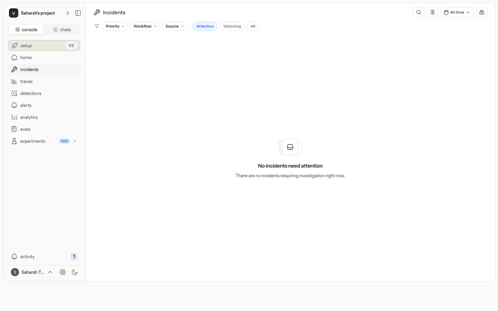
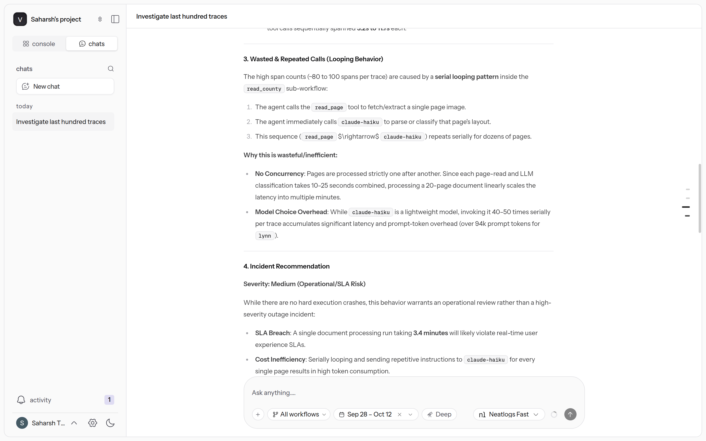
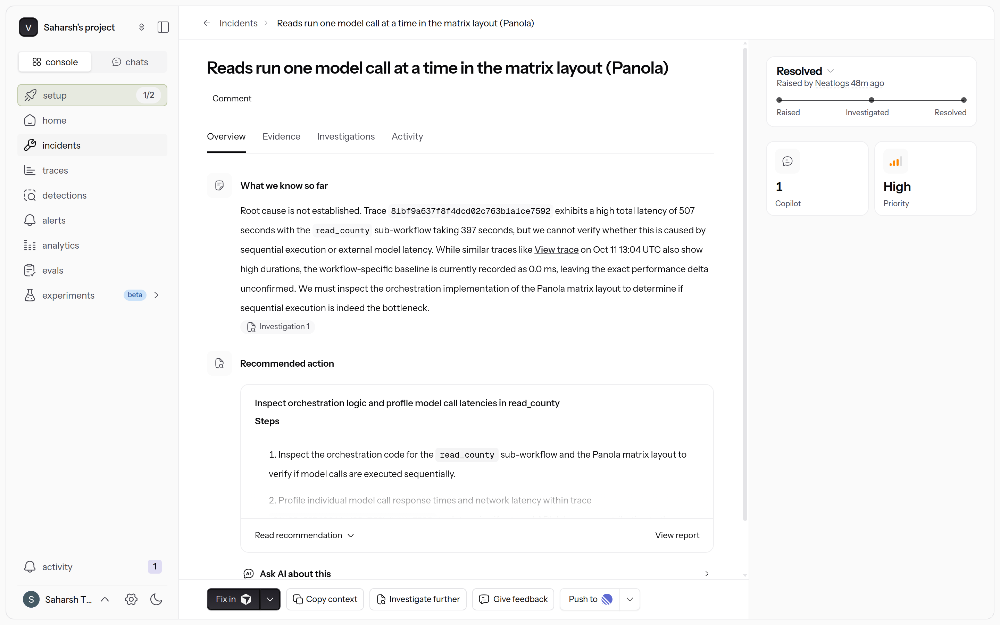
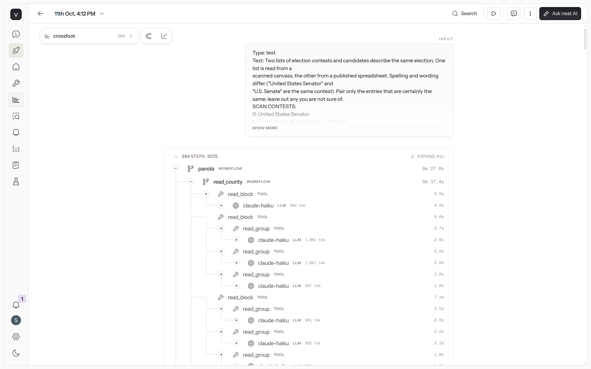
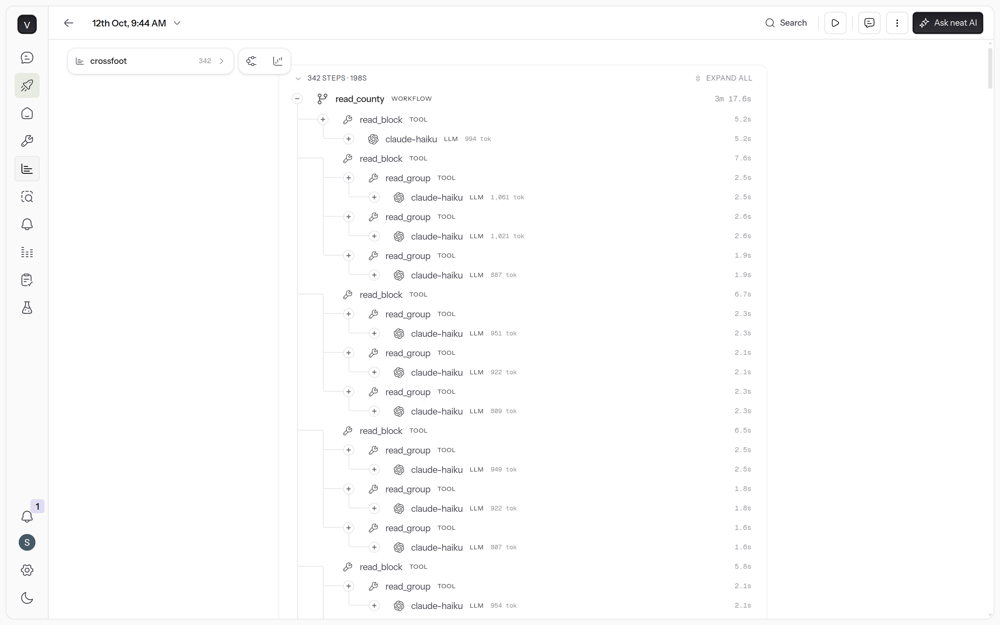
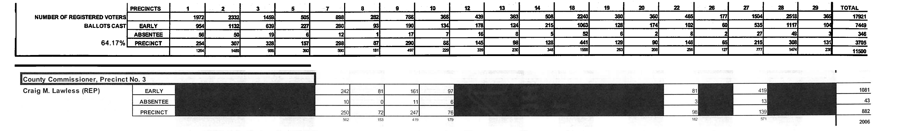
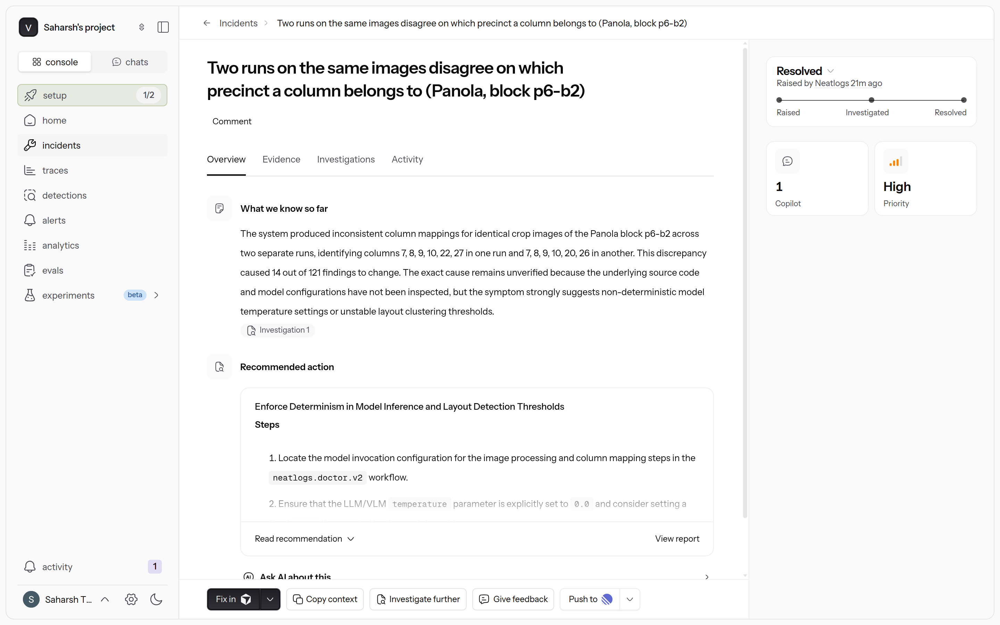
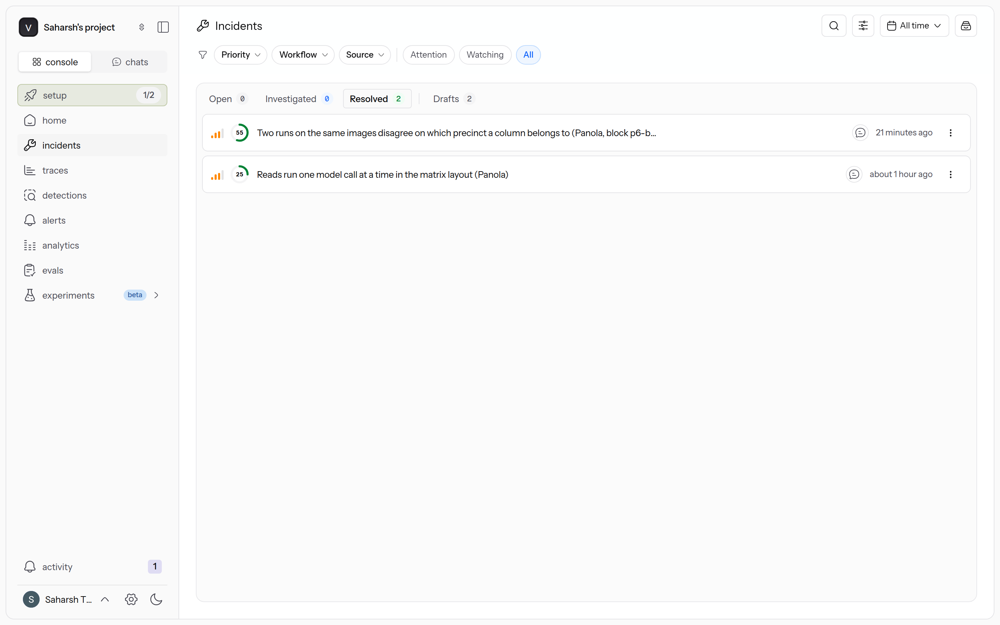

# Two incidents in neatlogs, and what each one changed

Until 12 October 2026 the project's incident board in neatlogs was empty: Home showed 545 sessions in seven days and
an error rate of 0%. No run had failed, so nothing had been raised. On 12 October we asked neatlogs to look for a problem
in the traces. It found one, and comparing the traced runs of the fix exposed a second. This page says what neatlogs
found, where it was right and where it was not, what changed in the program, and how each change was checked.

| | Incident 1 | Incident 2 |
|---|---|---|
| Title in neatlogs | Reads run one model call at a time in the matrix layout (Panola) | Two runs on the same images disagree on which precinct a column belongs to (Panola, block p6-b2) |
| How it was found | neatlogs' assistant, asked to investigate the last 100 traces | By comparing the findings of the two traced runs, before and after the first fix |
| What neatlogs' investigation said | "Root cause is not established" (25%, low confidence). Inspect how `read_county` runs its model calls | 55%, medium confidence. Suspects a non-zero model temperature or unstable layout thresholds |
| What was true | One of the two layouts read one block at a time | The temperature was already 0. The model gave two answers for the same picture |
| The fix | Commit `4f5f61d`: the matrix layout keeps several calls in flight | Commit `eb0bf90`: blank columns are read from the picture, not from the model |
| The measured result | The read takes 197.6 s, was 397.4 s. The whole audit takes 317.8 s, was 507.0 s | All 121 findings of the next run equal the final run's 121 |
| State | Resolved | Resolved |

## The board before

## Asking neatlogs to investigate

In the console's assistant, in Deep mode, we asked: "Start an investigation on the last 100 traces. Look for failures,
wasted or repeated calls, slow steps, and anything that should be raised as an incident."

What it answered, in its words:

- "no explicit execution errors were logged", and no trace had triggered a detection.
- "The primary issue in this dataset is extreme latency, driven by highly sequential visual-document parsing steps."
  It named two traces: Lynn, 207.38 seconds, and Scurry, 139.45 seconds.
- "No Concurrency: Pages are processed strictly one after another."
- "Incident Recommendation. Severity: Medium (Operational/SLA Risk)", with two mitigations: "Parallelization" and
  prompt caching. Only the first was tried.

We checked that against the code. It was wrong about the two traces it named: Lynn and Scurry use the report
layout, and `crossfoot/layouts/report.py` already kept three model calls in flight. It was right about the other
layout. The matrix layout, which reads Panola, read every block and every column group in it one after another, and
Panola was the slowest county of the final run: 507.0 seconds, 397.4 of them the read (trace
`81bf9a637f8f4dcd02c763b1a1ce7592`, in [trace-panola-final.md](trace-panola-final.md)).

## Incident 1: reads run one model call at a time

Raised on 12 October at 09:39 UTC, priority High. neatlogs then ran its own investigation of the incident:

- "Root cause is not established. Trace 81bf9a637f8f4dcd02c763b1a1ce7592 exhibits a high total latency of 507 seconds
  with the read_county sub-workflow taking 397 seconds, but we cannot verify whether this is caused by sequential
  execution or external model latency."
- Recommended action: "Inspect orchestration logic and profile model call latencies in read_county", and, if the
  calls do run in sequence, "evaluate the feasibility of parallelizing the model calls".
- Risk: "Parallelizing up to 172 model calls concurrently may trigger rate limits".

So neatlogs did not find the cause, and it said so. Its first step was the right one. Reading the code settled it in
a few minutes: the calls ran in sequence.

The fix is commit `4f5f61d`, written by a coding session that Entire recorded:
[the session](https://entire.io/gh/itssaharsh/crossfoot/session/98bc1e84-e6c6-4c05-ade1-7eac85a5282f) and
[its commit and checkpoint](https://entire.io/gh/itssaharsh/crossfoot/commit/4f5f61dd1a7583832daa8cc2551c0926582eb9a2).

- After the page header and the sample, the matrix layout reads blocks with up to N model calls in flight. Worker
  threads cut the crops, call the model and parse. One thread stores the answers in block order, so the ledger is the
  same as before.
- `--workers N` on `crossfoot audit` and `crossfoot read` sets N. The default is 3.
- For the risk neatlogs named: the model client now reserves each call's start time under a lock, so calls stay 1.1
  seconds apart however many threads there are.

The check is a real run of Panola from nothing, with four workers, traced like the first one:

| | Final run, 11 October | After the fix, 12 October |
|---|---|---|
| Run | `runs/20261011-161207` | `runs/20261012-094453` |
| The read (`read_county`) | 397.4 s | 197.6 s |
| The whole audit | 507.0 s | 317.8 s |
| Model calls | 172 | 174 |
| Metered cost (estimate) | $0.7892 | $0.7890 |
| neatlogs trace | `81bf9a637f8f4dcd02c763b1a1ce7592` | `6cdc36b6ef012dfb8fd2eb96ed9ee13b` (the read) |

What did not improve: the two phases after the read still run as before (84.8 and 15.0 seconds in the new run), so
the read is half as long and the whole audit is 37% shorter. The cost did not change.

## Incident 2: the same picture, two answers

The new run's findings were compared with the final run's. 107 of the 121 were identical and 14 were not. The
cause was not the concurrency. Both runs sent the model byte-identical crops of two blocks on page 6 (`p6-b2` and
`p6-b4`), and the model put the last two filled columns under precincts 22 and 27 in one run and under 20 and 26 in
the other. On the scan, 22 and 27 are right: the cells under 20 and 26 are blacked out.

The printed sums cannot see this. A column that moves whole to another precinct keeps every row sum and its own
column sum.

Raised on 12 October at 10:06 UTC, priority High. neatlogs' investigation of it:

- "The system produced inconsistent column mappings for identical crop images of the Panola block p6-b2 across two
  separate runs, identifying columns 7, 8, 9, 10, 22, 27 in one run and 7, 8, 9, 10, 20, 26 in another. This
  discrepancy caused 14 out of 121 findings to change."
- "the symptom strongly suggests non-deterministic model temperature settings or unstable layout clustering
  thresholds".
- Recommended action: set the temperature to 0, and "Implement a regression test suite using the Panola block p6-b2
  crop images".

Where it was right and where it was not: the temperature was already 0 (`crossfoot/model.py`), and no layout
threshold was involved, because both runs cut the same crops. The model simply answered the same picture two ways.
Its suggestion of a test built on the real crops was used.

The fix is commit `eb0bf90`, also a recorded session:
[the session](https://entire.io/gh/itssaharsh/crossfoot/session/59a4c2f9-922f-40b1-9e66-5ceceddc4af0) and
[its commit and checkpoint](https://entire.io/gh/itssaharsh/crossfoot/commit/eb0bf90fbff87df0624e1b4b49007a0020ac55fb).

- Which columns of a block are blank is now read from the page image: a column is blank when all three of its cells
  are blacked out.
- The model's filled columns are compared with the picture's. With the same count, the values are moved onto the
  picture's columns and the ledger records a `columns_realigned` event. With a different count, the block is marked
  failed and is not used.
- `crossfoot check-columns --run <id>` makes the same comparison on a finished run, without a model call.
- `tests/test_columns_picture.py` has eight tests, on the real crops of page 6 (`tests/fixtures/panola_p6_b2.png` and
  two more) and on a drawn page.

The checks:

| Run | `check-columns` | Findings |
|---|---|---|
| `20261011-161207`, the final run | 42 blocks: 42 agree | 121, the published ones |
| `20261012-094453`, after fix 1 | 42 blocks: 40 agree, 2 differ (`p6-b2` and `p6-b4`) | 121, of which 14 differ from the final run's |
| `20261012-095754`, after fix 2 | 42 blocks: 42 agree | 121, all equal to the final run's |

So the published findings stand: the final run had read these columns correctly. In the run after the second fix
the model misplaced the columns of `p6-b2` again, and the picture check moved them back (one `columns_realigned`
event). That run's read is trace `52b7e0863792adabb6d76946d31a77f0`.

What it does not cover: the picture check works only in blocks that have blacked-out cells, and it cannot see two
filled columns that swap. This is in the README's limits.

## What neatlogs did here, and what it did not

- Its assistant found the slow reads from the traces alone, with the seconds and the span counts. It named the wrong
  layout.
- Its investigation of incident 1 could not tell slow model calls from calls in sequence, and said so. Its first
  recommended step was the one that settled it.
- The two traces are the before and the after: the same workflow span, 397.4 and 197.6 seconds.
- Incident 2 was not found by neatlogs. No trace marks a column under the wrong name; we found it by comparing the
  two runs' findings. Its investigation guessed at the temperature, which was not the cause.

## Where to open these

In the neatlogs console (they need access to the project):

- Incident 1: `https://app.neatlogs.com/incidents/261e6e5b-a1c6-4068-9212-f64f8c389a65?orgId=49bb68f6-aef0-4731-b559-b05fe4e2476b&projectId=e8af572b-9701-4c84-bd8d-00c0aabc1dc6`
- Incident 2: `https://app.neatlogs.com/incidents/6dbc1850-c70a-443b-8159-2226d0452b0a?orgId=49bb68f6-aef0-4731-b559-b05fe4e2476b&projectId=e8af572b-9701-4c84-bd8d-00c0aabc1dc6`
- The trace before: `https://app.neatlogs.com/traces/81bf9a637f8f4dcd02c763b1a1ce7592?orgId=49bb68f6-aef0-4731-b559-b05fe4e2476b&projectId=e8af572b-9701-4c84-bd8d-00c0aabc1dc6`
- The trace after: `https://app.neatlogs.com/traces/6cdc36b6ef012dfb8fd2eb96ed9ee13b?orgId=49bb68f6-aef0-4731-b559-b05fe4e2476b&projectId=e8af572b-9701-4c84-bd8d-00c0aabc1dc6`

In this repository: the three runs are under `runs/`, each with its `run.json`, findings and report. The build log
has an entry for each fix ([hackathon.md](../../hackathon.md), T13 and T14).
