# Crossfoot audit: Lynn County, run 20261011-130414

The published spreadsheet was copied from a scanned canvass. This audit compares the two. What it finds are transcription slips in a volunteer dataset; the county's scan is the source. Each finding is proved with the totals printed on the scan itself. No finding has been confirmed by a person.

- Scan: https://raw.githubusercontent.com/openelections/openelections-sources-tx/master/2024/general/2024%20Lynn%20County%2C%20TX%20precinct-level%20results.pdf
- Published file: https://raw.githubusercontent.com/openelections/openelections-data-tx/master/2024/counties/20241105__tx__general__lynn__precinct.csv

## Counts

43 findings in 20 groups; 37 values changed in the corrected file.

| kind | findings |
|---|---|
| wrong_number | 37 |
| wrong_column | 6 |

| status | findings |
|---|---|
| settled_against_file | 38 |
| cannot_verify | 5 |

## Printed sums, checked against the published file and the corrected file

Printed sums in all: 1427 printed sums (row totals, small totals, grand totals). Recomputed with the published file's values in place of the scan's (matched rows only): 1393 hold. Recomputed with the corrected file's values: 1417 hold. Rows whose votes differ from their three parts: 0 in the published file, 0 in the corrected file.

10 sums still fail with the corrected file's values:

- page 1, block 1|2: the candidates' total figures add to the contest total's total figure (printed 330, adds to 331). Why: the scan's own cells and its printed total disagree, and no difference from the file is involved.
- page 1, block 1|2: the candidates' election day figures add to the contest total's election day figure (printed 101, adds to 102). Why: the scan's own cells and its printed total disagree, and no difference from the file is involved.
- page 5, block 2|1: the candidates' total figures add to the contest total's total figure (printed 311, adds to 312). Why: a value that could not be verified (f003: Donald J. Trump, precinct Precinct 2, early_voting); a row that could not be corrected as a whole (f004).
- page 5, block 2|1: the candidates' early voting figures add to the contest total's early voting figure (printed 127, adds to 160). Why: a value that could not be verified (f003: Donald J. Trump, precinct Precinct 2, early_voting); a row that could not be corrected as a whole (f004).
- page 5, block 2|1: the candidates' election day figures add to the contest total's election day figure (printed 175, adds to 143). Why: a value that could not be verified (f003: Donald J. Trump, precinct Precinct 2, early_voting); a row that could not be corrected as a whole (f004).
- page 15, block 4|1: the candidates' total figures add to the contest total's total figure (printed 979, adds to 985). Why: a value that could not be verified (f005: Donald J. Trump, precinct Precinct 4, early_voting); a value that could not be verified (f006: Donald J. Trump, precinct Precinct 4, election_day).
- page 15, block 4|1: the candidates' early voting figures add to the contest total's early voting figure (printed 545, adds to 541). Why: a value that could not be verified (f005: Donald J. Trump, precinct Precinct 4, early_voting); a value that could not be verified (f006: Donald J. Trump, precinct Precinct 4, election_day).
- page 15, block 4|1: the candidates' election day figures add to the contest total's election day figure (printed 423, adds to 433). Why: a value that could not be verified (f005: Donald J. Trump, precinct Precinct 4, early_voting); a value that could not be verified (f006: Donald J. Trump, precinct Precinct 4, election_day).
- page 15, block 4|2: the candidates' total figures add to the contest total's total figure (printed 977, adds to 978). Why: the scan's own cells and its printed total disagree, and no difference from the file is involved.
- page 15, block 4|2: the candidates' election day figures add to the contest total's election day figure (printed 420, adds to 421). Why: the scan's own cells and its printed total disagree, and no difference from the file is involved.

## What the printed sums cannot see

In this layout the only sum printed for a value is its row's own: total = absentee + early voting + election day. Where a page prints a contest total ("Total Votes Cast", "Cast Votes"), the candidates' figures in a column also add to it; that is a second sum on the value. Second sum in this county: yes (149 of 157 contests print a contest total).

What one sum cannot see: two numbers of one row that are both wrong and cancel out are not detected. And when a published row differs from the scan's row in two or more values but still adds up to its own total, with no contest total over it, no printed total can tell the two rows apart; such a finding is cannot_verify, nothing is corrected, and the scan's row is read once more so the finding can say whether two readings of the scan agree.

## Look at these first

None: no single-value re-read disagreed with the ledger.

## Could not be corrected as a whole row

Each row below has a finding settled against the file, but the row would not add up after the change, so no part of it is changed.

- file line 82: Donald J. Trump, precinct Precinct 2 (findings f004): the corrected votes 255 would not equal the corrected parts 5 + 141 + 141 = 287.

Where the scan disagrees with itself, the answer in use is 'cells' (follow the cells as printed and list the printed total as inconsistent); answered by: default, not yet confirmed by a person. It never changes a value; only a printed total that decides can.

## Groups

### g001: wrong_number, Ballots Cast, precinct Precinct 6

Ballots Cast. Page 24, block 6|st. Statuses: cannot_verify 2.

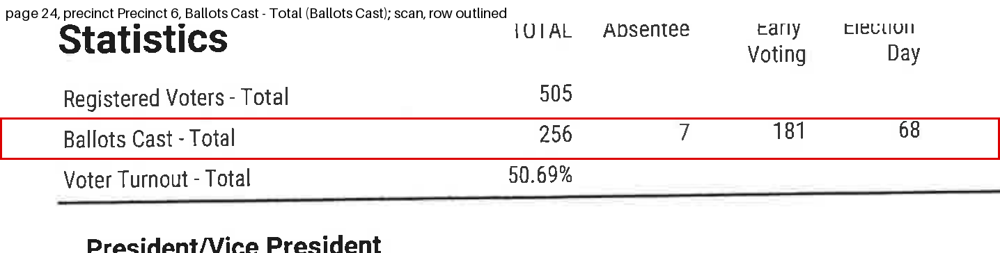

- Precinct Precinct 6, votes: the file has 255, the scan has 256. Status cannot_verify: no printed total can tell the two rows apart: the published row differs from the scan's row in 2 values, adds up to its own total, and no contest total covers it; nothing is corrected. A second reading of the scan's row (claude-sonnet-4.6, 400 dpi) gives total 256, absentee 7, early 181, election_day 68 and agrees with the first reading.
  - the row's total printed on the scan equals its absentee + early voting + election day (Ballots Cast - Total): printed 256; with the scan's value the cells add to 256 (holds); with the file's value they add to 255 (holds).
  - Looked at the scan again (claude-sonnet-4.6, 400 dpi): it reads 256.
- Precinct Precinct 6, election_day: the file has 67, the scan has 68. Status cannot_verify: no printed total can tell the two rows apart: the published row differs from the scan's row in 2 values, adds up to its own total, and no contest total covers it; nothing is corrected. A second reading of the scan's row (claude-sonnet-4.6, 400 dpi) gives total 256, absentee 7, early 181, election_day 68 and agrees with the first reading.
  - the row's total printed on the scan equals its absentee + early voting + election day (Ballots Cast - Total): printed 256; with the scan's value the cells add to 256 (holds); with the file's value they add to 255 (holds).
  - Looked at the scan again (claude-sonnet-4.6, 400 dpi): it reads 68.

### g002: wrong_column, Donald J. Trump, precinct Precinct 2

President. Page 5, block 2|1. Statuses: settled_against_file 1, cannot_verify 1.

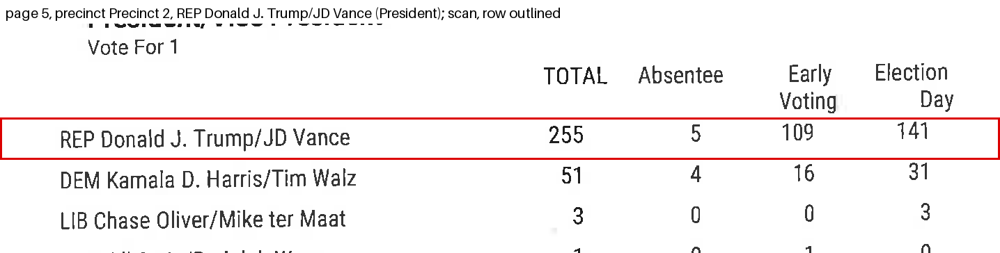

- Precinct Precinct 2, early_voting: the file has 141, the scan has 109. Status cannot_verify: no printed total decides: the candidates' early voting figures add to the contest total's early voting figure give the same answer with either value
  - the row's total printed on the scan equals its absentee + early voting + election day (REP Donald J. Trump/JD Vance): printed 255; with the scan's value the cells add to 255 (holds); with the file's value they add to 255 (holds).
  - the candidates' early voting figures add to the contest total's early voting figure: printed 127; with the scan's value the cells add to 128 (does not hold); with the file's value they add to 160 (does not hold).
- Precinct Precinct 2, election_day: the file has 109, the scan has 141. Status settled_against_file: the candidates' election day figures add to the contest total's election day figure hold(s) with the scan's value and fail(s) with the file's, and no printed total holds with the file's value and fails with the scan's
  - the row's total printed on the scan equals its absentee + early voting + election day (REP Donald J. Trump/JD Vance): printed 255; with the scan's value the cells add to 255 (holds); with the file's value they add to 255 (holds).
  - the candidates' election day figures add to the contest total's election day figure: printed 175; with the scan's value the cells add to 175 (holds); with the file's value they add to 143 (does not hold).

### g003: wrong_number, Donald J. Trump, precinct Precinct 4

President. Page 15, block 4|1. Statuses: cannot_verify 2.

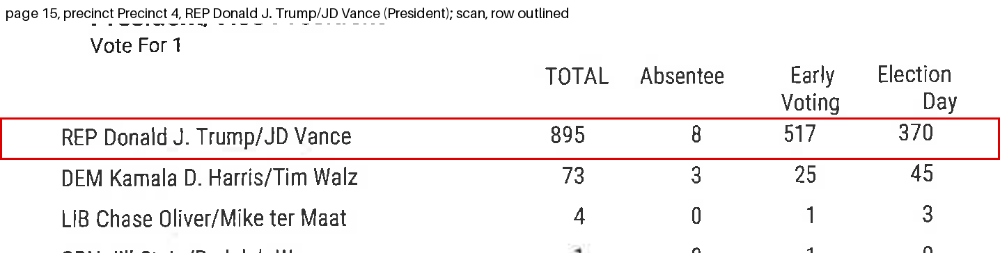

- Precinct Precinct 4, early_voting: the file has 512, the scan has 517. Status cannot_verify: no printed total decides: the candidates' early voting figures add to the contest total's early voting figure give the same answer with either value
  - the row's total printed on the scan equals its absentee + early voting + election day (REP Donald J. Trump/JD Vance): printed 895; with the scan's value the cells add to 895 (holds); with the file's value they add to 895 (holds).
  - the candidates' early voting figures add to the contest total's early voting figure: printed 545; with the scan's value the cells add to 546 (does not hold); with the file's value they add to 541 (does not hold).
- Precinct Precinct 4, election_day: the file has 375, the scan has 370. Status cannot_verify: no printed total decides: the candidates' election day figures add to the contest total's election day figure give the same answer with either value
  - the row's total printed on the scan equals its absentee + early voting + election day (REP Donald J. Trump/JD Vance): printed 895; with the scan's value the cells add to 895 (holds); with the file's value they add to 895 (holds).
  - the candidates' election day figures add to the contest total's election day figure: printed 423; with the scan's value the cells add to 428 (does not hold); with the file's value they add to 433 (does not hold).

### g004: wrong_number, Bernard Johnson, precinct Precinct 6

U.S. House, 19. Page 24, block 6|3. Statuses: settled_against_file 2.

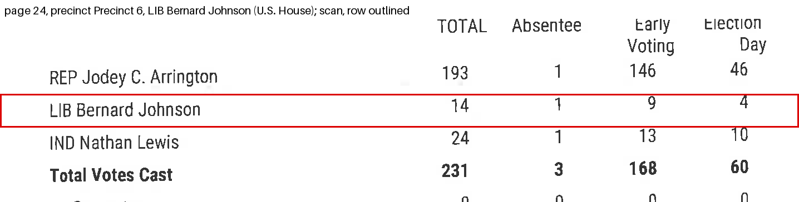

- Precinct Precinct 6, votes: the file has 24, the scan has 14. Status settled_against_file: the candidates' total figures add to the contest total's total figure hold(s) with the scan's value and fail(s) with the file's, and no printed total holds with the file's value and fails with the scan's Changed in the corrected file.
  - the row's total printed on the scan equals its absentee + early voting + election day (LIB Bernard Johnson): printed 14; with the scan's value the cells add to 14 (holds); with the file's value they add to 24 (holds).
  - the candidates' total figures add to the contest total's total figure: printed 231; with the scan's value the cells add to 231 (holds); with the file's value they add to 241 (does not hold).
- Precinct Precinct 6, election_day: the file has 14, the scan has 4. Status settled_against_file: the candidates' election day figures add to the contest total's election day figure hold(s) with the scan's value and fail(s) with the file's, and no printed total holds with the file's value and fails with the scan's Changed in the corrected file.
  - the row's total printed on the scan equals its absentee + early voting + election day (LIB Bernard Johnson): printed 14; with the scan's value the cells add to 14 (holds); with the file's value they add to 24 (holds).
  - the candidates' election day figures add to the contest total's election day figure: printed 60; with the scan's value the cells add to 60 (holds); with the file's value they add to 70 (does not hold).

### g005: wrong_number, Nathan Lewis, precinct Precinct 6

U.S. House, 19. Page 24, block 6|3. Statuses: settled_against_file 4.

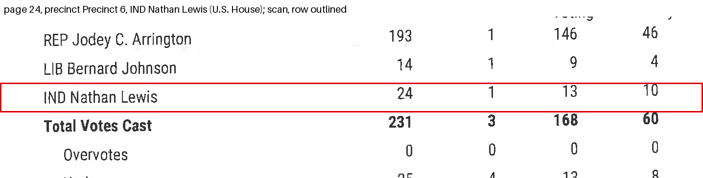

- Precinct Precinct 6, votes: the file has 14, the scan has 24. Status settled_against_file: the candidates' total figures add to the contest total's total figure hold(s) with the scan's value and fail(s) with the file's, and no printed total holds with the file's value and fails with the scan's Changed in the corrected file.
  - the row's total printed on the scan equals its absentee + early voting + election day (IND Nathan Lewis): printed 24; with the scan's value the cells add to 24 (holds); with the file's value they add to 14 (holds).
  - the candidates' total figures add to the contest total's total figure: printed 231; with the scan's value the cells add to 231 (holds); with the file's value they add to 221 (does not hold).
- Precinct Precinct 6, absentee: the file has 2, the scan has 1. Status settled_against_file: the candidates' absentee figures add to the contest total's absentee figure hold(s) with the scan's value and fail(s) with the file's, and no printed total holds with the file's value and fails with the scan's Changed in the corrected file.
  - the row's total printed on the scan equals its absentee + early voting + election day (IND Nathan Lewis): printed 24; with the scan's value the cells add to 24 (holds); with the file's value they add to 14 (holds).
  - the candidates' absentee figures add to the contest total's absentee figure: printed 3; with the scan's value the cells add to 3 (holds); with the file's value they add to 4 (does not hold).
- Precinct Precinct 6, early_voting: the file has 10, the scan has 13. Status settled_against_file: the candidates' early voting figures add to the contest total's early voting figure hold(s) with the scan's value and fail(s) with the file's, and no printed total holds with the file's value and fails with the scan's Changed in the corrected file.
  - the row's total printed on the scan equals its absentee + early voting + election day (IND Nathan Lewis): printed 24; with the scan's value the cells add to 24 (holds); with the file's value they add to 14 (holds).
  - the candidates' early voting figures add to the contest total's early voting figure: printed 168; with the scan's value the cells add to 168 (holds); with the file's value they add to 165 (does not hold).
- Precinct Precinct 6, election_day: the file has 2, the scan has 10. Status settled_against_file: the candidates' election day figures add to the contest total's election day figure hold(s) with the scan's value and fail(s) with the file's, and no printed total holds with the file's value and fails with the scan's Changed in the corrected file.
  - the row's total printed on the scan equals its absentee + early voting + election day (IND Nathan Lewis): printed 24; with the scan's value the cells add to 24 (holds); with the file's value they add to 14 (holds).
  - the candidates' election day figures add to the contest total's election day figure: printed 60; with the scan's value the cells add to 60 (holds); with the file's value they add to 52 (does not hold).

### g006: wrong_number, Christi Craddick, precinct Precinct 2

Railroad Commissioner. Page 6, block 2|4. Statuses: settled_against_file 2.

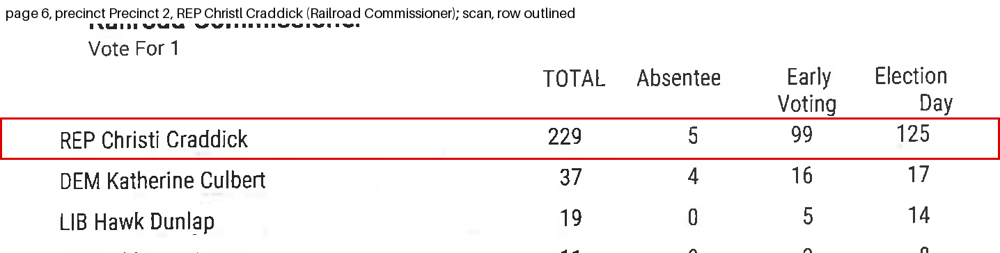

- Precinct Precinct 2, early_voting: the file has 100, the scan has 99. Status settled_against_file: the candidates' early voting figures add to the contest total's early voting figure hold(s) with the scan's value and fail(s) with the file's, and no printed total holds with the file's value and fails with the scan's Changed in the corrected file.
  - the row's total printed on the scan equals its absentee + early voting + election day (REP Christl Craddick): printed 229; with the scan's value the cells add to 229 (holds); with the file's value they add to 229 (holds).
  - the candidates' early voting figures add to the contest total's early voting figure: printed 123; with the scan's value the cells add to 123 (holds); with the file's value they add to 124 (does not hold).
- Precinct Precinct 2, election_day: the file has 124, the scan has 125. Status settled_against_file: the candidates' election day figures add to the contest total's election day figure hold(s) with the scan's value and fail(s) with the file's, and no printed total holds with the file's value and fails with the scan's Changed in the corrected file.
  - the row's total printed on the scan equals its absentee + early voting + election day (REP Christl Craddick): printed 229; with the scan's value the cells add to 229 (holds); with the file's value they add to 229 (holds).
  - the candidates' election day figures add to the contest total's election day figure: printed 164; with the scan's value the cells add to 164 (holds); with the file's value they add to 163 (does not hold).

### g007: wrong_number, Christi Craddick, precinct Precinct 5

Railroad Commissioner. Page 21, block 5|4. Statuses: settled_against_file 2.

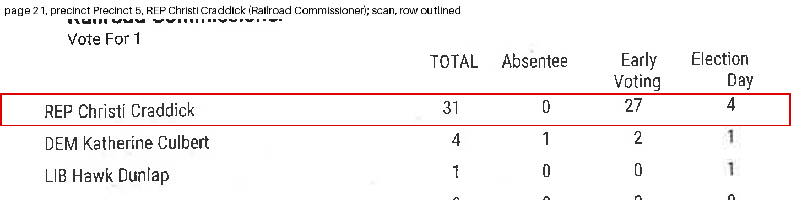

- Precinct Precinct 5, early_voting: the file has 26, the scan has 27. Status settled_against_file: the candidates' early voting figures add to the contest total's early voting figure hold(s) with the scan's value and fail(s) with the file's, and no printed total holds with the file's value and fails with the scan's Changed in the corrected file.
  - the row's total printed on the scan equals its absentee + early voting + election day (REP Christi Craddick): printed 31; with the scan's value the cells add to 31 (holds); with the file's value they add to 31 (holds).
  - the candidates' early voting figures add to the contest total's early voting figure: printed 29; with the scan's value the cells add to 29 (holds); with the file's value they add to 28 (does not hold).
- Precinct Precinct 5, election_day: the file has 5, the scan has 4. Status settled_against_file: the candidates' election day figures add to the contest total's election day figure hold(s) with the scan's value and fail(s) with the file's, and no printed total holds with the file's value and fails with the scan's Changed in the corrected file.
  - the row's total printed on the scan equals its absentee + early voting + election day (REP Christi Craddick): printed 31; with the scan's value the cells add to 31 (holds); with the file's value they add to 31 (holds).
  - the candidates' election day figures add to the contest total's election day figure: printed 6; with the scan's value the cells add to 6 (holds); with the file's value they add to 7 (does not hold).

### g008: wrong_column, Hawk Dunlap, precinct Precinct 5

Railroad Commissioner. Page 21, block 5|4. Statuses: settled_against_file 2.

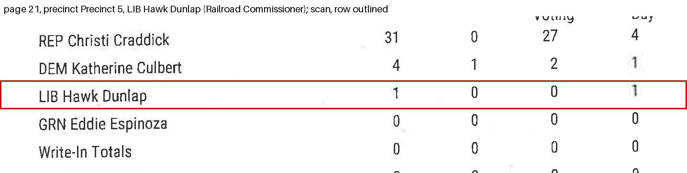

- Precinct Precinct 5, early_voting: the file has 1, the scan has 0. Status settled_against_file: the candidates' early voting figures add to the contest total's early voting figure hold(s) with the scan's value and fail(s) with the file's, and no printed total holds with the file's value and fails with the scan's Changed in the corrected file.
  - the row's total printed on the scan equals its absentee + early voting + election day (LIB Hawk Dunlap): printed 1; with the scan's value the cells add to 1 (holds); with the file's value they add to 1 (holds).
  - the candidates' early voting figures add to the contest total's early voting figure: printed 29; with the scan's value the cells add to 29 (holds); with the file's value they add to 30 (does not hold).
- Precinct Precinct 5, election_day: the file has 0, the scan has 1. Status settled_against_file: the candidates' election day figures add to the contest total's election day figure hold(s) with the scan's value and fail(s) with the file's, and no printed total holds with the file's value and fails with the scan's Changed in the corrected file.
  - the row's total printed on the scan equals its absentee + early voting + election day (LIB Hawk Dunlap): printed 1; with the scan's value the cells add to 1 (holds); with the file's value they add to 1 (holds).
  - the candidates' election day figures add to the contest total's election day figure: printed 6; with the scan's value the cells add to 6 (holds); with the file's value they add to 5 (does not hold).

### g009: wrong_number, Jimmy Blacklock, precinct Precinct 1

Justice, Supreme Court, 2. Page 2, block 1|5. Statuses: settled_against_file 2.

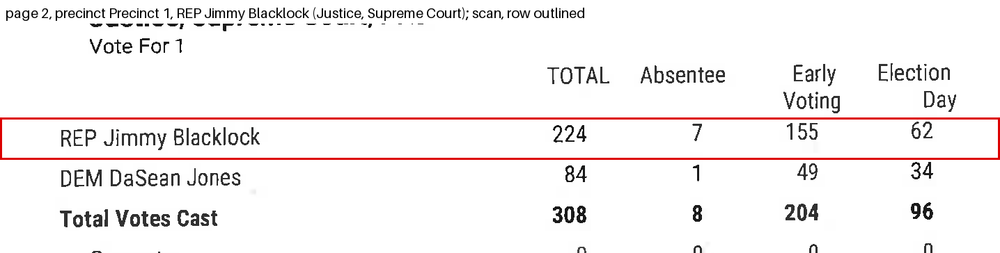

- Precinct Precinct 1, early_voting: the file has 150, the scan has 155. Status settled_against_file: the candidates' early voting figures add to the contest total's early voting figure hold(s) with the scan's value and fail(s) with the file's, and no printed total holds with the file's value and fails with the scan's Changed in the corrected file.
  - the row's total printed on the scan equals its absentee + early voting + election day (REP Jimmy Blacklock): printed 224; with the scan's value the cells add to 224 (holds); with the file's value they add to 224 (holds).
  - the candidates' early voting figures add to the contest total's early voting figure: printed 204; with the scan's value the cells add to 204 (holds); with the file's value they add to 199 (does not hold).
- Precinct Precinct 1, election_day: the file has 67, the scan has 62. Status settled_against_file: the candidates' election day figures add to the contest total's election day figure hold(s) with the scan's value and fail(s) with the file's, and no printed total holds with the file's value and fails with the scan's Changed in the corrected file.
  - the row's total printed on the scan equals its absentee + early voting + election day (REP Jimmy Blacklock): printed 224; with the scan's value the cells add to 224 (holds); with the file's value they add to 224 (holds).
  - the candidates' election day figures add to the contest total's election day figure: printed 96; with the scan's value the cells add to 96 (holds); with the file's value they add to 101 (does not hold).

### g010: wrong_number, Jane Bland, precinct Precinct 1

Justice, Supreme Court, 6. Page 2, block 1|7. Statuses: settled_against_file 2.

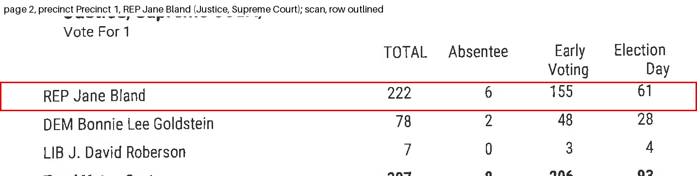

- Precinct Precinct 1, early_voting: the file has 153, the scan has 155. Status settled_against_file: the candidates' early voting figures add to the contest total's early voting figure hold(s) with the scan's value and fail(s) with the file's, and no printed total holds with the file's value and fails with the scan's Changed in the corrected file.
  - the row's total printed on the scan equals its absentee + early voting + election day (REP Jane Bland): printed 222; with the scan's value the cells add to 222 (holds); with the file's value they add to 222 (holds).
  - the candidates' early voting figures add to the contest total's early voting figure: printed 206; with the scan's value the cells add to 206 (holds); with the file's value they add to 204 (does not hold).
- Precinct Precinct 1, election_day: the file has 63, the scan has 61. Status settled_against_file: the candidates' election day figures add to the contest total's election day figure hold(s) with the scan's value and fail(s) with the file's, and no printed total holds with the file's value and fails with the scan's Changed in the corrected file.
  - the row's total printed on the scan equals its absentee + early voting + election day (REP Jane Bland): printed 222; with the scan's value the cells add to 222 (holds); with the file's value they add to 222 (holds).
  - the candidates' election day figures add to the contest total's election day figure: printed 93; with the scan's value the cells add to 93 (holds); with the file's value they add to 95 (does not hold).

### g011: wrong_number, David J. Schenck, precinct Precinct 2

Presiding Judge, Ct of Crim App. Page 7, block 2|8. Statuses: settled_against_file 2.

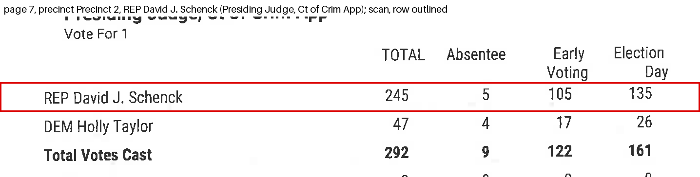

- Precinct Precinct 2, early_voting: the file has 104, the scan has 105. Status settled_against_file: the candidates' early voting figures add to the contest total's early voting figure hold(s) with the scan's value and fail(s) with the file's, and no printed total holds with the file's value and fails with the scan's Changed in the corrected file.
  - the row's total printed on the scan equals its absentee + early voting + election day (REP David J. Schenck): printed 245; with the scan's value the cells add to 245 (holds); with the file's value they add to 245 (holds).
  - the candidates' early voting figures add to the contest total's early voting figure: printed 122; with the scan's value the cells add to 122 (holds); with the file's value they add to 121 (does not hold).
- Precinct Precinct 2, election_day: the file has 136, the scan has 135. Status settled_against_file: the candidates' election day figures add to the contest total's election day figure hold(s) with the scan's value and fail(s) with the file's, and no printed total holds with the file's value and fails with the scan's Changed in the corrected file.
  - the row's total printed on the scan equals its absentee + early voting + election day (REP David J. Schenck): printed 245; with the scan's value the cells add to 245 (holds); with the file's value they add to 245 (holds).
  - the candidates' election day figures add to the contest total's election day figure: printed 161; with the scan's value the cells add to 161 (holds); with the file's value they add to 162 (does not hold).

### g012: wrong_number, David J. Schenck, precinct Precinct 4

Presiding Judge, Ct of Crim App. Page 17, block 4|8. Statuses: settled_against_file 2.

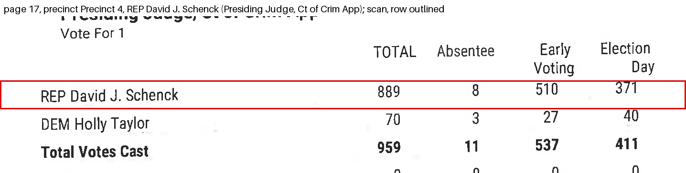

- Precinct Precinct 4, early_voting: the file has 511, the scan has 510. Status settled_against_file: the candidates' early voting figures add to the contest total's early voting figure hold(s) with the scan's value and fail(s) with the file's, and no printed total holds with the file's value and fails with the scan's Changed in the corrected file.
  - the row's total printed on the scan equals its absentee + early voting + election day (REP David J. Schenck): printed 889; with the scan's value the cells add to 889 (holds); with the file's value they add to 889 (holds).
  - the candidates' early voting figures add to the contest total's early voting figure: printed 537; with the scan's value the cells add to 537 (holds); with the file's value they add to 538 (does not hold).
- Precinct Precinct 4, election_day: the file has 370, the scan has 371. Status settled_against_file: the candidates' election day figures add to the contest total's election day figure hold(s) with the scan's value and fail(s) with the file's, and no printed total holds with the file's value and fails with the scan's Changed in the corrected file.
  - the row's total printed on the scan equals its absentee + early voting + election day (REP David J. Schenck): printed 889; with the scan's value the cells add to 889 (holds); with the file's value they add to 889 (holds).
  - the candidates' election day figures add to the contest total's election day figure: printed 411; with the scan's value the cells add to 411 (holds); with the file's value they add to 410 (does not hold).

### g013: wrong_number, David J. Schenck, precinct Precinct 9

Presiding Judge, Ct of Crim App. Page 31, block 9|8. Statuses: settled_against_file 2.

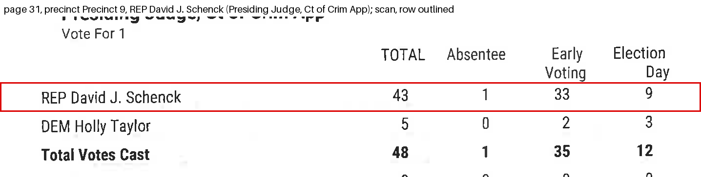

- Precinct Precinct 9, early_voting: the file has 32, the scan has 33. Status settled_against_file: the candidates' early voting figures add to the contest total's early voting figure hold(s) with the scan's value and fail(s) with the file's, and no printed total holds with the file's value and fails with the scan's Changed in the corrected file.
  - the row's total printed on the scan equals its absentee + early voting + election day (REP David J. Schenck): printed 43; with the scan's value the cells add to 43 (holds); with the file's value they add to 43 (holds).
  - the candidates' early voting figures add to the contest total's early voting figure: printed 35; with the scan's value the cells add to 35 (holds); with the file's value they add to 34 (does not hold).
- Precinct Precinct 9, election_day: the file has 10, the scan has 9. Status settled_against_file: the candidates' election day figures add to the contest total's election day figure hold(s) with the scan's value and fail(s) with the file's, and no printed total holds with the file's value and fails with the scan's Changed in the corrected file.
  - the row's total printed on the scan equals its absentee + early voting + election day (REP David J. Schenck): printed 43; with the scan's value the cells add to 43 (holds); with the file's value they add to 43 (holds).
  - the candidates' election day figures add to the contest total's election day figure: printed 12; with the scan's value the cells add to 12 (holds); with the file's value they add to 13 (does not hold).

### g014: wrong_number, David J. Schenck, precinct Precinct 12

Presiding Judge, Ct of Crim App. Page 35, block 12|8. Statuses: settled_against_file 2.

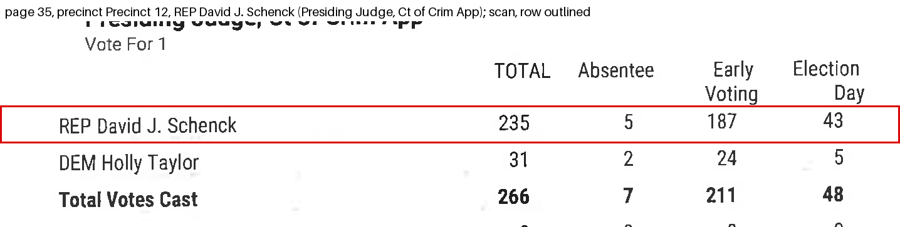

- Precinct Precinct 12, early_voting: the file has 185, the scan has 187. Status settled_against_file: the candidates' early voting figures add to the contest total's early voting figure hold(s) with the scan's value and fail(s) with the file's, and no printed total holds with the file's value and fails with the scan's Changed in the corrected file.
  - the row's total printed on the scan equals its absentee + early voting + election day (REP David J. Schenck): printed 235; with the scan's value the cells add to 235 (holds); with the file's value they add to 235 (holds).
  - the candidates' early voting figures add to the contest total's early voting figure: printed 211; with the scan's value the cells add to 211 (holds); with the file's value they add to 209 (does not hold).
- Precinct Precinct 12, election_day: the file has 45, the scan has 43. Status settled_against_file: the candidates' election day figures add to the contest total's election day figure hold(s) with the scan's value and fail(s) with the file's, and no printed total holds with the file's value and fails with the scan's Changed in the corrected file.
  - the row's total printed on the scan equals its absentee + early voting + election day (REP David J. Schenck): printed 235; with the scan's value the cells add to 235 (holds); with the file's value they add to 235 (holds).
  - the candidates' election day figures add to the contest total's election day figure: printed 48; with the scan's value the cells add to 48 (holds); with the file's value they add to 50 (does not hold).

### g015: wrong_column, Holly Taylor, precinct Precinct 9

Presiding Judge, Ct of Crim App. Page 31, block 9|8. Statuses: settled_against_file 2.

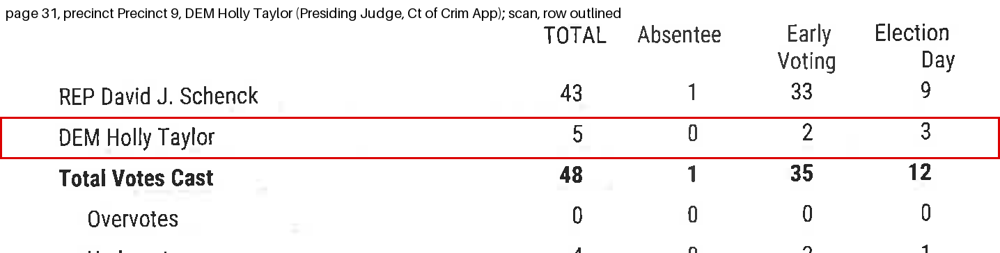

- Precinct Precinct 9, early_voting: the file has 3, the scan has 2. Status settled_against_file: the candidates' early voting figures add to the contest total's early voting figure hold(s) with the scan's value and fail(s) with the file's, and no printed total holds with the file's value and fails with the scan's Changed in the corrected file.
  - the row's total printed on the scan equals its absentee + early voting + election day (DEM Holly Taylor): printed 5; with the scan's value the cells add to 5 (holds); with the file's value they add to 5 (holds).
  - the candidates' early voting figures add to the contest total's early voting figure: printed 35; with the scan's value the cells add to 35 (holds); with the file's value they add to 36 (does not hold).
- Precinct Precinct 9, election_day: the file has 2, the scan has 3. Status settled_against_file: the candidates' election day figures add to the contest total's election day figure hold(s) with the scan's value and fail(s) with the file's, and no printed total holds with the file's value and fails with the scan's Changed in the corrected file.
  - the row's total printed on the scan equals its absentee + early voting + election day (DEM Holly Taylor): printed 5; with the scan's value the cells add to 5 (holds); with the file's value they add to 5 (holds).
  - the candidates' election day figures add to the contest total's election day figure: printed 12; with the scan's value the cells add to 12 (holds); with the file's value they add to 11 (does not hold).

### g016: wrong_number, Gina Parker, precinct Precinct 4

Judge, Ct of Crim App, 7. Page 17, block 4|9. Statuses: settled_against_file 2.

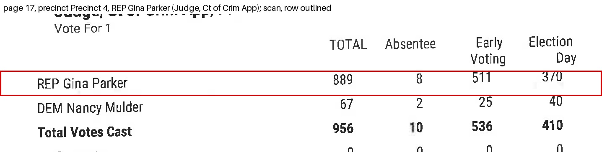

- Precinct Precinct 4, votes: the file has 885, the scan has 889. Status settled_against_file: the candidates' total figures add to the contest total's total figure hold(s) with the scan's value and fail(s) with the file's, and no printed total holds with the file's value and fails with the scan's Changed in the corrected file.
  - the row's total printed on the scan equals its absentee + early voting + election day (REP Gina Parker): printed 889; with the scan's value the cells add to 889 (holds); with the file's value they add to 885 (holds).
  - the candidates' total figures add to the contest total's total figure: printed 956; with the scan's value the cells add to 956 (holds); with the file's value they add to 952 (does not hold).
- Precinct Precinct 4, election_day: the file has 366, the scan has 370. Status settled_against_file: the candidates' election day figures add to the contest total's election day figure hold(s) with the scan's value and fail(s) with the file's, and no printed total holds with the file's value and fails with the scan's Changed in the corrected file.
  - the row's total printed on the scan equals its absentee + early voting + election day (REP Gina Parker): printed 889; with the scan's value the cells add to 889 (holds); with the file's value they add to 885 (holds).
  - the candidates' election day figures add to the contest total's election day figure: printed 410; with the scan's value the cells add to 410 (holds); with the file's value they add to 406 (does not hold).

### g017: wrong_number, Nancy Mulder, precinct Precinct 4

Judge, Ct of Crim App, 7. Page 17, block 4|9. Statuses: settled_against_file 3.

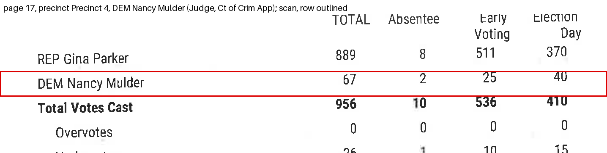

- Precinct Precinct 4, votes: the file has 71, the scan has 67. Status settled_against_file: the candidates' total figures add to the contest total's total figure hold(s) with the scan's value and fail(s) with the file's, and no printed total holds with the file's value and fails with the scan's Changed in the corrected file.
  - the row's total printed on the scan equals its absentee + early voting + election day (DEM Nancy Mulder): printed 67; with the scan's value the cells add to 67 (holds); with the file's value they add to 71 (holds).
  - the candidates' total figures add to the contest total's total figure: printed 956; with the scan's value the cells add to 956 (holds); with the file's value they add to 960 (does not hold).
- Precinct Precinct 4, absentee: the file has 3, the scan has 2. Status settled_against_file: the candidates' absentee figures add to the contest total's absentee figure hold(s) with the scan's value and fail(s) with the file's, and no printed total holds with the file's value and fails with the scan's Changed in the corrected file.
  - the row's total printed on the scan equals its absentee + early voting + election day (DEM Nancy Mulder): printed 67; with the scan's value the cells add to 67 (holds); with the file's value they add to 71 (holds).
  - the candidates' absentee figures add to the contest total's absentee figure: printed 10; with the scan's value the cells add to 10 (holds); with the file's value they add to 11 (does not hold).
- Precinct Precinct 4, early_voting: the file has 28, the scan has 25. Status settled_against_file: the candidates' early voting figures add to the contest total's early voting figure hold(s) with the scan's value and fail(s) with the file's, and no printed total holds with the file's value and fails with the scan's Changed in the corrected file.
  - the row's total printed on the scan equals its absentee + early voting + election day (DEM Nancy Mulder): printed 67; with the scan's value the cells add to 67 (holds); with the file's value they add to 71 (holds).
  - the candidates' early voting figures add to the contest total's early voting figure: printed 536; with the scan's value the cells add to 536 (holds); with the file's value they add to 539 (does not hold).

### g018: wrong_number, Lee Finley, precinct Precinct 1

Judge, Ct of Crim App, 8. Page 3, block 1|10. Statuses: settled_against_file 2.

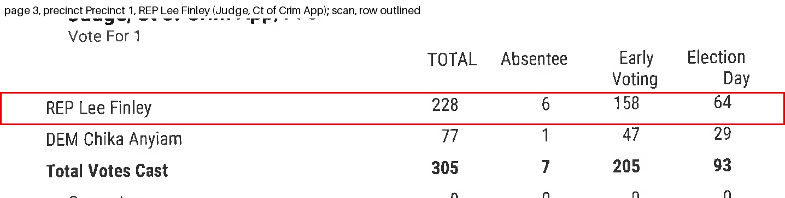

- Precinct Precinct 1, early_voting: the file has 159, the scan has 158. Status settled_against_file: the candidates' early voting figures add to the contest total's early voting figure hold(s) with the scan's value and fail(s) with the file's, and no printed total holds with the file's value and fails with the scan's Changed in the corrected file.
  - the row's total printed on the scan equals its absentee + early voting + election day (REP Lee Finley): printed 228; with the scan's value the cells add to 228 (holds); with the file's value they add to 228 (holds).
  - the candidates' early voting figures add to the contest total's early voting figure: printed 205; with the scan's value the cells add to 205 (holds); with the file's value they add to 206 (does not hold).
- Precinct Precinct 1, election_day: the file has 63, the scan has 64. Status settled_against_file: the candidates' election day figures add to the contest total's election day figure hold(s) with the scan's value and fail(s) with the file's, and no printed total holds with the file's value and fails with the scan's Changed in the corrected file.
  - the row's total printed on the scan equals its absentee + early voting + election day (REP Lee Finley): printed 228; with the scan's value the cells add to 228 (holds); with the file's value they add to 228 (holds).
  - the candidates' election day figures add to the contest total's election day figure: printed 93; with the scan's value the cells add to 93 (holds); with the file's value they add to 92 (does not hold).

### g019: wrong_number, Aaron Kinsey, precinct Precinct 2

Member, State BoE, 15. Page 7, block 2|11. Statuses: settled_against_file 2.

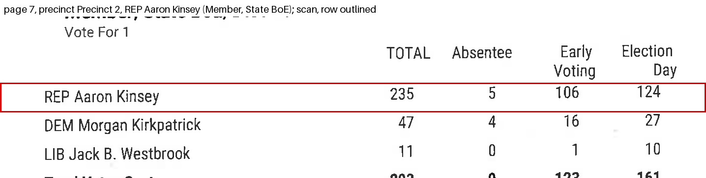

- Precinct Precinct 2, early_voting: the file has 100, the scan has 106. Status settled_against_file: the candidates' early voting figures add to the contest total's early voting figure hold(s) with the scan's value and fail(s) with the file's, and no printed total holds with the file's value and fails with the scan's Changed in the corrected file.
  - the row's total printed on the scan equals its absentee + early voting + election day (REP Aaron Kinsey): printed 235; with the scan's value the cells add to 235 (holds); with the file's value they add to 235 (holds).
  - the candidates' early voting figures add to the contest total's early voting figure: printed 123; with the scan's value the cells add to 123 (holds); with the file's value they add to 117 (does not hold).
- Precinct Precinct 2, election_day: the file has 130, the scan has 124. Status settled_against_file: the candidates' election day figures add to the contest total's election day figure hold(s) with the scan's value and fail(s) with the file's, and no printed total holds with the file's value and fails with the scan's Changed in the corrected file.
  - the row's total printed on the scan equals its absentee + early voting + election day (REP Aaron Kinsey): printed 235; with the scan's value the cells add to 235 (holds); with the file's value they add to 235 (holds).
  - the candidates' election day figures add to the contest total's election day figure: printed 161; with the scan's value the cells add to 161 (holds); with the file's value they add to 167 (does not hold).

### g020: wrong_number, Aaron Kinsey, precinct Precinct 4

Member, State BoE, 15. Page 17, block 4|11. Statuses: settled_against_file 2.

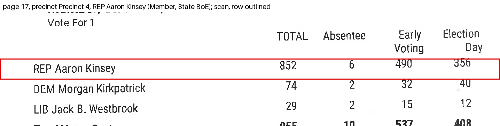

- Precinct Precinct 4, early_voting: the file has 494, the scan has 490. Status settled_against_file: the candidates' early voting figures add to the contest total's early voting figure hold(s) with the scan's value and fail(s) with the file's, and no printed total holds with the file's value and fails with the scan's Changed in the corrected file.
  - the row's total printed on the scan equals its absentee + early voting + election day (REP Aaron Kinsey): printed 852; with the scan's value the cells add to 852 (holds); with the file's value they add to 852 (holds).
  - the candidates' early voting figures add to the contest total's early voting figure: printed 537; with the scan's value the cells add to 537 (holds); with the file's value they add to 541 (does not hold).
- Precinct Precinct 4, election_day: the file has 352, the scan has 356. Status settled_against_file: the candidates' election day figures add to the contest total's election day figure hold(s) with the scan's value and fail(s) with the file's, and no printed total holds with the file's value and fails with the scan's Changed in the corrected file.
  - the row's total printed on the scan equals its absentee + early voting + election day (REP Aaron Kinsey): printed 852; with the scan's value the cells add to 852 (holds); with the file's value they add to 852 (holds).
  - the candidates' election day figures add to the contest total's election day figure: printed 408; with the scan's value the cells add to 408 (holds); with the file's value they add to 404 (does not hold).

## What could not be verified, and why

- f001 (group g001), Ballots Cast, precinct Precinct 6, votes: cannot_verify. no printed total can tell the two rows apart: the published row differs from the scan's row in 2 values, adds up to its own total, and no contest total covers it; nothing is corrected. A second reading of the scan's row (claude-sonnet-4.6, 400 dpi) gives total 256, absentee 7, early 181, election_day 68 and agrees with the first reading.
- f002 (group g001), Ballots Cast, precinct Precinct 6, election_day: cannot_verify. no printed total can tell the two rows apart: the published row differs from the scan's row in 2 values, adds up to its own total, and no contest total covers it; nothing is corrected. A second reading of the scan's row (claude-sonnet-4.6, 400 dpi) gives total 256, absentee 7, early 181, election_day 68 and agrees with the first reading.
- f003 (group g002), Donald J. Trump, precinct Precinct 2, early_voting: cannot_verify. no printed total decides: the candidates' early voting figures add to the contest total's early voting figure give the same answer with either value
- f005 (group g003), Donald J. Trump, precinct Precinct 4, early_voting: cannot_verify. no printed total decides: the candidates' early voting figures add to the contest total's early voting figure give the same answer with either value
- f006 (group g003), Donald J. Trump, precinct Precinct 4, election_day: cannot_verify. no printed total decides: the candidates' election day figures add to the contest total's election day figure give the same answer with either value
- The ledger itself: report_contest:15:4|1:early ended cannot_verify. 6 re-read(s) of the rows of this contest did not make the early column hold: the candidates add to 546, the contest total prints 545
- The ledger itself: report_contest:15:4|1:election_day ended cannot_verify. 6 re-read(s) of the rows of this contest did not make the election_day column hold: the candidates add to 428, the contest total prints 423
- The ledger itself: report_contest:15:4|1:total ended cannot_verify. 6 re-read(s) of the rows of this contest did not make the total column hold: the candidates add to 985, the contest total prints 979
- The ledger itself: report_contest:15:4|2:election_day ended cannot_verify. 6 re-read(s) of the rows of this contest did not make the election_day column hold: the candidates add to 421, the contest total prints 420
- The ledger itself: report_contest:15:4|2:total ended cannot_verify. 6 re-read(s) of the rows of this contest did not make the total column hold: the candidates add to 978, the contest total prints 977
- The ledger itself: report_contest:1:1|2:election_day ended cannot_verify. 6 re-read(s) of the rows of this contest did not make the election_day column hold: the candidates add to 102, the contest total prints 101
- The ledger itself: report_contest:1:1|2:total ended cannot_verify. 6 re-read(s) of the rows of this contest did not make the total column hold: the candidates add to 331, the contest total prints 330
- The ledger itself: report_contest:5:2|1:early ended cannot_verify. 6 re-read(s) of the rows of this contest did not make the early column hold: the candidates add to 128, the contest total prints 127
- The ledger itself: report_contest:5:2|1:total ended cannot_verify. 6 re-read(s) of the rows of this contest did not make the total column hold: the candidates add to 312, the contest total prints 311

Not matched between the scan and the file, so not compared:
- scan block c007: President/Vice President, Write-In: UnCertified
- scan block c008: President/Vice President, Not Assigned
- scan block c013: US Senator, Write-In: UnCertified
- scan block c014: US Senator, Not Assigned
- scan block c023: Railroad Commissioner, Not Assigned
- scan block c041: Justice, 7th Ct of App Dist, Pl 2, Judy Parker
- scan block c042: Justice, 7th Ct of App Dist, Pl 3, Alex Yarbrough
- scan block c043: Dist Attorney, 106th Judicial Dist, Phillip Mack Furlow
- scan block c050: School Board New Home ISD, 2 Kevin Bass
- scan block c051: School Board New Home ISD, 3 Kevin Bass
- scan block c053: School Board New Home ISD, 1 Justin Tubb
- scan block c054: School Board New Home ISD, 2 Justin Tubb
- scan block c056: School Board New Home ISD, 1 Martin Gill
- scan block c057: School Board New Home ISD, 2 Martin Gill
- scan block c059: School Board New Home ISD, 1 Shaun Weid
- scan block c060: School Board New Home ISD, 2 Shaun Weid
- file: Registered Voters ,  (8 rows)
- file: President , Over Votes (8 rows)
- file: President , Under Votes (8 rows)
- file: U.S. Senate , Over Votes (8 rows)
- file: U.S. Senate , Under Votes (8 rows)
- file: U.S. House 19, Over Votes (8 rows)
- file: U.S. House 19, Under Votes (8 rows)
- file: Railroad Commissioner , Over Votes (8 rows)
- file: Railroad Commissioner , Under Votes (8 rows)
- file: Justice, Supreme Court 2, Over Votes (8 rows)
- file: Justice, Supreme Court 2, Under Votes (8 rows)
- file: Justice, Supreme Court 4, Over Votes (8 rows)
- file: Justice, Supreme Court 4, Under Votes (8 rows)
- file: Justice, Supreme Court 6, Over Votes (8 rows)
- file: Justice, Supreme Court 6, Under Votes (8 rows)
- file: Presiding Judge, Ct of Crim App , Over Votes (8 rows)
- file: Presiding Judge, Ct of Crim App , Under Votes (8 rows)
- file: Judge, Ct of Crim App 7, Over Votes (8 rows)
- file: Judge, Ct of Crim App 7, Under Votes (8 rows)
- file: Judge, Ct of Crim App 8, Over Votes (8 rows)
- file: Judge, Ct of Crim App 8, Under Votes (8 rows)
- file: Member, State BoE 15, Over Votes (8 rows)
- file: Member, State BoE 15, Under Votes (8 rows)
- file: State Representative 83, Over Votes (8 rows)
- file: State Representative 83, Under Votes (8 rows)
- file: Justice, 7th Ct of App Dist 2, Judy Parker (8 rows)
- file: Justice, 7th Ct of App Dist 2, Over Votes (8 rows)
- file: Justice, 7th Ct of App Dist 2, Under Votes (8 rows)
- file: Justice, 7th Ct of App Dist 3, Alex Yarbrough (8 rows)
- file: Justice, 7th Ct of App Dist 3, Over Votes (8 rows)
- file: Justice, 7th Ct of App Dist 3, Under Votes (8 rows)
- file: Dist Attorney, 106th Judicial Dist , Philip Mack Furlow (8 rows)
- file: Dist Attorney, 106th Judicial Dist , Over Votes (8 rows)
- file: Dist Attorney, 106th Judicial Dist , Under Votes (8 rows)
- file: County Attorney , Over Votes (8 rows)
- file: County Attorney , Under Votes (8 rows)
- file: Sheriff , Over Votes (8 rows)
- file: Sheriff , Under Votes (8 rows)
- file: County Tax Assessor-Collector , Over Votes (8 rows)
- file: County Tax Assessor-Collector , Under Votes (8 rows)
- file: County Commissioner Pct 1 , Over Votes (2 rows)
- file: County Commissioner Pct 1 , Under Votes (2 rows)
- file: County Commissioner Pct 3 , Over Votes (2 rows)
- file: County Commissioner Pct 3 , Under Votes (2 rows)
- file: School Board New Home ISD , Over Votes (1 rows)
- file: School Board New Home ISD , Under Votes (1 rows)
- rejected pairing, Justice, 7th Ct of App Dist, Pl 2 = Justice, 7th Ct of App Dist: county totals are not close (scan 2210, file 2571)
- rejected pairing, Justice, 7th Ct of App Dist, Pl 3 = Justice, 7th Ct of App Dist: county totals are not close (scan 2187, file 2571)
- rejected pairing, Judy Parker = Judy Parker: their contests are not paired
- rejected pairing, Alex Yarbrough = Alex Yarbrough: their contests are not paired
- rejected pairing, 2 Kevin Bass = Over Votes: county totals are not close (scan 18, file 0)
- rejected pairing, candidate pair 33/67: not one-to-one, or not in the list
