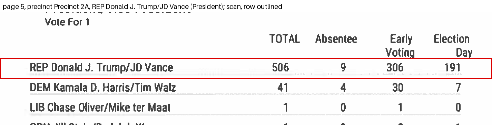
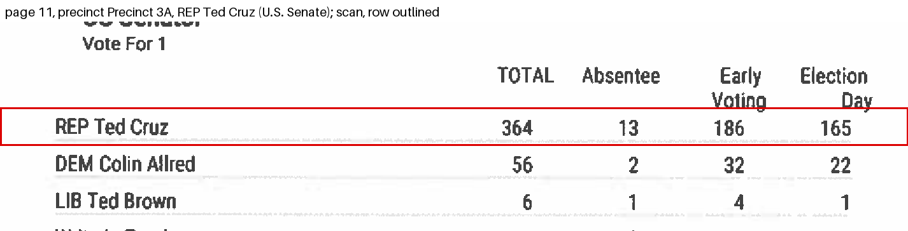
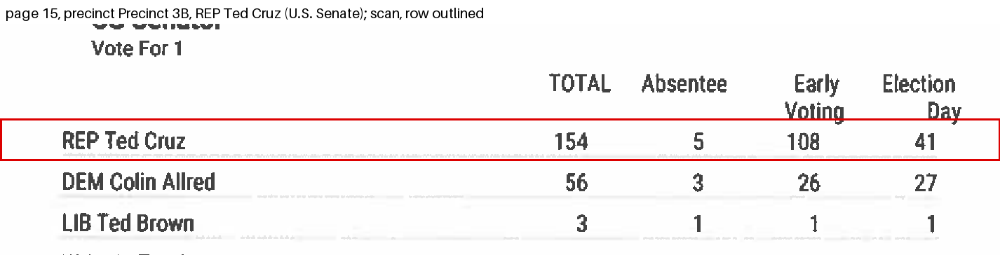
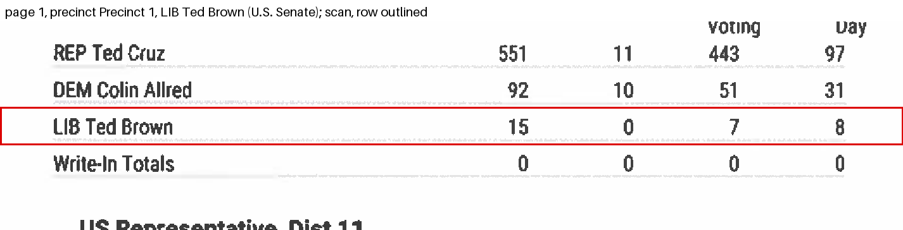
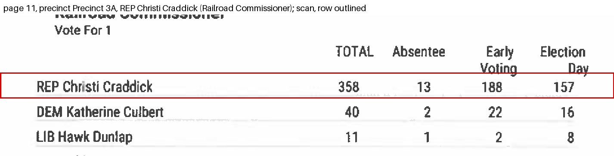
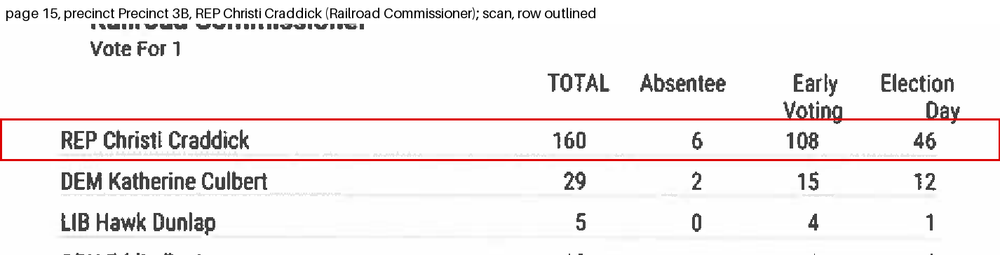
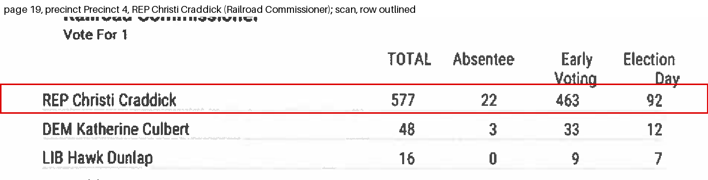
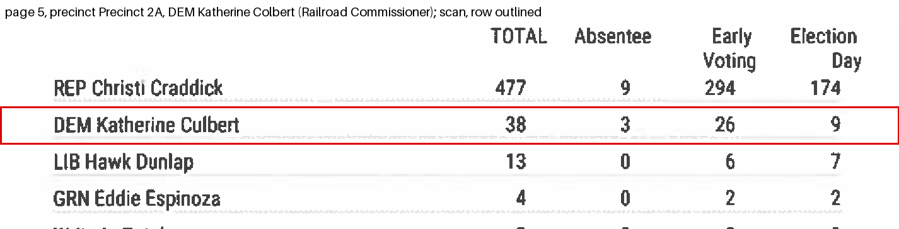
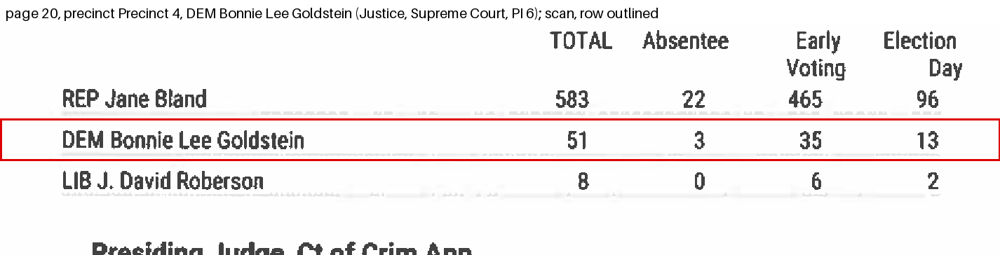
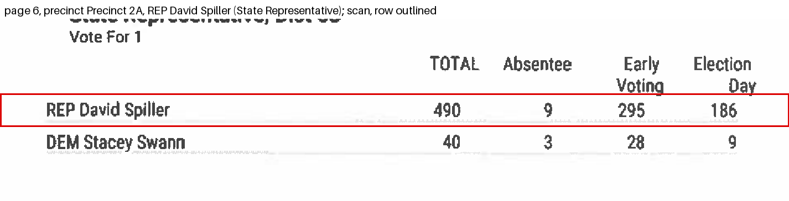

# Crossfoot audit: San Saba County, run 20261011-134552

The published spreadsheet was copied from a scanned canvass. This audit compares the two. What it finds are transcription slips in a volunteer dataset; the county's scan is the source. Each finding is proved with the totals printed on the scan itself. No finding has been confirmed by a person.

- Scan: https://raw.githubusercontent.com/openelections/openelections-sources-tx/master/2024/general/2024%20San%20Saba%20County%2C%20TX%20precinct-level%20results.pdf
- Published file: https://raw.githubusercontent.com/openelections/openelections-data-tx/master/2024/counties/20241105__tx__general__san_saba__precinct.csv

## Counts

21 findings in 11 groups; 3 values changed in the corrected file.

| kind | findings |
|---|---|
| file_row_fails_own_total | 1 |
| wrong_number | 20 |

| status | findings |
|---|---|
| settled_against_file | 3 |
| cannot_verify | 18 |

## Coverage

The published file has 275 rows; 275 of 275 were compared with the scan.
Every published row was compared.

## Printed sums, checked against the published file and the corrected file

Printed sums in all: 275 printed sums (row totals, small totals, grand totals). Recomputed with the published file's values in place of the scan's (matched rows only): 274 hold. Recomputed with the corrected file's values: 275 hold. Rows whose votes differ from their three parts: 1 in the published file, 0 in the corrected file.

No sum fails with the corrected file's values.

## What the printed sums cannot see

In this layout the only sum printed for a value is its row's own: total = absentee + early voting + election day. Where a page prints a contest total ("Total Votes Cast", "Cast Votes"), the candidates' figures in a column also add to it; that is a second sum on the value. Second sum in this county: no (0 of 142 contests print a contest total).

What one sum cannot see: two numbers of one row that are both wrong and cancel out are not detected. And when a published row differs from the scan's row in two or more values but still adds up to its own total, with no contest total over it, no printed total can tell the two rows apart; such a finding is cannot_verify, nothing is corrected, and the scan's row is read once more so the finding can say whether two readings of the scan agree.

## Look at these first

None: no single-value re-read disagreed with the ledger.

## Could not be corrected as a whole row

None.

Where the scan disagrees with itself, the answer in use is 'cells' (follow the cells as printed and list the printed total as inconsistent); answered by: default, not yet confirmed by a person. It never changes a value; only a printed total that decides can.

## Groups

### g001: wrong_number, Donald J. Trump, precinct Precinct 2A

President. Page 5, block 2a|1. Statuses: settled_against_file 2.

- Precinct Precinct 2A, absentee: the file has 8, the scan has 9. Status settled_against_file: the row's total printed on the scan equals its absentee + early voting + election day (REP Donald J. Trump/JD Vance) hold(s) with the scan's value and fail(s) with the file's, and no printed total holds with the file's value and fails with the scan's Changed in the corrected file.
  - the row's total printed on the scan equals its absentee + early voting + election day (REP Donald J. Trump/JD Vance): printed 506; with the scan's value the cells add to 506 (holds); with the file's value they add to 507 (does not hold).
- Precinct Precinct 2A, early_voting: the file has 308, the scan has 306. Status settled_against_file: the row's total printed on the scan equals its absentee + early voting + election day (REP Donald J. Trump/JD Vance) hold(s) with the scan's value and fail(s) with the file's, and no printed total holds with the file's value and fails with the scan's Changed in the corrected file.
  - the row's total printed on the scan equals its absentee + early voting + election day (REP Donald J. Trump/JD Vance): printed 506; with the scan's value the cells add to 506 (holds); with the file's value they add to 507 (does not hold).

### g002: wrong_number, Ted Cruz, precinct Precinct 3A

U.S. Senate. Page 11, block 3a|2. Statuses: cannot_verify 2.

- Precinct Precinct 3A, early_voting: the file has 189, the scan has 186. Status cannot_verify: no printed total can tell the two rows apart: the published row differs from the scan's row in 2 values, adds up to its own total, and no contest total covers it; nothing is corrected. A second reading of the scan's row (claude-sonnet-4.6, 400 dpi) gives total 364, absentee 13, early 186, election_day 165 and agrees with the first reading.
  - the row's total printed on the scan equals its absentee + early voting + election day (REP Ted Cruz): printed 364; with the scan's value the cells add to 364 (holds); with the file's value they add to 364 (holds).
  - Looked at the scan again (claude-sonnet-4.6, 400 dpi): it reads 186.
- Precinct Precinct 3A, election_day: the file has 162, the scan has 165. Status cannot_verify: no printed total can tell the two rows apart: the published row differs from the scan's row in 2 values, adds up to its own total, and no contest total covers it; nothing is corrected. A second reading of the scan's row (claude-sonnet-4.6, 400 dpi) gives total 364, absentee 13, early 186, election_day 165 and agrees with the first reading.
  - the row's total printed on the scan equals its absentee + early voting + election day (REP Ted Cruz): printed 364; with the scan's value the cells add to 364 (holds); with the file's value they add to 364 (holds).
  - Looked at the scan again (claude-sonnet-4.6, 400 dpi): it reads 165.

### g003: wrong_number, Ted Cruz, precinct Precinct 3B

U.S. Senate. Page 15, block 3b|2. Statuses: cannot_verify 2.

- Precinct Precinct 3B, early_voting: the file has 102, the scan has 108. Status cannot_verify: no printed total can tell the two rows apart: the published row differs from the scan's row in 2 values, adds up to its own total, and no contest total covers it; nothing is corrected. A second reading of the scan's row (claude-sonnet-4.6, 400 dpi) gives total 154, absentee 5, early 108, election_day 41 and agrees with the first reading.
  - the row's total printed on the scan equals its absentee + early voting + election day (REP Ted Cruz): printed 154; with the scan's value the cells add to 154 (holds); with the file's value they add to 154 (holds).
  - Looked at the scan again (claude-sonnet-4.6, 400 dpi): it reads 108.
- Precinct Precinct 3B, election_day: the file has 47, the scan has 41. Status cannot_verify: no printed total can tell the two rows apart: the published row differs from the scan's row in 2 values, adds up to its own total, and no contest total covers it; nothing is corrected. A second reading of the scan's row (claude-sonnet-4.6, 400 dpi) gives total 154, absentee 5, early 108, election_day 41 and agrees with the first reading.
  - the row's total printed on the scan equals its absentee + early voting + election day (REP Ted Cruz): printed 154; with the scan's value the cells add to 154 (holds); with the file's value they add to 154 (holds).
  - Looked at the scan again (claude-sonnet-4.6, 400 dpi): it reads 41.

### g004: wrong_number, Ted Brown, precinct Precinct 1

U.S. Senate. Page 1, block 1|2. Statuses: cannot_verify 2.

- Precinct Precinct 1, votes: the file has 16, the scan has 15. Status cannot_verify: no printed total can tell the two rows apart: the published row differs from the scan's row in 2 values, adds up to its own total, and no contest total covers it; nothing is corrected. A second reading of the scan's row (claude-sonnet-4.6, 400 dpi) gives total 15, absentee 0, early 7, election_day 8 and agrees with the first reading.
  - the row's total printed on the scan equals its absentee + early voting + election day (LIB Ted Brown): printed 15; with the scan's value the cells add to 15 (holds); with the file's value they add to 16 (holds).
  - Looked at the scan again (claude-sonnet-4.6, 400 dpi): it reads 15.
- Precinct Precinct 1, election_day: the file has 9, the scan has 8. Status cannot_verify: no printed total can tell the two rows apart: the published row differs from the scan's row in 2 values, adds up to its own total, and no contest total covers it; nothing is corrected. A second reading of the scan's row (claude-sonnet-4.6, 400 dpi) gives total 15, absentee 0, early 7, election_day 8 and agrees with the first reading.
  - the row's total printed on the scan equals its absentee + early voting + election day (LIB Ted Brown): printed 15; with the scan's value the cells add to 15 (holds); with the file's value they add to 16 (holds).
  - Looked at the scan again (claude-sonnet-4.6, 400 dpi): it reads 8.

### g005: wrong_number, Christi Craddick, precinct Precinct 3A

Railroad Commissioner. Page 11, block 3a|4. Statuses: cannot_verify 2.

- Precinct Precinct 3A, absentee: the file has 12, the scan has 13. Status cannot_verify: no printed total can tell the two rows apart: the published row differs from the scan's row in 2 values, adds up to its own total, and no contest total covers it; nothing is corrected. A second reading of the scan's row (claude-sonnet-4.6, 400 dpi) gives total 358, absentee 13, early 188, election_day 157 and agrees with the first reading.
  - the row's total printed on the scan equals its absentee + early voting + election day (REP Christi Craddick): printed 358; with the scan's value the cells add to 358 (holds); with the file's value they add to 358 (holds).
  - Looked at the scan again (claude-sonnet-4.6, 400 dpi): it reads 13.
- Precinct Precinct 3A, early_voting: the file has 189, the scan has 188. Status cannot_verify: no printed total can tell the two rows apart: the published row differs from the scan's row in 2 values, adds up to its own total, and no contest total covers it; nothing is corrected. A second reading of the scan's row (claude-sonnet-4.6, 400 dpi) gives total 358, absentee 13, early 188, election_day 157 and agrees with the first reading.
  - the row's total printed on the scan equals its absentee + early voting + election day (REP Christi Craddick): printed 358; with the scan's value the cells add to 358 (holds); with the file's value they add to 358 (holds).
  - Looked at the scan again (claude-sonnet-4.6, 400 dpi): it reads 188.

### g006: wrong_number, Christi Craddick, precinct Precinct 3B

Railroad Commissioner. Page 15, block 3b|4. Statuses: cannot_verify 2.

- Precinct Precinct 3B, early_voting: the file has 109, the scan has 108. Status cannot_verify: no printed total can tell the two rows apart: the published row differs from the scan's row in 2 values, adds up to its own total, and no contest total covers it; nothing is corrected. A second reading of the scan's row (claude-sonnet-4.6, 400 dpi) gives total 160, absentee 6, early 108, election_day 46 and agrees with the first reading.
  - the row's total printed on the scan equals its absentee + early voting + election day (REP Christi Craddick): printed 160; with the scan's value the cells add to 160 (holds); with the file's value they add to 160 (holds).
  - Looked at the scan again (claude-sonnet-4.6, 400 dpi): it reads 108.
- Precinct Precinct 3B, election_day: the file has 45, the scan has 46. Status cannot_verify: no printed total can tell the two rows apart: the published row differs from the scan's row in 2 values, adds up to its own total, and no contest total covers it; nothing is corrected. A second reading of the scan's row (claude-sonnet-4.6, 400 dpi) gives total 160, absentee 6, early 108, election_day 46 and agrees with the first reading.
  - the row's total printed on the scan equals its absentee + early voting + election day (REP Christi Craddick): printed 160; with the scan's value the cells add to 160 (holds); with the file's value they add to 160 (holds).
  - Looked at the scan again (claude-sonnet-4.6, 400 dpi): it reads 46.

### g007: wrong_number, Christi Craddick, precinct Precinct 4

Railroad Commissioner. Page 19, block 4|4. Statuses: cannot_verify 2.

- Precinct Precinct 4, early_voting: the file has 458, the scan has 463. Status cannot_verify: no printed total can tell the two rows apart: the published row differs from the scan's row in 2 values, adds up to its own total, and no contest total covers it; nothing is corrected. A second reading of the scan's row (claude-sonnet-4.6, 400 dpi) gives total 577, absentee 22, early 463, election_day 92 and agrees with the first reading.
  - the row's total printed on the scan equals its absentee + early voting + election day (REP Christi Craddick): printed 577; with the scan's value the cells add to 577 (holds); with the file's value they add to 577 (holds).
  - Looked at the scan again (claude-sonnet-4.6, 400 dpi): it reads 463.
- Precinct Precinct 4, election_day: the file has 97, the scan has 92. Status cannot_verify: no printed total can tell the two rows apart: the published row differs from the scan's row in 2 values, adds up to its own total, and no contest total covers it; nothing is corrected. A second reading of the scan's row (claude-sonnet-4.6, 400 dpi) gives total 577, absentee 22, early 463, election_day 92 and agrees with the first reading.
  - the row's total printed on the scan equals its absentee + early voting + election day (REP Christi Craddick): printed 577; with the scan's value the cells add to 577 (holds); with the file's value they add to 577 (holds).
  - Looked at the scan again (claude-sonnet-4.6, 400 dpi): it reads 92.

### g008: wrong_number, Katherine Culbert, precinct Precinct 2A

Railroad Commissioner. Page 5, block 2a|4. Statuses: cannot_verify 2.

- Precinct Precinct 2A, early_voting: the file has 28, the scan has 26. Status cannot_verify: no printed total can tell the two rows apart: the published row differs from the scan's row in 2 values, adds up to its own total, and no contest total covers it; nothing is corrected. A second reading of the scan's row (claude-sonnet-4.6, 400 dpi) gives total 38, absentee 3, early 26, election_day 9 and agrees with the first reading.
  - the row's total printed on the scan equals its absentee + early voting + election day (DEM Katherine Colbert): printed 38; with the scan's value the cells add to 38 (holds); with the file's value they add to 38 (holds).
  - Looked at the scan again (claude-sonnet-4.6, 400 dpi): it reads 26.
- Precinct Precinct 2A, election_day: the file has 7, the scan has 9. Status cannot_verify: no printed total can tell the two rows apart: the published row differs from the scan's row in 2 values, adds up to its own total, and no contest total covers it; nothing is corrected. A second reading of the scan's row (claude-sonnet-4.6, 400 dpi) gives total 38, absentee 3, early 26, election_day 9 and agrees with the first reading.
  - the row's total printed on the scan equals its absentee + early voting + election day (DEM Katherine Colbert): printed 38; with the scan's value the cells add to 38 (holds); with the file's value they add to 38 (holds).
  - Looked at the scan again (claude-sonnet-4.6, 400 dpi): it reads 9.

### g009: wrong_number, Bonnie Lee Goldstein, precinct Precinct 4

Justice, Supreme Court, PI 6. Page 20, block 4|7. Statuses: cannot_verify 2.

- Precinct Precinct 4, early_voting: the file has 36, the scan has 35. Status cannot_verify: no printed total can tell the two rows apart: the published row differs from the scan's row in 2 values, adds up to its own total, and no contest total covers it; nothing is corrected. A second reading of the scan's row (claude-sonnet-4.6, 400 dpi) gives total 51, absentee 3, early 35, election_day 13 and agrees with the first reading.
  - the row's total printed on the scan equals its absentee + early voting + election day (DEM Bonnie Lee Goldstein): printed 51; with the scan's value the cells add to 51 (holds); with the file's value they add to 51 (holds).
  - Looked at the scan again (claude-sonnet-4.6, 400 dpi): it reads 35.
- Precinct Precinct 4, election_day: the file has 12, the scan has 13. Status cannot_verify: no printed total can tell the two rows apart: the published row differs from the scan's row in 2 values, adds up to its own total, and no contest total covers it; nothing is corrected. A second reading of the scan's row (claude-sonnet-4.6, 400 dpi) gives total 51, absentee 3, early 35, election_day 13 and agrees with the first reading.
  - the row's total printed on the scan equals its absentee + early voting + election day (DEM Bonnie Lee Goldstein): printed 51; with the scan's value the cells add to 51 (holds); with the file's value they add to 51 (holds).
  - Looked at the scan again (claude-sonnet-4.6, 400 dpi): it reads 13.

### g010: wrong_number, David Spiller, precinct Precinct 2A

State Representative, 68. Page 6, block 2a|12. Statuses: cannot_verify 2.

- Precinct Precinct 2A, early_voting: the file has 298, the scan has 295. Status cannot_verify: no printed total can tell the two rows apart: the published row differs from the scan's row in 2 values, adds up to its own total, and no contest total covers it; nothing is corrected. A second reading of the scan's row (claude-sonnet-4.6, 400 dpi) gives total 490, absentee 9, early 295, election_day 186 and agrees with the first reading.
  - the row's total printed on the scan equals its absentee + early voting + election day (REP David Spiller): printed 490; with the scan's value the cells add to 490 (holds); with the file's value they add to 490 (holds).
  - Looked at the scan again (claude-sonnet-4.6, 400 dpi): it reads 295.
- Precinct Precinct 2A, election_day: the file has 183, the scan has 186. Status cannot_verify: no printed total can tell the two rows apart: the published row differs from the scan's row in 2 values, adds up to its own total, and no contest total covers it; nothing is corrected. A second reading of the scan's row (claude-sonnet-4.6, 400 dpi) gives total 490, absentee 9, early 295, election_day 186 and agrees with the first reading.
  - the row's total printed on the scan equals its absentee + early voting + election day (REP David Spiller): printed 490; with the scan's value the cells add to 490 (holds); with the file's value they add to 490 (holds).
  - Looked at the scan again (claude-sonnet-4.6, 400 dpi): it reads 186.

### g011: file_row_fails_own_total, Donald J. Trump, precinct Precinct 2A

President. Page 5, block 2a|1. Statuses: settled_against_file 1.

- Precinct Precinct 2A, votes: the file has 506, the scan has 506. Status settled_against_file: the file's votes 506 differ from its parts 8 + 308 + 191 = 507; the row's total printed on the scan equals its absentee + early voting + election day (REP Donald J. Trump/JD Vance) hold(s) with the scan's value and fail(s) with the file's, and no printed total holds with the file's value and fails with the scan's Changed in the corrected file.
  - the row's total printed on the scan equals its absentee + early voting + election day (REP Donald J. Trump/JD Vance): printed 506; with the scan's value the cells add to 506 (holds); with the file's value they add to 507 (does not hold).

## What could not be verified, and why

- f003 (group g002), Ted Cruz, precinct Precinct 3A, early_voting: cannot_verify. no printed total can tell the two rows apart: the published row differs from the scan's row in 2 values, adds up to its own total, and no contest total covers it; nothing is corrected. A second reading of the scan's row (claude-sonnet-4.6, 400 dpi) gives total 364, absentee 13, early 186, election_day 165 and agrees with the first reading.
- f004 (group g002), Ted Cruz, precinct Precinct 3A, election_day: cannot_verify. no printed total can tell the two rows apart: the published row differs from the scan's row in 2 values, adds up to its own total, and no contest total covers it; nothing is corrected. A second reading of the scan's row (claude-sonnet-4.6, 400 dpi) gives total 364, absentee 13, early 186, election_day 165 and agrees with the first reading.
- f005 (group g003), Ted Cruz, precinct Precinct 3B, early_voting: cannot_verify. no printed total can tell the two rows apart: the published row differs from the scan's row in 2 values, adds up to its own total, and no contest total covers it; nothing is corrected. A second reading of the scan's row (claude-sonnet-4.6, 400 dpi) gives total 154, absentee 5, early 108, election_day 41 and agrees with the first reading.
- f006 (group g003), Ted Cruz, precinct Precinct 3B, election_day: cannot_verify. no printed total can tell the two rows apart: the published row differs from the scan's row in 2 values, adds up to its own total, and no contest total covers it; nothing is corrected. A second reading of the scan's row (claude-sonnet-4.6, 400 dpi) gives total 154, absentee 5, early 108, election_day 41 and agrees with the first reading.
- f007 (group g004), Ted Brown, precinct Precinct 1, votes: cannot_verify. no printed total can tell the two rows apart: the published row differs from the scan's row in 2 values, adds up to its own total, and no contest total covers it; nothing is corrected. A second reading of the scan's row (claude-sonnet-4.6, 400 dpi) gives total 15, absentee 0, early 7, election_day 8 and agrees with the first reading.
- f008 (group g004), Ted Brown, precinct Precinct 1, election_day: cannot_verify. no printed total can tell the two rows apart: the published row differs from the scan's row in 2 values, adds up to its own total, and no contest total covers it; nothing is corrected. A second reading of the scan's row (claude-sonnet-4.6, 400 dpi) gives total 15, absentee 0, early 7, election_day 8 and agrees with the first reading.
- f009 (group g005), Christi Craddick, precinct Precinct 3A, absentee: cannot_verify. no printed total can tell the two rows apart: the published row differs from the scan's row in 2 values, adds up to its own total, and no contest total covers it; nothing is corrected. A second reading of the scan's row (claude-sonnet-4.6, 400 dpi) gives total 358, absentee 13, early 188, election_day 157 and agrees with the first reading.
- f010 (group g005), Christi Craddick, precinct Precinct 3A, early_voting: cannot_verify. no printed total can tell the two rows apart: the published row differs from the scan's row in 2 values, adds up to its own total, and no contest total covers it; nothing is corrected. A second reading of the scan's row (claude-sonnet-4.6, 400 dpi) gives total 358, absentee 13, early 188, election_day 157 and agrees with the first reading.
- f011 (group g006), Christi Craddick, precinct Precinct 3B, early_voting: cannot_verify. no printed total can tell the two rows apart: the published row differs from the scan's row in 2 values, adds up to its own total, and no contest total covers it; nothing is corrected. A second reading of the scan's row (claude-sonnet-4.6, 400 dpi) gives total 160, absentee 6, early 108, election_day 46 and agrees with the first reading.
- f012 (group g006), Christi Craddick, precinct Precinct 3B, election_day: cannot_verify. no printed total can tell the two rows apart: the published row differs from the scan's row in 2 values, adds up to its own total, and no contest total covers it; nothing is corrected. A second reading of the scan's row (claude-sonnet-4.6, 400 dpi) gives total 160, absentee 6, early 108, election_day 46 and agrees with the first reading.
- f013 (group g007), Christi Craddick, precinct Precinct 4, early_voting: cannot_verify. no printed total can tell the two rows apart: the published row differs from the scan's row in 2 values, adds up to its own total, and no contest total covers it; nothing is corrected. A second reading of the scan's row (claude-sonnet-4.6, 400 dpi) gives total 577, absentee 22, early 463, election_day 92 and agrees with the first reading.
- f014 (group g007), Christi Craddick, precinct Precinct 4, election_day: cannot_verify. no printed total can tell the two rows apart: the published row differs from the scan's row in 2 values, adds up to its own total, and no contest total covers it; nothing is corrected. A second reading of the scan's row (claude-sonnet-4.6, 400 dpi) gives total 577, absentee 22, early 463, election_day 92 and agrees with the first reading.
- f015 (group g008), Katherine Culbert, precinct Precinct 2A, early_voting: cannot_verify. no printed total can tell the two rows apart: the published row differs from the scan's row in 2 values, adds up to its own total, and no contest total covers it; nothing is corrected. A second reading of the scan's row (claude-sonnet-4.6, 400 dpi) gives total 38, absentee 3, early 26, election_day 9 and agrees with the first reading.
- f016 (group g008), Katherine Culbert, precinct Precinct 2A, election_day: cannot_verify. no printed total can tell the two rows apart: the published row differs from the scan's row in 2 values, adds up to its own total, and no contest total covers it; nothing is corrected. A second reading of the scan's row (claude-sonnet-4.6, 400 dpi) gives total 38, absentee 3, early 26, election_day 9 and agrees with the first reading.
- f017 (group g009), Bonnie Lee Goldstein, precinct Precinct 4, early_voting: cannot_verify. no printed total can tell the two rows apart: the published row differs from the scan's row in 2 values, adds up to its own total, and no contest total covers it; nothing is corrected. A second reading of the scan's row (claude-sonnet-4.6, 400 dpi) gives total 51, absentee 3, early 35, election_day 13 and agrees with the first reading.
- f018 (group g009), Bonnie Lee Goldstein, precinct Precinct 4, election_day: cannot_verify. no printed total can tell the two rows apart: the published row differs from the scan's row in 2 values, adds up to its own total, and no contest total covers it; nothing is corrected. A second reading of the scan's row (claude-sonnet-4.6, 400 dpi) gives total 51, absentee 3, early 35, election_day 13 and agrees with the first reading.
- f019 (group g010), David Spiller, precinct Precinct 2A, early_voting: cannot_verify. no printed total can tell the two rows apart: the published row differs from the scan's row in 2 values, adds up to its own total, and no contest total covers it; nothing is corrected. A second reading of the scan's row (claude-sonnet-4.6, 400 dpi) gives total 490, absentee 9, early 295, election_day 186 and agrees with the first reading.
- f020 (group g010), David Spiller, precinct Precinct 2A, election_day: cannot_verify. no printed total can tell the two rows apart: the published row differs from the scan's row in 2 values, adds up to its own total, and no contest total covers it; nothing is corrected. A second reading of the scan's row (claude-sonnet-4.6, 400 dpi) gives total 490, absentee 9, early 295, election_day 186 and agrees with the first reading.
