# Crossfoot audit: Jones County, run 20261011-161207

The published spreadsheet was copied from a scanned canvass. This audit compares the two. What it finds are transcription slips in a volunteer dataset; the county's scan is the source. Each finding is proved with the totals printed on the scan itself. No finding has been confirmed by a person.

- Scan: https://raw.githubusercontent.com/openelections/openelections-sources-tx/master/2024/general/2024%20Jones%20County%2C%20TX%20precinct-level%20results.pdf
- Published file: https://raw.githubusercontent.com/openelections/openelections-data-tx/master/2024/counties/20241105__tx__general__jones__precinct.csv

## Counts

26 findings in 13 groups; 26 values changed in the corrected file.

| kind | findings |
|---|---|
| wrong_number | 26 |

| status | findings |
|---|---|
| settled_against_file | 26 |

## Coverage

The published file has 344 rows; 335 of 344 were compared with the scan.
Not compared:

- Registered Voters: 4 rows. The contest was not paired with a contest on the scan.
- Ballots Cast Blank: 4 rows. The contest was not paired with a contest on the scan.
- Trustee Roby CISD: 1 row. The contest is paired, but this candidate has no block on the scan.

## Printed sums, checked against the published file and the corrected file

Printed sums in all: 1102 printed sums (row totals, small totals, grand totals). Recomputed with the published file's values in place of the scan's (matched rows only): 1083 hold. Recomputed with the corrected file's values: 1102 hold. Rows whose votes differ from their three parts: 0 in the published file, 0 in the corrected file.

No sum fails with the corrected file's values.

## What the printed sums cannot see

In this layout the only sum printed for a value is its row's own: total = absentee + early voting + election day. Where a page prints a contest total ("Total Votes Cast", "Cast Votes"), the candidates' figures in a column also add to it; that is a second sum on the value. Second sum in this county: yes (78 of 82 contests print a contest total).

Where a contest also prints a write-in total with rows that break it down, those rows add to it; and where the precinct's Statistics block prints its ballots cast, the contest total plus overvotes plus undervotes adds to it. The ballots-cast equation was not used for 4 contest blocks, because it fails in every printed column on the same side (the contest was not on every ballot of the precinct): page 10, block 2|19; page 10, block 2|20; page 10, block 2|21; page 20, block 4|19.

What one sum cannot see: two numbers of one row that are both wrong and cancel out are not detected. And when a published row differs from the scan's row in two or more values but still adds up to its own total, with no contest total over it, no printed total can tell the two rows apart; such a finding is cannot_verify, nothing is corrected, and the scan's row is read once more so the finding can say whether two readings of the scan agree.

## Look at these first

None: no single-value re-read disagreed with the ledger.

## Could not be corrected as a whole row

None.

Where the scan disagrees with itself, the answer in use is 'cells' (follow the cells as printed and list the printed total as inconsistent); answered by: default, not yet confirmed by a person. It never changes a value; only a printed total that decides can.

## Groups

### g001: wrong_number, Donald J. Trump/JD Vance, precinct Precinct 2

President. Page 6, block 2|1. Statuses: settled_against_file 2.

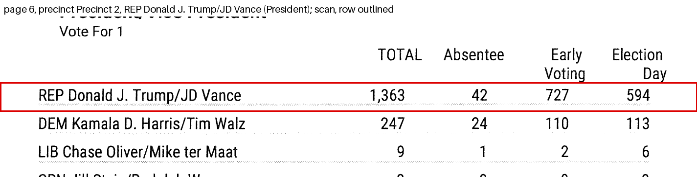

- Precinct Precinct 2, votes: the file has 1263, the scan has 1363. Status settled_against_file: the candidates' total figures add to the contest total's total figure hold(s) with the scan's value and fail(s) with the file's, and no printed total holds with the file's value and fails with the scan's Changed in the corrected file.
  - the row's total printed on the scan equals its absentee + early voting + election day (REP Donald J. Trump/JD Vance): printed 1363; with the scan's value the cells add to 1363 (holds); with the file's value they add to 1263 (holds).
  - the candidates' total figures add to the contest total's total figure: printed 1629; with the scan's value the cells add to 1629 (holds); with the file's value they add to 1529 (does not hold).
- Precinct Precinct 2, election_day: the file has 494, the scan has 594. Status settled_against_file: the candidates' election day figures add to the contest total's election day figure hold(s) with the scan's value and fail(s) with the file's, and no printed total holds with the file's value and fails with the scan's Changed in the corrected file.
  - the row's total printed on the scan equals its absentee + early voting + election day (REP Donald J. Trump/JD Vance): printed 1363; with the scan's value the cells add to 1363 (holds); with the file's value they add to 1263 (holds).
  - the candidates' election day figures add to the contest total's election day figure: printed 721; with the scan's value the cells add to 721 (holds); with the file's value they add to 621 (does not hold).

### g002: wrong_number, Donald J. Trump/JD Vance, precinct Precinct 3

President. Page 11, block 3|1. Statuses: settled_against_file 2.

- Precinct Precinct 3, votes: the file has 1858, the scan has 1868. Status settled_against_file: the candidates' total figures add to the contest total's total figure hold(s) with the scan's value and fail(s) with the file's, and no printed total holds with the file's value and fails with the scan's Changed in the corrected file.
  - the row's total printed on the scan equals its absentee + early voting + election day (REP Donald J. Trump/JD Vance): printed 1868; with the scan's value the cells add to 1868 (holds); with the file's value they add to 1858 (holds).
  - the candidates' total figures add to the contest total's total figure: printed 2102; with the scan's value the cells add to 2102 (holds); with the file's value they add to 2092 (does not hold).
- Precinct Precinct 3, election_day: the file has 722, the scan has 732. Status settled_against_file: the candidates' election day figures add to the contest total's election day figure hold(s) with the scan's value and fail(s) with the file's, and no printed total holds with the file's value and fails with the scan's Changed in the corrected file.
  - the row's total printed on the scan equals its absentee + early voting + election day (REP Donald J. Trump/JD Vance): printed 1868; with the scan's value the cells add to 1868 (holds); with the file's value they add to 1858 (holds).
  - the candidates' election day figures add to the contest total's election day figure: printed 819; with the scan's value the cells add to 819 (holds); with the file's value they add to 809 (does not hold).

### g003: wrong_number, Kamala D. Harris/Tim Walz, precinct Precinct 2

President. Page 6, block 2|1. Statuses: settled_against_file 2.

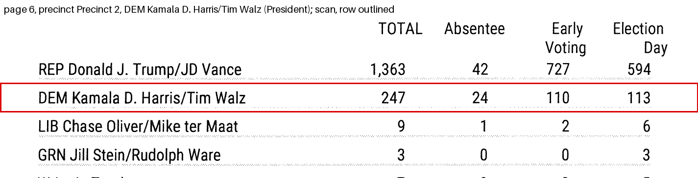

- Precinct Precinct 2, early_voting: the file has 112, the scan has 110. Status settled_against_file: the candidates' early voting figures add to the contest total's early voting figure hold(s) with the scan's value and fail(s) with the file's, and no printed total holds with the file's value and fails with the scan's Changed in the corrected file.
  - the row's total printed on the scan equals its absentee + early voting + election day (DEM Kamala D. Harris/Tim Walz): printed 247; with the scan's value the cells add to 247 (holds); with the file's value they add to 247 (holds).
  - the candidates' early voting figures add to the contest total's early voting figure: printed 841; with the scan's value the cells add to 841 (holds); with the file's value they add to 843 (does not hold).
- Precinct Precinct 2, election_day: the file has 111, the scan has 113. Status settled_against_file: the candidates' election day figures add to the contest total's election day figure hold(s) with the scan's value and fail(s) with the file's, and no printed total holds with the file's value and fails with the scan's Changed in the corrected file.
  - the row's total printed on the scan equals its absentee + early voting + election day (DEM Kamala D. Harris/Tim Walz): printed 247; with the scan's value the cells add to 247 (holds); with the file's value they add to 247 (holds).
  - the candidates' election day figures add to the contest total's election day figure: printed 721; with the scan's value the cells add to 721 (holds); with the file's value they add to 719 (does not hold).

### g004: wrong_number, Kamala D. Harris/Tim Walz, precinct Precinct 4

President. Page 16, block 4|1. Statuses: settled_against_file 2.

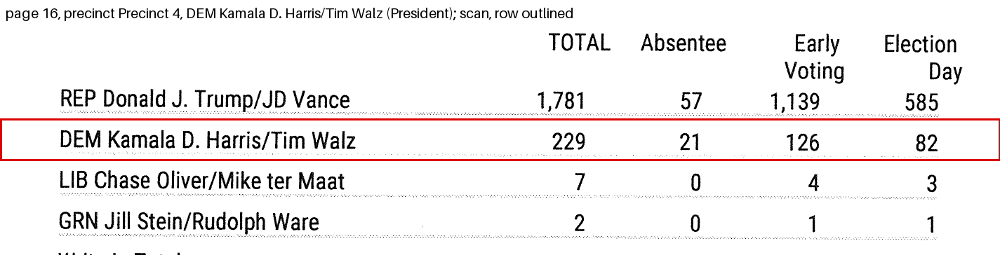

- Precinct Precinct 4, early_voting: the file has 136, the scan has 126. Status settled_against_file: the candidates' early voting figures add to the contest total's early voting figure hold(s) with the scan's value and fail(s) with the file's, and no printed total holds with the file's value and fails with the scan's Changed in the corrected file.
  - the row's total printed on the scan equals its absentee + early voting + election day (DEM Kamala D. Harris/Tim Walz): printed 229; with the scan's value the cells add to 229 (holds); with the file's value they add to 229 (holds).
  - the candidates' early voting figures add to the contest total's early voting figure: printed 1271; with the scan's value the cells add to 1271 (holds); with the file's value they add to 1281 (does not hold).
- Precinct Precinct 4, election_day: the file has 72, the scan has 82. Status settled_against_file: the candidates' election day figures add to the contest total's election day figure hold(s) with the scan's value and fail(s) with the file's, and no printed total holds with the file's value and fails with the scan's Changed in the corrected file.
  - the row's total printed on the scan equals its absentee + early voting + election day (DEM Kamala D. Harris/Tim Walz): printed 229; with the scan's value the cells add to 229 (holds); with the file's value they add to 229 (holds).
  - the candidates' election day figures add to the contest total's election day figure: printed 673; with the scan's value the cells add to 673 (holds); with the file's value they add to 663 (does not hold).

### g005: wrong_number, Bernard Johnson, precinct Precinct 2

U.S. House, 19. Page 6, block 2|3. Statuses: settled_against_file 2.

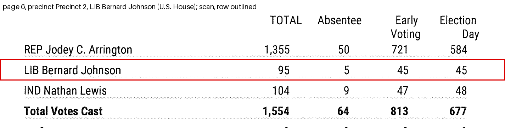

- Precinct Precinct 2, votes: the file has 93, the scan has 95. Status settled_against_file: the candidates' total figures add to the contest total's total figure hold(s) with the scan's value and fail(s) with the file's, and no printed total holds with the file's value and fails with the scan's Changed in the corrected file.
  - the row's total printed on the scan equals its absentee + early voting + election day (LIB Bernard Johnson): printed 95; with the scan's value the cells add to 95 (holds); with the file's value they add to 93 (holds).
  - the candidates' total figures add to the contest total's total figure: printed 1554; with the scan's value the cells add to 1554 (holds); with the file's value they add to 1552 (does not hold).
- Precinct Precinct 2, election_day: the file has 43, the scan has 45. Status settled_against_file: the candidates' election day figures add to the contest total's election day figure hold(s) with the scan's value and fail(s) with the file's, and no printed total holds with the file's value and fails with the scan's Changed in the corrected file.
  - the row's total printed on the scan equals its absentee + early voting + election day (LIB Bernard Johnson): printed 95; with the scan's value the cells add to 95 (holds); with the file's value they add to 93 (holds).
  - the candidates' election day figures add to the contest total's election day figure: printed 677; with the scan's value the cells add to 677 (holds); with the file's value they add to 675 (does not hold).

### g006: wrong_number, Bernard Johnson, precinct Precinct 4

U.S. House, 19. Page 16, block 4|3. Statuses: settled_against_file 2.

- Precinct Precinct 4, absentee: the file has 8, the scan has 5. Status settled_against_file: the candidates' absentee figures add to the contest total's absentee figure hold(s) with the scan's value and fail(s) with the file's, and no printed total holds with the file's value and fails with the scan's Changed in the corrected file.
  - the row's total printed on the scan equals its absentee + early voting + election day (LIB Bernard Johnson): printed 96; with the scan's value the cells add to 96 (holds); with the file's value they add to 96 (holds).
  - the candidates' absentee figures add to the contest total's absentee figure: printed 72; with the scan's value the cells add to 72 (holds); with the file's value they add to 75 (does not hold).
- Precinct Precinct 4, election_day: the file has 42, the scan has 45. Status settled_against_file: the candidates' election day figures add to the contest total's election day figure hold(s) with the scan's value and fail(s) with the file's, and no printed total holds with the file's value and fails with the scan's Changed in the corrected file.
  - the row's total printed on the scan equals its absentee + early voting + election day (LIB Bernard Johnson): printed 96; with the scan's value the cells add to 96 (holds); with the file's value they add to 96 (holds).
  - the candidates' election day figures add to the contest total's election day figure: printed 660; with the scan's value the cells add to 660 (holds); with the file's value they add to 657 (does not hold).

### g007: wrong_number, Nathan Lewis, precinct Precinct 1

U.S. House, 19. Page 1, block 1|3. Statuses: settled_against_file 2.

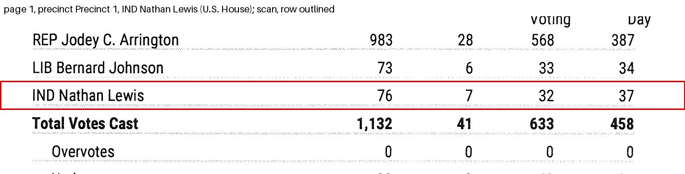

- Precinct Precinct 1, early_voting: the file has 42, the scan has 32. Status settled_against_file: the candidates' early voting figures add to the contest total's early voting figure hold(s) with the scan's value and fail(s) with the file's, and no printed total holds with the file's value and fails with the scan's Changed in the corrected file.
  - the row's total printed on the scan equals its absentee + early voting + election day (IND Nathan Lewis): printed 76; with the scan's value the cells add to 76 (holds); with the file's value they add to 76 (holds).
  - the candidates' early voting figures add to the contest total's early voting figure: printed 633; with the scan's value the cells add to 633 (holds); with the file's value they add to 643 (does not hold).
- Precinct Precinct 1, election_day: the file has 27, the scan has 37. Status settled_against_file: the candidates' election day figures add to the contest total's election day figure hold(s) with the scan's value and fail(s) with the file's, and no printed total holds with the file's value and fails with the scan's Changed in the corrected file.
  - the row's total printed on the scan equals its absentee + early voting + election day (IND Nathan Lewis): printed 76; with the scan's value the cells add to 76 (holds); with the file's value they add to 76 (holds).
  - the candidates' election day figures add to the contest total's election day figure: printed 458; with the scan's value the cells add to 458 (holds); with the file's value they add to 448 (does not hold).

### g008: wrong_number, Nathan Lewis, precinct Precinct 2

U.S. House, 19. Page 6, block 2|3. Statuses: settled_against_file 2.

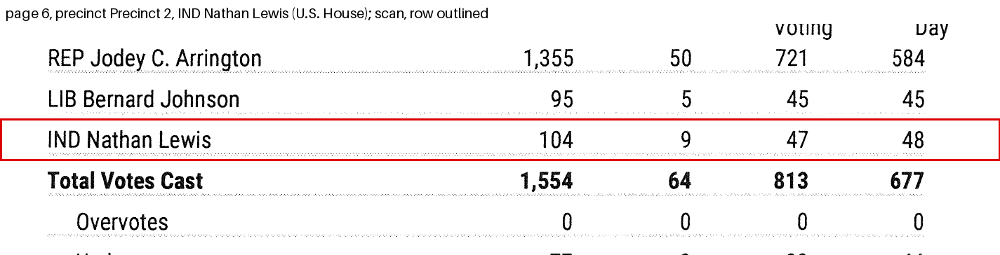

- Precinct Precinct 2, absentee: the file has 7, the scan has 9. Status settled_against_file: the candidates' absentee figures add to the contest total's absentee figure hold(s) with the scan's value and fail(s) with the file's, and no printed total holds with the file's value and fails with the scan's Changed in the corrected file.
  - the row's total printed on the scan equals its absentee + early voting + election day (IND Nathan Lewis): printed 104; with the scan's value the cells add to 104 (holds); with the file's value they add to 104 (holds).
  - the candidates' absentee figures add to the contest total's absentee figure: printed 64; with the scan's value the cells add to 64 (holds); with the file's value they add to 62 (does not hold).
- Precinct Precinct 2, election_day: the file has 50, the scan has 48. Status settled_against_file: the candidates' election day figures add to the contest total's election day figure hold(s) with the scan's value and fail(s) with the file's, and no printed total holds with the file's value and fails with the scan's Changed in the corrected file.
  - the row's total printed on the scan equals its absentee + early voting + election day (IND Nathan Lewis): printed 104; with the scan's value the cells add to 104 (holds); with the file's value they add to 104 (holds).
  - the candidates' election day figures add to the contest total's election day figure: printed 677; with the scan's value the cells add to 677 (holds); with the file's value they add to 679 (does not hold).

### g009: wrong_number, Nathan Lewis, precinct Precinct 4

U.S. House, 19. Page 16, block 4|3. Statuses: settled_against_file 2.

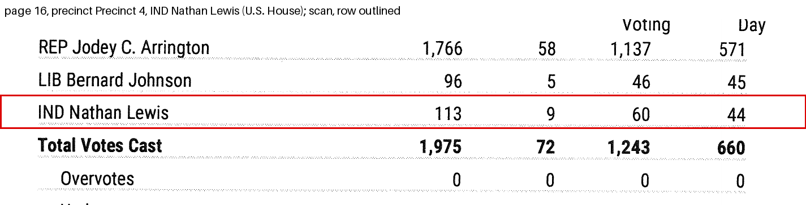

- Precinct Precinct 4, absentee: the file has 6, the scan has 9. Status settled_against_file: the candidates' absentee figures add to the contest total's absentee figure hold(s) with the scan's value and fail(s) with the file's, and no printed total holds with the file's value and fails with the scan's Changed in the corrected file.
  - the row's total printed on the scan equals its absentee + early voting + election day (IND Nathan Lewis): printed 113; with the scan's value the cells add to 113 (holds); with the file's value they add to 113 (holds).
  - the candidates' absentee figures add to the contest total's absentee figure: printed 72; with the scan's value the cells add to 72 (holds); with the file's value they add to 69 (does not hold).
- Precinct Precinct 4, election_day: the file has 47, the scan has 44. Status settled_against_file: the candidates' election day figures add to the contest total's election day figure hold(s) with the scan's value and fail(s) with the file's, and no printed total holds with the file's value and fails with the scan's Changed in the corrected file.
  - the row's total printed on the scan equals its absentee + early voting + election day (IND Nathan Lewis): printed 113; with the scan's value the cells add to 113 (holds); with the file's value they add to 113 (holds).
  - the candidates' election day figures add to the contest total's election day figure: printed 660; with the scan's value the cells add to 660 (holds); with the file's value they add to 663 (does not hold).

### g010: wrong_number, John Devine, precinct Precinct 1

Justice, Supreme Court, Pl 4. Page 2, block 1|6. Statuses: settled_against_file 2.

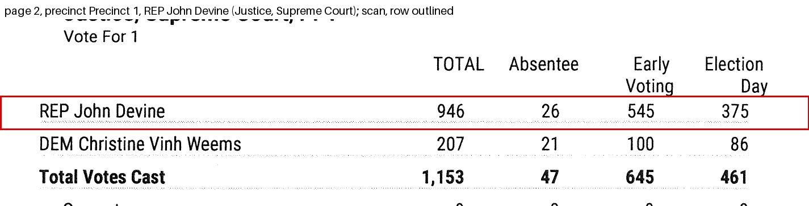

- Precinct Precinct 1, early_voting: the file has 550, the scan has 545. Status settled_against_file: the candidates' early voting figures add to the contest total's early voting figure hold(s) with the scan's value and fail(s) with the file's, and no printed total holds with the file's value and fails with the scan's Changed in the corrected file.
  - the row's total printed on the scan equals its absentee + early voting + election day (REP John Devine): printed 946; with the scan's value the cells add to 946 (holds); with the file's value they add to 946 (holds).
  - the candidates' early voting figures add to the contest total's early voting figure: printed 645; with the scan's value the cells add to 645 (holds); with the file's value they add to 650 (does not hold).
- Precinct Precinct 1, election_day: the file has 370, the scan has 375. Status settled_against_file: the candidates' election day figures add to the contest total's election day figure hold(s) with the scan's value and fail(s) with the file's, and no printed total holds with the file's value and fails with the scan's Changed in the corrected file.
  - the row's total printed on the scan equals its absentee + early voting + election day (REP John Devine): printed 946; with the scan's value the cells add to 946 (holds); with the file's value they add to 946 (holds).
  - the candidates' election day figures add to the contest total's election day figure: printed 461; with the scan's value the cells add to 461 (holds); with the file's value they add to 456 (does not hold).

### g011: wrong_number, Holly Taylor, precinct Precinct 1

Presiding Judge, Ct of Crim App. Page 3, block 1|8. Statuses: settled_against_file 2.

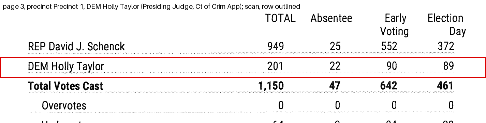

- Precinct Precinct 1, early_voting: the file has 91, the scan has 90. Status settled_against_file: the candidates' early voting figures add to the contest total's early voting figure hold(s) with the scan's value and fail(s) with the file's, and no printed total holds with the file's value and fails with the scan's Changed in the corrected file.
  - the row's total printed on the scan equals its absentee + early voting + election day (DEM Holly Taylor): printed 201; with the scan's value the cells add to 201 (holds); with the file's value they add to 201 (holds).
  - the candidates' early voting figures add to the contest total's early voting figure: printed 642; with the scan's value the cells add to 642 (holds); with the file's value they add to 643 (does not hold).
- Precinct Precinct 1, election_day: the file has 88, the scan has 89. Status settled_against_file: the candidates' election day figures add to the contest total's election day figure hold(s) with the scan's value and fail(s) with the file's, and no printed total holds with the file's value and fails with the scan's Changed in the corrected file.
  - the row's total printed on the scan equals its absentee + early voting + election day (DEM Holly Taylor): printed 201; with the scan's value the cells add to 201 (holds); with the file's value they add to 201 (holds).
  - the candidates' election day figures add to the contest total's election day figure: printed 461; with the scan's value the cells add to 461 (holds); with the file's value they add to 460 (does not hold).

### g012: wrong_number, Holly Taylor, precinct Precinct 3

Presiding Judge, Ct of Crim App. Page 13, block 3|8. Statuses: settled_against_file 2.

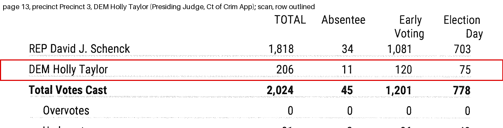

- Precinct Precinct 3, early_voting: the file has 115, the scan has 120. Status settled_against_file: the candidates' early voting figures add to the contest total's early voting figure hold(s) with the scan's value and fail(s) with the file's, and no printed total holds with the file's value and fails with the scan's Changed in the corrected file.
  - the row's total printed on the scan equals its absentee + early voting + election day (DEM Holly Taylor): printed 206; with the scan's value the cells add to 206 (holds); with the file's value they add to 206 (holds).
  - the candidates' early voting figures add to the contest total's early voting figure: printed 1201; with the scan's value the cells add to 1201 (holds); with the file's value they add to 1196 (does not hold).
- Precinct Precinct 3, election_day: the file has 80, the scan has 75. Status settled_against_file: the candidates' election day figures add to the contest total's election day figure hold(s) with the scan's value and fail(s) with the file's, and no printed total holds with the file's value and fails with the scan's Changed in the corrected file.
  - the row's total printed on the scan equals its absentee + early voting + election day (DEM Holly Taylor): printed 206; with the scan's value the cells add to 206 (holds); with the file's value they add to 206 (holds).
  - the candidates' election day figures add to the contest total's election day figure: printed 778; with the scan's value the cells add to 778 (holds); with the file's value they add to 783 (does not hold).

### g013: wrong_number, Jack B. Westbrook, precinct Precinct 3

Member, State BoE, Dist 15. Page 13, block 3|11. Statuses: settled_against_file 2.

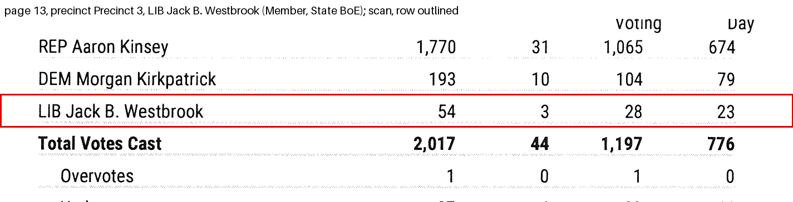

- Precinct Precinct 3, absentee: the file has 4, the scan has 3. Status settled_against_file: the candidates' absentee figures add to the contest total's absentee figure hold(s) with the scan's value and fail(s) with the file's, and no printed total holds with the file's value and fails with the scan's Changed in the corrected file.
  - the row's total printed on the scan equals its absentee + early voting + election day (LIB Jack B. Westbrook): printed 54; with the scan's value the cells add to 54 (holds); with the file's value they add to 54 (holds).
  - the candidates' absentee figures add to the contest total's absentee figure: printed 44; with the scan's value the cells add to 44 (holds); with the file's value they add to 45 (does not hold).
- Precinct Precinct 3, election_day: the file has 22, the scan has 23. Status settled_against_file: the candidates' election day figures add to the contest total's election day figure hold(s) with the scan's value and fail(s) with the file's, and no printed total holds with the file's value and fails with the scan's Changed in the corrected file.
  - the row's total printed on the scan equals its absentee + early voting + election day (LIB Jack B. Westbrook): printed 54; with the scan's value the cells add to 54 (holds); with the file's value they add to 54 (holds).
  - the candidates' election day figures add to the contest total's election day figure: printed 776; with the scan's value the cells add to 776 (holds); with the file's value they add to 775 (does not hold).

## What could not be verified, and why

Every finding is settled by a printed total.

Not matched between the scan and the file, so not compared:
- scan block c007: President/Vice President, Write-In: Uncertified
- scan block c008: President/Vice President, Write-In: Peter Sonski
- scan block c009: President/Vice President, Not Assigned
- scan block c016: US Senator, Write-In: Uncertified
- scan block c017: US Senator, Not Assigned
- scan block c030: Railroad Commissioner, Write-In: Richard McKibbin
- scan block c031: Railroad Commissioner, Write-In: Uncertified
- scan block c032: Railroad Commissioner, Not Assigned
- scan block c105: Trustee Roby CISD, Danny Carrion
- file: Registered Voters ,  (4 rows)
- file: Ballots Cast Blank ,  (4 rows)
- file: Trustee Roby CISD , Danny Garison (1 rows)
