# Crossfoot audit: Panola County, run 20261012-095754

The published spreadsheet was copied from a scanned canvass. This audit compares the two. What it finds are transcription slips in a volunteer dataset; the county's scan is the source. Each finding is proved with the totals printed on the scan itself. No finding has been confirmed by a person.

- Scan: https://raw.githubusercontent.com/openelections/openelections-sources-tx/master/2024/general/2024%20Panola%20County%2C%20TX%20precinct-level%20results.pdf
- Published file: https://raw.githubusercontent.com/openelections/openelections-data-tx/master/2024/counties/20241105__tx__general__panola__precinct.csv

## Counts

121 findings in 46 groups; 80 values changed in the corrected file.

| kind | findings |
|---|---|
| file_row_fails_own_total | 1 |
| wrong_number | 64 |
| wrong_column | 4 |
| wrong_precinct | 44 |
| missing_row | 6 |
| extra_row | 2 |

| status | findings |
|---|---|
| settled_against_file | 109 |
| cannot_verify | 12 |

## Coverage

The published file has 783 rows; 783 of 783 were compared with the scan.
Every published row was compared.

## Printed sums, checked against the published file and the corrected file

Printed sums in all: 984 printed sums (row totals, small totals, grand totals). Recomputed with the published file's values in place of the scan's (matched rows only): 949 hold. Recomputed with the corrected file's values: 978 hold. Rows whose votes differ from their three parts: 1 in the published file, 0 in the corrected file.

6 sums still fail with the corrected file's values:

- page 1, block reg: the registered-voters row (its cells add to the printed total of the row; this row has no other sum) (printed 17921, adds to 17917). Why: a value that could not be verified (f001: Registered Voters, precinct 3, votes).
- page 6, block p6-b3: the EARLY cells across the page add to the row total printed at the right end of the row (printed 3616, adds to 3500). Why: a row missing from the file (precinct 1, page 6, block p6-b3); a row that could not be corrected as a whole (f098); a row that could not be corrected as a whole (f099); a row that could not be corrected as a whole (f100); a row that could not be corrected as a whole (f101); a row that could not be corrected as a whole (f102); a row that could not be corrected as a whole (f103); a row missing from the file (precinct 26, page 6, block p6-b3); a row missing from the file (precinct 28, page 6, block p6-b3).
- page 6, block p6-b3: the ABSENTEE cells across the page add to the row total printed at the right end of the row (printed 149, adds to 137). Why: a row missing from the file (precinct 1, page 6, block p6-b3); a row that could not be corrected as a whole (f093); a row that could not be corrected as a whole (f094); a row that could not be corrected as a whole (f095); a row that could not be corrected as a whole (f096); a row that could not be corrected as a whole (f097); a row missing from the file (precinct 26, page 6, block p6-b3); a row missing from the file (precinct 28, page 6, block p6-b3).
- page 6, block p6-b3: the PRECINCT cells across the page add to the row total printed at the right end of the row (printed 1555, adds to 1471). Why: a row missing from the file (precinct 1, page 6, block p6-b3); a row that could not be corrected as a whole (f104); a row that could not be corrected as a whole (f105); a row that could not be corrected as a whole (f106); a row that could not be corrected as a whole (f107); a row that could not be corrected as a whole (f108); a row that could not be corrected as a whole (f109); a row missing from the file (precinct 26, page 6, block p6-b3); a row missing from the file (precinct 28, page 6, block p6-b3).
- page 6, block p6-b3: the three cells of precinct 1 add to the small total printed under the column (printed 1079, adds to 1076). Why: a row missing from the file (precinct 1, page 6, block p6-b3).
- page 6, block p6-b3: the small totals under the columns add to the grand total (printed 5320, adds to 5111). Why: a row missing from the file (precinct 1, page 6, block p6-b3); a value that could not be verified (f085: Jeff Ivy, precinct 12, votes); a value that could not be verified (f086: Jeff Ivy, precinct 13, votes); a value that could not be verified (f087: Jeff Ivy, precinct 14, votes); a value that could not be verified (f088: Jeff Ivy, precinct 18, votes); a value that could not be verified (f089: Jeff Ivy, precinct 19, votes); a value that could not be verified (f090: Jeff Ivy, precinct 20, votes); a row missing from the file (precinct 26, page 6, block p6-b3); a value that could not be verified (f091: Jeff Ivy, precinct 26, votes); a row missing from the file (precinct 28, page 6, block p6-b3); a value that could not be verified (f110: Jeff Ivy, precinct 28, votes).

## Look at these first

None: no single-value re-read disagreed with the ledger.

## Could not be corrected as a whole row

Each row below has a finding settled against the file, but the row would not add up after the change, so no part of it is changed.

- file line 768: Jeff Ivy, precinct 12 (findings f093, f098, f104): the corrected votes 181 would not equal the corrected parts 14 + 168 + 138 = 320.
- file line 769: Jeff Ivy, precinct 13 (findings f094, f099, f105): the corrected votes 311 would not equal the corrected parts 5 + 102 + 74 = 181.
- file line 770: Jeff Ivy, precinct 14 (findings f095, f100, f106): the corrected votes 1363 would not equal the corrected parts 3 + 195 + 113 = 311.
- file line 771: Jeff Ivy, precinct 18 (findings f096, f101, f107): the corrected votes 235 would not equal the corrected parts 35 + 938 + 390 = 1363.
- file line 772: Jeff Ivy, precinct 19 (findings f097, f102, f108): the corrected votes 245 would not equal the corrected parts 5 + 115 + 115 = 235.
- file line 773: Jeff Ivy, precinct 20 (findings f103, f109): the corrected votes 108 would not equal the corrected parts 2 + 160 + 83 = 245.

Where the scan disagrees with itself, the answer in use is 'cells' (follow the cells as printed and list the printed total as inconsistent); answered by: default, not yet confirmed by a person. It never changes a value; only a printed total that decides can.

## Groups

### g001: wrong_number, Registered Voters, precinct 3

Registered Voters. Page 1, block reg. Statuses: cannot_verify 1.

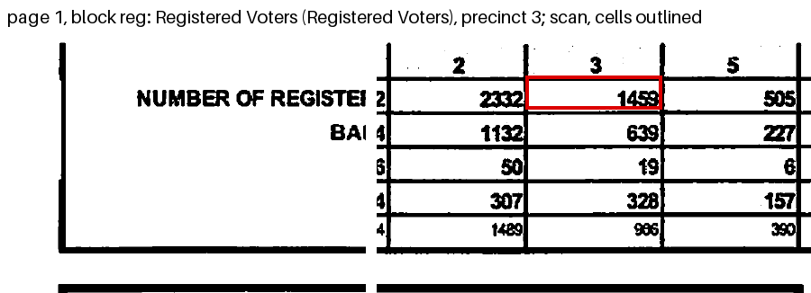

- Precinct 3, votes: the file has 1453, the scan has 1459. Status cannot_verify: no printed total decides: the registered-voters row (its cells add to the printed total of the row; this row has no other sum) give the same answer with either value
  - the registered-voters row (its cells add to the printed total of the row; this row has no other sum): printed 17921; with the scan's value the cells add to 17923 (does not hold); with the file's value they add to 17917 (does not hold).
  - Looked at the scan again (claude-sonnet-4.6, 400 dpi): it reads 1459.

### g002: wrong_column, Chase Oliver, precinct 18

President. Page 1, block p1-b3. Statuses: settled_against_file 2.

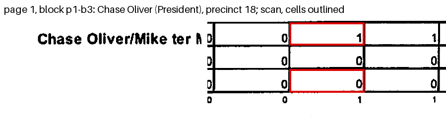

- Precinct 18, early_voting: the file has 0, the scan has 1. Status settled_against_file: the EARLY cells across the page add to the row total printed at the right end of the row; the three cells of precinct 18 add to the small total printed under the column hold(s) with the scan's value and fail(s) with the file's, and no printed total holds with the file's value and fails with the scan's Changed in the corrected file.
  - the EARLY cells across the page add to the row total printed at the right end of the row: printed 10; with the scan's value the cells add to 10 (holds); with the file's value they add to 9 (does not hold).
  - the three cells of precinct 18 add to the small total printed under the column: printed 1; with the scan's value the cells add to 1 (holds); with the file's value they add to 0 (does not hold).
- Precinct 18, election_day: the file has 1, the scan has 0. Status settled_against_file: the PRECINCT cells across the page add to the row total printed at the right end of the row; the three cells of precinct 18 add to the small total printed under the column hold(s) with the scan's value and fail(s) with the file's, and no printed total holds with the file's value and fails with the scan's Changed in the corrected file.
  - the PRECINCT cells across the page add to the row total printed at the right end of the row: printed 12; with the scan's value the cells add to 12 (holds); with the file's value they add to 13 (does not hold).
  - the three cells of precinct 18 add to the small total printed under the column: printed 1; with the scan's value the cells add to 1 (holds); with the file's value they add to 2 (does not hold).

### g003: wrong_number, Chase Oliver, precinct 29

President. Page 1, block p1-b3. Statuses: settled_against_file 2.

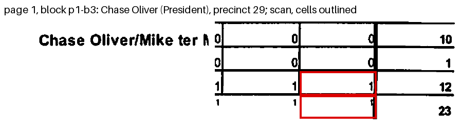

- Precinct 29, votes: the file has 0, the scan has 1. Status settled_against_file: the three cells of precinct 29 add to the small total printed under the column; the small totals under the columns add to the grand total hold(s) with the scan's value and fail(s) with the file's, and no printed total holds with the file's value and fails with the scan's Changed in the corrected file.
  - the three cells of precinct 29 add to the small total printed under the column: printed 1; with the scan's value the cells add to 1 (holds); with the file's value they add to 1 (does not hold).
  - the small totals under the columns add to the grand total: printed 23; with the scan's value the cells add to 23 (holds); with the file's value they add to 22 (does not hold).
- Precinct 29, election_day: the file has 0, the scan has 1. Status settled_against_file: the PRECINCT cells across the page add to the row total printed at the right end of the row; the three cells of precinct 29 add to the small total printed under the column hold(s) with the scan's value and fail(s) with the file's, and no printed total holds with the file's value and fails with the scan's Changed in the corrected file.
  - the PRECINCT cells across the page add to the row total printed at the right end of the row: printed 12; with the scan's value the cells add to 12 (holds); with the file's value they add to 11 (does not hold).
  - the three cells of precinct 29 add to the small total printed under the column: printed 1; with the scan's value the cells add to 1 (holds); with the file's value they add to 0 (does not hold).

### g004: wrong_precinct, Jill Stein, precinct 2, 3

President. Page 1, block p1-b4. Statuses: settled_against_file 4.

Move the same 1 rows of values, each labelled 1 precinct earlier than where the scan has it, back to the precinct the scan puts them under, and 1 more row(s) of the group have no counterpart (see the missing and extra rows).

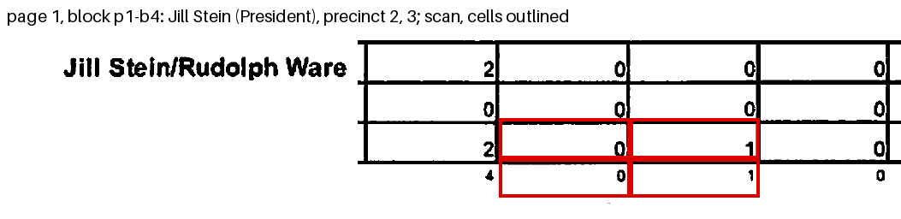

- Precinct 2, votes: the file has 1, the scan has 0. Status settled_against_file: the three cells of precinct 2 add to the small total printed under the column; the small totals under the columns add to the grand total hold(s) with the scan's value and fail(s) with the file's, and no printed total holds with the file's value and fails with the scan's Changed in the corrected file.
  - the three cells of precinct 2 add to the small total printed under the column: printed 0; with the scan's value the cells add to 0 (holds); with the file's value they add to 0 (does not hold).
  - the small totals under the columns add to the grand total: printed 9; with the scan's value the cells add to 9 (holds); with the file's value they add to 10 (does not hold).
- Precinct 3, votes: the file has 0, the scan has 1. Status settled_against_file: the three cells of precinct 3 add to the small total printed under the column; the small totals under the columns add to the grand total hold(s) with the scan's value and fail(s) with the file's, and no printed total holds with the file's value and fails with the scan's Changed in the corrected file.
  - the three cells of precinct 3 add to the small total printed under the column: printed 1; with the scan's value the cells add to 1 (holds); with the file's value they add to 1 (does not hold).
  - the small totals under the columns add to the grand total: printed 9; with the scan's value the cells add to 9 (holds); with the file's value they add to 8 (does not hold).
- Precinct 2, election_day: the file has 1, the scan has 0. Status settled_against_file: the PRECINCT cells across the page add to the row total printed at the right end of the row; the three cells of precinct 2 add to the small total printed under the column hold(s) with the scan's value and fail(s) with the file's, and no printed total holds with the file's value and fails with the scan's Changed in the corrected file.
  - the PRECINCT cells across the page add to the row total printed at the right end of the row: printed 4; with the scan's value the cells add to 4 (holds); with the file's value they add to 5 (does not hold).
  - the three cells of precinct 2 add to the small total printed under the column: printed 0; with the scan's value the cells add to 0 (holds); with the file's value they add to 1 (does not hold).
- Precinct 3, election_day: the file has 0, the scan has 1. Status settled_against_file: the PRECINCT cells across the page add to the row total printed at the right end of the row; the three cells of precinct 3 add to the small total printed under the column hold(s) with the scan's value and fail(s) with the file's, and no printed total holds with the file's value and fails with the scan's Changed in the corrected file.
  - the PRECINCT cells across the page add to the row total printed at the right end of the row: printed 4; with the scan's value the cells add to 4 (holds); with the file's value they add to 3 (does not hold).
  - the three cells of precinct 3 add to the small total printed under the column: printed 1; with the scan's value the cells add to 1 (holds); with the file's value they add to 0 (does not hold).

### g005: wrong_number, Jill Stein, precinct 18

President. Page 1, block p1-b4. Statuses: settled_against_file 2.

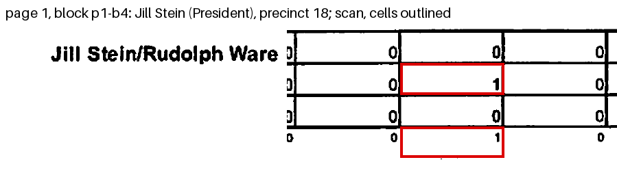

- Precinct 18, votes: the file has 0, the scan has 1. Status settled_against_file: the three cells of precinct 18 add to the small total printed under the column; the small totals under the columns add to the grand total hold(s) with the scan's value and fail(s) with the file's, and no printed total holds with the file's value and fails with the scan's Changed in the corrected file.
  - the three cells of precinct 18 add to the small total printed under the column: printed 1; with the scan's value the cells add to 1 (holds); with the file's value they add to 1 (does not hold).
  - the small totals under the columns add to the grand total: printed 9; with the scan's value the cells add to 9 (holds); with the file's value they add to 8 (does not hold).
- Precinct 18, absentee: the file has 0, the scan has 1. Status settled_against_file: the ABSENTEE cells across the page add to the row total printed at the right end of the row; the three cells of precinct 18 add to the small total printed under the column hold(s) with the scan's value and fail(s) with the file's, and no printed total holds with the file's value and fails with the scan's Changed in the corrected file.
  - the ABSENTEE cells across the page add to the row total printed at the right end of the row: printed 1; with the scan's value the cells add to 1 (holds); with the file's value they add to 0 (does not hold).
  - the three cells of precinct 18 add to the small total printed under the column: printed 1; with the scan's value the cells add to 1 (holds); with the file's value they add to 0 (does not hold).

### g006: wrong_number, Jill Stein, precinct 27

President. Page 1, block p1-b4. Statuses: settled_against_file 3.

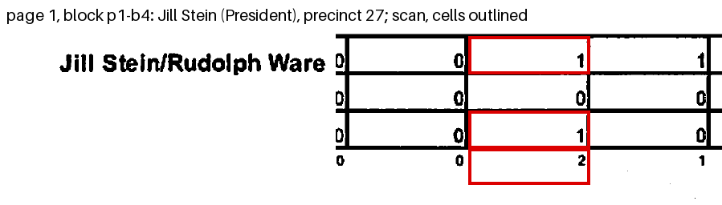

- Precinct 27, votes: the file has 0, the scan has 2. Status settled_against_file: the three cells of precinct 27 add to the small total printed under the column; the small totals under the columns add to the grand total hold(s) with the scan's value and fail(s) with the file's, and no printed total holds with the file's value and fails with the scan's Changed in the corrected file.
  - the three cells of precinct 27 add to the small total printed under the column: printed 2; with the scan's value the cells add to 2 (holds); with the file's value they add to 2 (does not hold).
  - the small totals under the columns add to the grand total: printed 9; with the scan's value the cells add to 9 (holds); with the file's value they add to 7 (does not hold).
- Precinct 27, early_voting: the file has 0, the scan has 1. Status settled_against_file: the EARLY cells across the page add to the row total printed at the right end of the row; the three cells of precinct 27 add to the small total printed under the column hold(s) with the scan's value and fail(s) with the file's, and no printed total holds with the file's value and fails with the scan's Changed in the corrected file.
  - the EARLY cells across the page add to the row total printed at the right end of the row: printed 4; with the scan's value the cells add to 4 (holds); with the file's value they add to 3 (does not hold).
  - the three cells of precinct 27 add to the small total printed under the column: printed 2; with the scan's value the cells add to 2 (holds); with the file's value they add to 1 (does not hold).
- Precinct 27, election_day: the file has 0, the scan has 1. Status settled_against_file: the PRECINCT cells across the page add to the row total printed at the right end of the row; the three cells of precinct 27 add to the small total printed under the column hold(s) with the scan's value and fail(s) with the file's, and no printed total holds with the file's value and fails with the scan's Changed in the corrected file.
  - the PRECINCT cells across the page add to the row total printed at the right end of the row: printed 4; with the scan's value the cells add to 4 (holds); with the file's value they add to 3 (does not hold).
  - the three cells of precinct 27 add to the small total printed under the column: printed 2; with the scan's value the cells add to 2 (holds); with the file's value they add to 1 (does not hold).

### g007: wrong_number, Jill Stein, precinct 28

President. Page 1, block p1-b4. Statuses: settled_against_file 3.

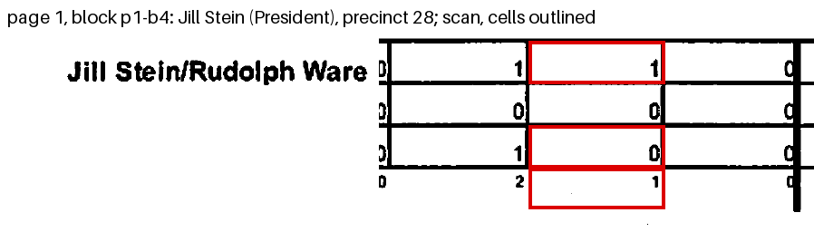

- Precinct 28, votes: the file has 4, the scan has 1. Status settled_against_file: the three cells of precinct 28 add to the small total printed under the column; the small totals under the columns add to the grand total hold(s) with the scan's value and fail(s) with the file's, and no printed total holds with the file's value and fails with the scan's Changed in the corrected file.
  - the three cells of precinct 28 add to the small total printed under the column: printed 1; with the scan's value the cells add to 1 (holds); with the file's value they add to 1 (does not hold).
  - the small totals under the columns add to the grand total: printed 9; with the scan's value the cells add to 9 (holds); with the file's value they add to 12 (does not hold).
- Precinct 28, early_voting: the file has 0, the scan has 1. Status settled_against_file: the EARLY cells across the page add to the row total printed at the right end of the row; the three cells of precinct 28 add to the small total printed under the column hold(s) with the scan's value and fail(s) with the file's, and no printed total holds with the file's value and fails with the scan's Changed in the corrected file.
  - the EARLY cells across the page add to the row total printed at the right end of the row: printed 4; with the scan's value the cells add to 4 (holds); with the file's value they add to 3 (does not hold).
  - the three cells of precinct 28 add to the small total printed under the column: printed 1; with the scan's value the cells add to 1 (holds); with the file's value they add to 0 (does not hold).
- Precinct 28, election_day: the file has 4, the scan has 0. Status settled_against_file: the PRECINCT cells across the page add to the row total printed at the right end of the row; the three cells of precinct 28 add to the small total printed under the column hold(s) with the scan's value and fail(s) with the file's, and no printed total holds with the file's value and fails with the scan's Changed in the corrected file.
  - the PRECINCT cells across the page add to the row total printed at the right end of the row: printed 4; with the scan's value the cells add to 4 (holds); with the file's value they add to 8 (does not hold).
  - the three cells of precinct 28 add to the small total printed under the column: printed 1; with the scan's value the cells add to 1 (holds); with the file's value they add to 5 (does not hold).

### g008: wrong_precinct, Peter Sonski, precinct 9, 28

President. Page 2, block p2-b2. Statuses: settled_against_file 4.

Move the same 1 rows of values, each labelled 11 precincts later than where the scan has it, back to the precinct the scan puts them under, and 1 more row(s) of the group have no counterpart (see the missing and extra rows).

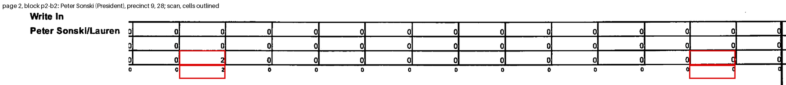

- Precinct 9, votes: the file has 0, the scan has 2. Status settled_against_file: the three cells of precinct 9 add to the small total printed under the column; the small totals under the columns add to the grand total hold(s) with the scan's value and fail(s) with the file's, and no printed total holds with the file's value and fails with the scan's Changed in the corrected file.
  - the three cells of precinct 9 add to the small total printed under the column: printed 2; with the scan's value the cells add to 2 (holds); with the file's value they add to 2 (does not hold).
  - the small totals under the columns add to the grand total: printed 2; with the scan's value the cells add to 2 (holds); with the file's value they add to 0 (does not hold).
- Precinct 28, votes: the file has 2, the scan has 0. Status settled_against_file: the three cells of precinct 28 add to the small total printed under the column; the small totals under the columns add to the grand total hold(s) with the scan's value and fail(s) with the file's, and no printed total holds with the file's value and fails with the scan's Changed in the corrected file.
  - the three cells of precinct 28 add to the small total printed under the column: printed 0; with the scan's value the cells add to 0 (holds); with the file's value they add to 0 (does not hold).
  - the small totals under the columns add to the grand total: printed 2; with the scan's value the cells add to 2 (holds); with the file's value they add to 4 (does not hold).
- Precinct 9, election_day: the file has 0, the scan has 2. Status settled_against_file: the PRECINCT cells across the page add to the row total printed at the right end of the row; the three cells of precinct 9 add to the small total printed under the column hold(s) with the scan's value and fail(s) with the file's, and no printed total holds with the file's value and fails with the scan's Changed in the corrected file.
  - the PRECINCT cells across the page add to the row total printed at the right end of the row: printed 2; with the scan's value the cells add to 2 (holds); with the file's value they add to 0 (does not hold).
  - the three cells of precinct 9 add to the small total printed under the column: printed 2; with the scan's value the cells add to 2 (holds); with the file's value they add to 0 (does not hold).
- Precinct 28, election_day: the file has 2, the scan has 0. Status settled_against_file: the PRECINCT cells across the page add to the row total printed at the right end of the row; the three cells of precinct 28 add to the small total printed under the column hold(s) with the scan's value and fail(s) with the file's, and no printed total holds with the file's value and fails with the scan's Changed in the corrected file.
  - the PRECINCT cells across the page add to the row total printed at the right end of the row: printed 2; with the scan's value the cells add to 2 (holds); with the file's value they add to 4 (does not hold).
  - the three cells of precinct 28 add to the small total printed under the column: printed 0; with the scan's value the cells add to 0 (holds); with the file's value they add to 2 (does not hold).

### g009: wrong_number, Ted Brown, precinct 29

U.S. Senate. Page 2, block p2-b6. Statuses: settled_against_file 2.

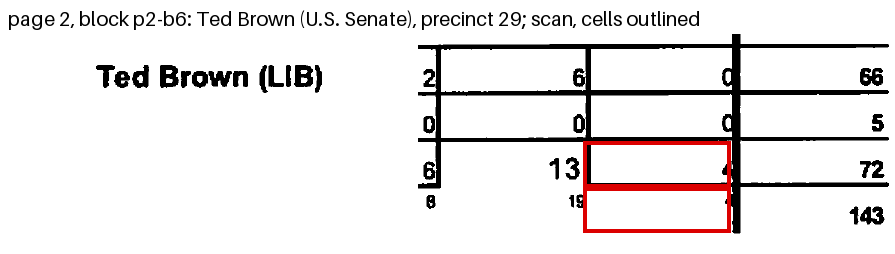

- Precinct 29, votes: the file has 0, the scan has 4. Status settled_against_file: the three cells of precinct 29 add to the small total printed under the column; the small totals under the columns add to the grand total hold(s) with the scan's value and fail(s) with the file's, and no printed total holds with the file's value and fails with the scan's Changed in the corrected file.
  - the three cells of precinct 29 add to the small total printed under the column: printed 4; with the scan's value the cells add to 4 (holds); with the file's value they add to 4 (does not hold).
  - the small totals under the columns add to the grand total: printed 143; with the scan's value the cells add to 143 (holds); with the file's value they add to 139 (does not hold).
- Precinct 29, election_day: the file has 0, the scan has 4. Status settled_against_file: the PRECINCT cells across the page add to the row total printed at the right end of the row; the three cells of precinct 29 add to the small total printed under the column hold(s) with the scan's value and fail(s) with the file's, and no printed total holds with the file's value and fails with the scan's Changed in the corrected file.
  - the PRECINCT cells across the page add to the row total printed at the right end of the row: printed 72; with the scan's value the cells add to 72 (holds); with the file's value they add to 68 (does not hold).
  - the three cells of precinct 29 add to the small total printed under the column: printed 4; with the scan's value the cells add to 4 (holds); with the file's value they add to 0 (does not hold).

### g010: wrong_number, Hawk Dunlap, precinct 12

Railroad Commissioner. Page 3, block p3-b3. Statuses: settled_against_file 2.

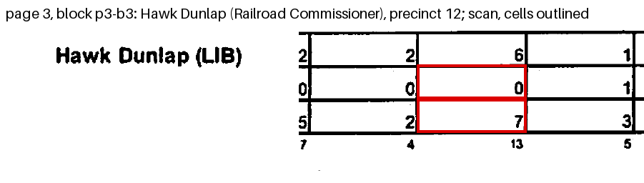

- Precinct 12, absentee: the file has 3, the scan has 0. Status settled_against_file: the ABSENTEE cells across the page add to the row total printed at the right end of the row; the three cells of precinct 12 add to the small total printed under the column hold(s) with the scan's value and fail(s) with the file's, and no printed total holds with the file's value and fails with the scan's Changed in the corrected file.
  - the ABSENTEE cells across the page add to the row total printed at the right end of the row: printed 6; with the scan's value the cells add to 6 (holds); with the file's value they add to 9 (does not hold).
  - the three cells of precinct 12 add to the small total printed under the column: printed 13; with the scan's value the cells add to 13 (holds); with the file's value they add to 16 (does not hold).
- Precinct 12, election_day: the file has 4, the scan has 7. Status settled_against_file: the PRECINCT cells across the page add to the row total printed at the right end of the row; the three cells of precinct 12 add to the small total printed under the column hold(s) with the scan's value and fail(s) with the file's, and no printed total holds with the file's value and fails with the scan's Changed in the corrected file.
  - the PRECINCT cells across the page add to the row total printed at the right end of the row: printed 129; with the scan's value the cells add to 129 (holds); with the file's value they add to 126 (does not hold).
  - the three cells of precinct 12 add to the small total printed under the column: printed 13; with the scan's value the cells add to 13 (holds); with the file's value they add to 10 (does not hold).

### g011: wrong_number, Hawk Dunlap, precinct 13

Railroad Commissioner. Page 3, block p3-b3. Statuses: settled_against_file 2.

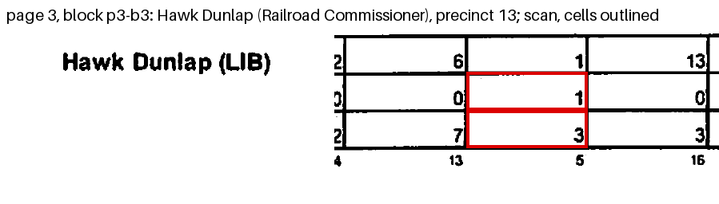

- Precinct 13, absentee: the file has 0, the scan has 1. Status settled_against_file: the ABSENTEE cells across the page add to the row total printed at the right end of the row; the three cells of precinct 13 add to the small total printed under the column hold(s) with the scan's value and fail(s) with the file's, and no printed total holds with the file's value and fails with the scan's Changed in the corrected file.
  - the ABSENTEE cells across the page add to the row total printed at the right end of the row: printed 6; with the scan's value the cells add to 6 (holds); with the file's value they add to 5 (does not hold).
  - the three cells of precinct 13 add to the small total printed under the column: printed 5; with the scan's value the cells add to 5 (holds); with the file's value they add to 4 (does not hold).
- Precinct 13, election_day: the file has 4, the scan has 3. Status settled_against_file: the PRECINCT cells across the page add to the row total printed at the right end of the row; the three cells of precinct 13 add to the small total printed under the column hold(s) with the scan's value and fail(s) with the file's, and no printed total holds with the file's value and fails with the scan's Changed in the corrected file.
  - the PRECINCT cells across the page add to the row total printed at the right end of the row: printed 129; with the scan's value the cells add to 129 (holds); with the file's value they add to 130 (does not hold).
  - the three cells of precinct 13 add to the small total printed under the column: printed 5; with the scan's value the cells add to 5 (holds); with the file's value they add to 6 (does not hold).

### g012: wrong_number, Hawk Dunlap, precinct 14

Railroad Commissioner. Page 3, block p3-b3. Statuses: settled_against_file 3.

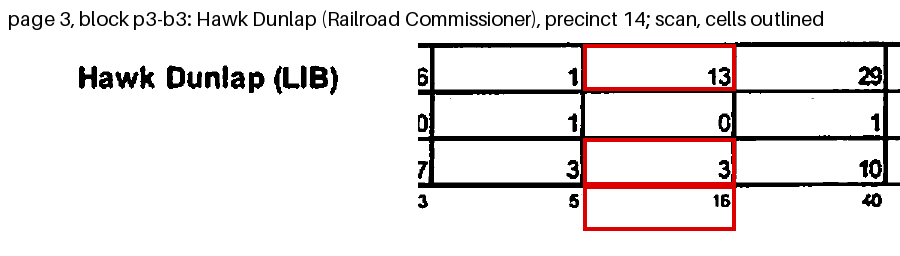

- Precinct 14, votes: the file has 7, the scan has 16. Status settled_against_file: the three cells of precinct 14 add to the small total printed under the column; the small totals under the columns add to the grand total hold(s) with the scan's value and fail(s) with the file's, and no printed total holds with the file's value and fails with the scan's Changed in the corrected file.
  - the three cells of precinct 14 add to the small total printed under the column: printed 16; with the scan's value the cells add to 16 (holds); with the file's value they add to 16 (does not hold).
  - the small totals under the columns add to the grand total: printed 364; with the scan's value the cells add to 364 (holds); with the file's value they add to 355 (does not hold).
- Precinct 14, early_voting: the file has 3, the scan has 13. Status settled_against_file: the EARLY cells across the page add to the row total printed at the right end of the row; the three cells of precinct 14 add to the small total printed under the column hold(s) with the scan's value and fail(s) with the file's, and no printed total holds with the file's value and fails with the scan's Changed in the corrected file.
  - the EARLY cells across the page add to the row total printed at the right end of the row: printed 229; with the scan's value the cells add to 229 (holds); with the file's value they add to 219 (does not hold).
  - the three cells of precinct 14 add to the small total printed under the column: printed 16; with the scan's value the cells add to 16 (holds); with the file's value they add to 6 (does not hold).
- Precinct 14, election_day: the file has 4, the scan has 3. Status settled_against_file: the PRECINCT cells across the page add to the row total printed at the right end of the row; the three cells of precinct 14 add to the small total printed under the column hold(s) with the scan's value and fail(s) with the file's, and no printed total holds with the file's value and fails with the scan's Changed in the corrected file.
  - the PRECINCT cells across the page add to the row total printed at the right end of the row: printed 129; with the scan's value the cells add to 129 (holds); with the file's value they add to 130 (does not hold).
  - the three cells of precinct 14 add to the small total printed under the column: printed 16; with the scan's value the cells add to 16 (holds); with the file's value they add to 17 (does not hold).

### g013: wrong_number, Hawk Dunlap, precinct 18

Railroad Commissioner. Page 3, block p3-b3. Statuses: settled_against_file 2.

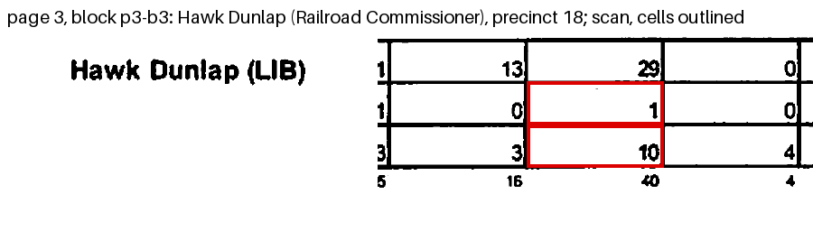

- Precinct 18, absentee: the file has 2, the scan has 1. Status settled_against_file: the ABSENTEE cells across the page add to the row total printed at the right end of the row; the three cells of precinct 18 add to the small total printed under the column hold(s) with the scan's value and fail(s) with the file's, and no printed total holds with the file's value and fails with the scan's Changed in the corrected file.
  - the ABSENTEE cells across the page add to the row total printed at the right end of the row: printed 6; with the scan's value the cells add to 6 (holds); with the file's value they add to 7 (does not hold).
  - the three cells of precinct 18 add to the small total printed under the column: printed 40; with the scan's value the cells add to 40 (holds); with the file's value they add to 41 (does not hold).
- Precinct 18, election_day: the file has 9, the scan has 10. Status settled_against_file: the PRECINCT cells across the page add to the row total printed at the right end of the row; the three cells of precinct 18 add to the small total printed under the column hold(s) with the scan's value and fail(s) with the file's, and no printed total holds with the file's value and fails with the scan's Changed in the corrected file.
  - the PRECINCT cells across the page add to the row total printed at the right end of the row: printed 129; with the scan's value the cells add to 129 (holds); with the file's value they add to 128 (does not hold).
  - the three cells of precinct 18 add to the small total printed under the column: printed 40; with the scan's value the cells add to 40 (holds); with the file's value they add to 39 (does not hold).

### g014: wrong_number, Hawk Dunlap, precinct 27

Railroad Commissioner. Page 3, block p3-b3. Statuses: settled_against_file 2.

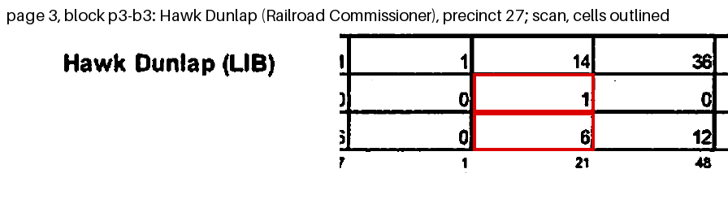

- Precinct 27, absentee: the file has 0, the scan has 1. Status settled_against_file: the ABSENTEE cells across the page add to the row total printed at the right end of the row; the three cells of precinct 27 add to the small total printed under the column hold(s) with the scan's value and fail(s) with the file's, and no printed total holds with the file's value and fails with the scan's Changed in the corrected file.
  - the ABSENTEE cells across the page add to the row total printed at the right end of the row: printed 6; with the scan's value the cells add to 6 (holds); with the file's value they add to 5 (does not hold).
  - the three cells of precinct 27 add to the small total printed under the column: printed 21; with the scan's value the cells add to 21 (holds); with the file's value they add to 20 (does not hold).
- Precinct 27, election_day: the file has 7, the scan has 6. Status settled_against_file: the PRECINCT cells across the page add to the row total printed at the right end of the row; the three cells of precinct 27 add to the small total printed under the column hold(s) with the scan's value and fail(s) with the file's, and no printed total holds with the file's value and fails with the scan's Changed in the corrected file.
  - the PRECINCT cells across the page add to the row total printed at the right end of the row: printed 129; with the scan's value the cells add to 129 (holds); with the file's value they add to 130 (does not hold).
  - the three cells of precinct 27 add to the small total printed under the column: printed 21; with the scan's value the cells add to 21 (holds); with the file's value they add to 22 (does not hold).

### g015: wrong_number, Hawk Dunlap, precinct 29

Railroad Commissioner. Page 3, block p3-b3. Statuses: settled_against_file 3.

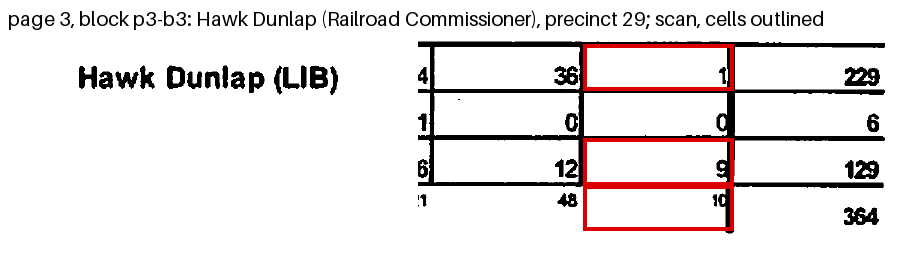

- Precinct 29, votes: the file has 0, the scan has 10. Status settled_against_file: the three cells of precinct 29 add to the small total printed under the column; the small totals under the columns add to the grand total hold(s) with the scan's value and fail(s) with the file's, and no printed total holds with the file's value and fails with the scan's Changed in the corrected file.
  - the three cells of precinct 29 add to the small total printed under the column: printed 10; with the scan's value the cells add to 10 (holds); with the file's value they add to 10 (does not hold).
  - the small totals under the columns add to the grand total: printed 364; with the scan's value the cells add to 364 (holds); with the file's value they add to 354 (does not hold).
- Precinct 29, early_voting: the file has 0, the scan has 1. Status settled_against_file: the EARLY cells across the page add to the row total printed at the right end of the row; the three cells of precinct 29 add to the small total printed under the column hold(s) with the scan's value and fail(s) with the file's, and no printed total holds with the file's value and fails with the scan's Changed in the corrected file.
  - the EARLY cells across the page add to the row total printed at the right end of the row: printed 229; with the scan's value the cells add to 229 (holds); with the file's value they add to 228 (does not hold).
  - the three cells of precinct 29 add to the small total printed under the column: printed 10; with the scan's value the cells add to 10 (holds); with the file's value they add to 9 (does not hold).
- Precinct 29, election_day: the file has 0, the scan has 9. Status settled_against_file: the PRECINCT cells across the page add to the row total printed at the right end of the row; the three cells of precinct 29 add to the small total printed under the column hold(s) with the scan's value and fail(s) with the file's, and no printed total holds with the file's value and fails with the scan's Changed in the corrected file.
  - the PRECINCT cells across the page add to the row total printed at the right end of the row: printed 129; with the scan's value the cells add to 129 (holds); with the file's value they add to 120 (does not hold).
  - the three cells of precinct 29 add to the small total printed under the column: printed 10; with the scan's value the cells add to 10 (holds); with the file's value they add to 1 (does not hold).

### g016: wrong_number, Eddie Espinoza, precinct 2

Railroad Commissioner. Page 3, block p3-b4. Statuses: settled_against_file 2.

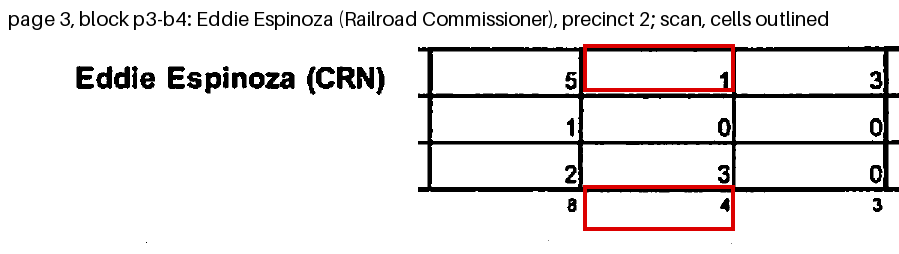

- Precinct 2, votes: the file has 6, the scan has 4. Status settled_against_file: the three cells of precinct 2 add to the small total printed under the column; the small totals under the columns add to the grand total hold(s) with the scan's value and fail(s) with the file's, and no printed total holds with the file's value and fails with the scan's Changed in the corrected file.
  - the three cells of precinct 2 add to the small total printed under the column: printed 4; with the scan's value the cells add to 4 (holds); with the file's value they add to 4 (does not hold).
  - the small totals under the columns add to the grand total: printed 58; with the scan's value the cells add to 58 (holds); with the file's value they add to 60 (does not hold).
- Precinct 2, early_voting: the file has 3, the scan has 1. Status settled_against_file: the EARLY cells across the page add to the row total printed at the right end of the row; the three cells of precinct 2 add to the small total printed under the column hold(s) with the scan's value and fail(s) with the file's, and no printed total holds with the file's value and fails with the scan's Changed in the corrected file.
  - the EARLY cells across the page add to the row total printed at the right end of the row: printed 28; with the scan's value the cells add to 28 (holds); with the file's value they add to 30 (does not hold).
  - the three cells of precinct 2 add to the small total printed under the column: printed 4; with the scan's value the cells add to 4 (holds); with the file's value they add to 6 (does not hold).

### g017: wrong_number, Eddie Espinoza, precinct 3

Railroad Commissioner. Page 3, block p3-b4. Statuses: settled_against_file 2.

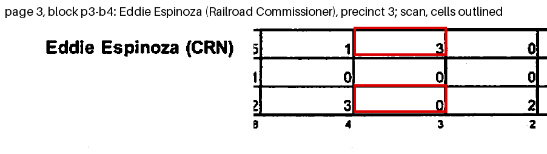

- Precinct 3, early_voting: the file has 1, the scan has 3. Status settled_against_file: the EARLY cells across the page add to the row total printed at the right end of the row; the three cells of precinct 3 add to the small total printed under the column hold(s) with the scan's value and fail(s) with the file's, and no printed total holds with the file's value and fails with the scan's Changed in the corrected file.
  - the EARLY cells across the page add to the row total printed at the right end of the row: printed 28; with the scan's value the cells add to 28 (holds); with the file's value they add to 26 (does not hold).
  - the three cells of precinct 3 add to the small total printed under the column: printed 3; with the scan's value the cells add to 3 (holds); with the file's value they add to 1 (does not hold).
- Precinct 3, election_day: the file has 2, the scan has 0. Status settled_against_file: the PRECINCT cells across the page add to the row total printed at the right end of the row; the three cells of precinct 3 add to the small total printed under the column hold(s) with the scan's value and fail(s) with the file's, and no printed total holds with the file's value and fails with the scan's Changed in the corrected file.
  - the PRECINCT cells across the page add to the row total printed at the right end of the row: printed 29; with the scan's value the cells add to 29 (holds); with the file's value they add to 31 (does not hold).
  - the three cells of precinct 3 add to the small total printed under the column: printed 3; with the scan's value the cells add to 3 (holds); with the file's value they add to 5 (does not hold).

### g018: wrong_number, Eddie Espinoza, precinct 7

Railroad Commissioner. Page 3, block p3-b4. Statuses: settled_against_file 2.

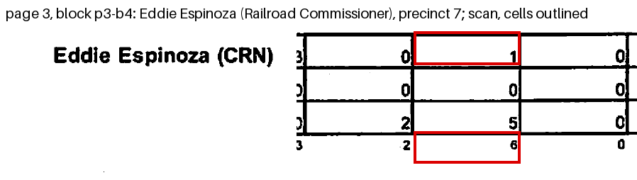

- Precinct 7, votes: the file has 5, the scan has 6. Status settled_against_file: the three cells of precinct 7 add to the small total printed under the column; the small totals under the columns add to the grand total hold(s) with the scan's value and fail(s) with the file's, and no printed total holds with the file's value and fails with the scan's Changed in the corrected file.
  - the three cells of precinct 7 add to the small total printed under the column: printed 6; with the scan's value the cells add to 6 (holds); with the file's value they add to 6 (does not hold).
  - the small totals under the columns add to the grand total: printed 58; with the scan's value the cells add to 58 (holds); with the file's value they add to 57 (does not hold).
- Precinct 7, early_voting: the file has 0, the scan has 1. Status settled_against_file: the EARLY cells across the page add to the row total printed at the right end of the row; the three cells of precinct 7 add to the small total printed under the column hold(s) with the scan's value and fail(s) with the file's, and no printed total holds with the file's value and fails with the scan's Changed in the corrected file.
  - the EARLY cells across the page add to the row total printed at the right end of the row: printed 28; with the scan's value the cells add to 28 (holds); with the file's value they add to 27 (does not hold).
  - the three cells of precinct 7 add to the small total printed under the column: printed 6; with the scan's value the cells add to 6 (holds); with the file's value they add to 5 (does not hold).

### g019: wrong_number, Eddie Espinoza, precinct 9

Railroad Commissioner. Page 3, block p3-b4. Statuses: settled_against_file 2.

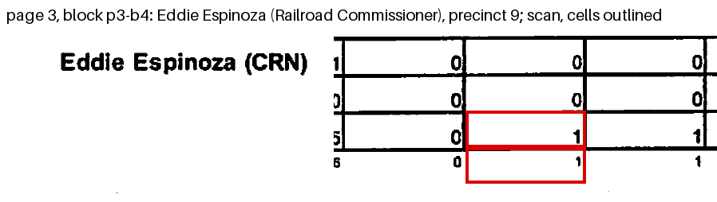

- Precinct 9, votes: the file has 6, the scan has 1. Status settled_against_file: the three cells of precinct 9 add to the small total printed under the column; the small totals under the columns add to the grand total hold(s) with the scan's value and fail(s) with the file's, and no printed total holds with the file's value and fails with the scan's Changed in the corrected file.
  - the three cells of precinct 9 add to the small total printed under the column: printed 1; with the scan's value the cells add to 1 (holds); with the file's value they add to 1 (does not hold).
  - the small totals under the columns add to the grand total: printed 58; with the scan's value the cells add to 58 (holds); with the file's value they add to 63 (does not hold).
- Precinct 9, election_day: the file has 6, the scan has 1. Status settled_against_file: the PRECINCT cells across the page add to the row total printed at the right end of the row; the three cells of precinct 9 add to the small total printed under the column hold(s) with the scan's value and fail(s) with the file's, and no printed total holds with the file's value and fails with the scan's Changed in the corrected file.
  - the PRECINCT cells across the page add to the row total printed at the right end of the row: printed 29; with the scan's value the cells add to 29 (holds); with the file's value they add to 34 (does not hold).
  - the three cells of precinct 9 add to the small total printed under the column: printed 1; with the scan's value the cells add to 1 (holds); with the file's value they add to 6 (does not hold).

### g020: wrong_number, Eddie Espinoza, precinct 13

Railroad Commissioner. Page 3, block p3-b4. Statuses: settled_against_file 2.

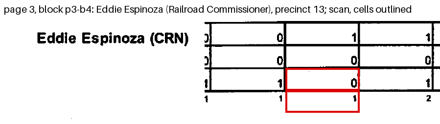

- Precinct 13, votes: the file has 3, the scan has 1. Status settled_against_file: the three cells of precinct 13 add to the small total printed under the column; the small totals under the columns add to the grand total hold(s) with the scan's value and fail(s) with the file's, and no printed total holds with the file's value and fails with the scan's Changed in the corrected file.
  - the three cells of precinct 13 add to the small total printed under the column: printed 1; with the scan's value the cells add to 1 (holds); with the file's value they add to 1 (does not hold).
  - the small totals under the columns add to the grand total: printed 58; with the scan's value the cells add to 58 (holds); with the file's value they add to 60 (does not hold).
- Precinct 13, election_day: the file has 2, the scan has 0. Status settled_against_file: the PRECINCT cells across the page add to the row total printed at the right end of the row; the three cells of precinct 13 add to the small total printed under the column hold(s) with the scan's value and fail(s) with the file's, and no printed total holds with the file's value and fails with the scan's Changed in the corrected file.
  - the PRECINCT cells across the page add to the row total printed at the right end of the row: printed 29; with the scan's value the cells add to 29 (holds); with the file's value they add to 31 (does not hold).
  - the three cells of precinct 13 add to the small total printed under the column: printed 1; with the scan's value the cells add to 1 (holds); with the file's value they add to 3 (does not hold).

### g021: wrong_number, Eddie Espinoza, precinct 14

Railroad Commissioner. Page 3, block p3-b4. Statuses: settled_against_file 3.

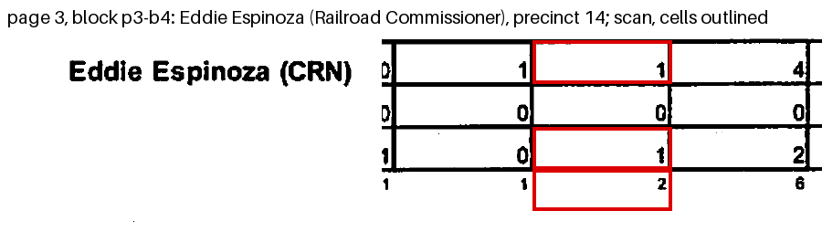

- Precinct 14, votes: the file has 0, the scan has 2. Status settled_against_file: the three cells of precinct 14 add to the small total printed under the column; the small totals under the columns add to the grand total hold(s) with the scan's value and fail(s) with the file's, and no printed total holds with the file's value and fails with the scan's Changed in the corrected file.
  - the three cells of precinct 14 add to the small total printed under the column: printed 2; with the scan's value the cells add to 2 (holds); with the file's value they add to 2 (does not hold).
  - the small totals under the columns add to the grand total: printed 58; with the scan's value the cells add to 58 (holds); with the file's value they add to 56 (does not hold).
- Precinct 14, early_voting: the file has 0, the scan has 1. Status settled_against_file: the EARLY cells across the page add to the row total printed at the right end of the row; the three cells of precinct 14 add to the small total printed under the column hold(s) with the scan's value and fail(s) with the file's, and no printed total holds with the file's value and fails with the scan's Changed in the corrected file.
  - the EARLY cells across the page add to the row total printed at the right end of the row: printed 28; with the scan's value the cells add to 28 (holds); with the file's value they add to 27 (does not hold).
  - the three cells of precinct 14 add to the small total printed under the column: printed 2; with the scan's value the cells add to 2 (holds); with the file's value they add to 1 (does not hold).
- Precinct 14, election_day: the file has 0, the scan has 1. Status settled_against_file: the PRECINCT cells across the page add to the row total printed at the right end of the row; the three cells of precinct 14 add to the small total printed under the column hold(s) with the scan's value and fail(s) with the file's, and no printed total holds with the file's value and fails with the scan's Changed in the corrected file.
  - the PRECINCT cells across the page add to the row total printed at the right end of the row: printed 29; with the scan's value the cells add to 29 (holds); with the file's value they add to 28 (does not hold).
  - the three cells of precinct 14 add to the small total printed under the column: printed 2; with the scan's value the cells add to 2 (holds); with the file's value they add to 1 (does not hold).

### g022: wrong_number, Eddie Espinoza, precinct 18

Railroad Commissioner. Page 3, block p3-b4. Statuses: settled_against_file 3.

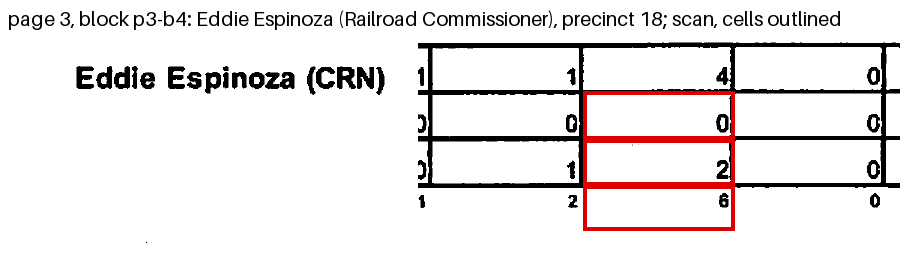

- Precinct 18, votes: the file has 9, the scan has 6. Status settled_against_file: the three cells of precinct 18 add to the small total printed under the column; the small totals under the columns add to the grand total hold(s) with the scan's value and fail(s) with the file's, and no printed total holds with the file's value and fails with the scan's Changed in the corrected file.
  - the three cells of precinct 18 add to the small total printed under the column: printed 6; with the scan's value the cells add to 6 (holds); with the file's value they add to 6 (does not hold).
  - the small totals under the columns add to the grand total: printed 58; with the scan's value the cells add to 58 (holds); with the file's value they add to 61 (does not hold).
- Precinct 18, absentee: the file has 1, the scan has 0. Status settled_against_file: the ABSENTEE cells across the page add to the row total printed at the right end of the row; the three cells of precinct 18 add to the small total printed under the column hold(s) with the scan's value and fail(s) with the file's, and no printed total holds with the file's value and fails with the scan's Changed in the corrected file.
  - the ABSENTEE cells across the page add to the row total printed at the right end of the row: printed 1; with the scan's value the cells add to 1 (holds); with the file's value they add to 2 (does not hold).
  - the three cells of precinct 18 add to the small total printed under the column: printed 6; with the scan's value the cells add to 6 (holds); with the file's value they add to 7 (does not hold).
- Precinct 18, election_day: the file has 4, the scan has 2. Status settled_against_file: the PRECINCT cells across the page add to the row total printed at the right end of the row; the three cells of precinct 18 add to the small total printed under the column hold(s) with the scan's value and fail(s) with the file's, and no printed total holds with the file's value and fails with the scan's Changed in the corrected file.
  - the PRECINCT cells across the page add to the row total printed at the right end of the row: printed 29; with the scan's value the cells add to 29 (holds); with the file's value they add to 31 (does not hold).
  - the three cells of precinct 18 add to the small total printed under the column: printed 6; with the scan's value the cells add to 6 (holds); with the file's value they add to 8 (does not hold).

### g023: wrong_number, Eddie Espinoza, precinct 27

Railroad Commissioner. Page 3, block p3-b4. Statuses: settled_against_file 2.

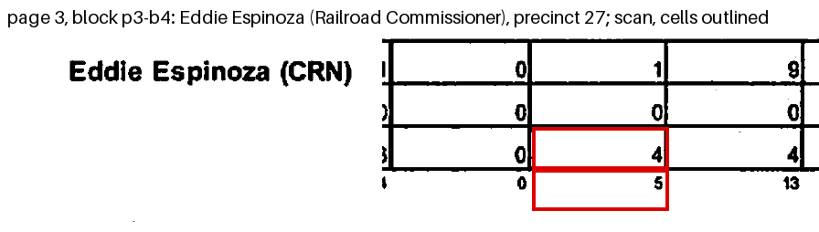

- Precinct 27, votes: the file has 1, the scan has 5. Status settled_against_file: the three cells of precinct 27 add to the small total printed under the column; the small totals under the columns add to the grand total hold(s) with the scan's value and fail(s) with the file's, and no printed total holds with the file's value and fails with the scan's Changed in the corrected file.
  - the three cells of precinct 27 add to the small total printed under the column: printed 5; with the scan's value the cells add to 5 (holds); with the file's value they add to 5 (does not hold).
  - the small totals under the columns add to the grand total: printed 58; with the scan's value the cells add to 58 (holds); with the file's value they add to 54 (does not hold).
- Precinct 27, election_day: the file has 0, the scan has 4. Status settled_against_file: the PRECINCT cells across the page add to the row total printed at the right end of the row; the three cells of precinct 27 add to the small total printed under the column hold(s) with the scan's value and fail(s) with the file's, and no printed total holds with the file's value and fails with the scan's Changed in the corrected file.
  - the PRECINCT cells across the page add to the row total printed at the right end of the row: printed 29; with the scan's value the cells add to 29 (holds); with the file's value they add to 25 (does not hold).
  - the three cells of precinct 27 add to the small total printed under the column: printed 5; with the scan's value the cells add to 5 (holds); with the file's value they add to 1 (does not hold).

### g024: wrong_number, Eddie Espinoza, precinct 28

Railroad Commissioner. Page 3, block p3-b4. Statuses: settled_against_file 3.

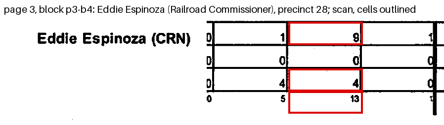

- Precinct 28, votes: the file has 9, the scan has 13. Status settled_against_file: the three cells of precinct 28 add to the small total printed under the column; the small totals under the columns add to the grand total hold(s) with the scan's value and fail(s) with the file's, and no printed total holds with the file's value and fails with the scan's Changed in the corrected file.
  - the three cells of precinct 28 add to the small total printed under the column: printed 13; with the scan's value the cells add to 13 (holds); with the file's value they add to 13 (does not hold).
  - the small totals under the columns add to the grand total: printed 58; with the scan's value the cells add to 58 (holds); with the file's value they add to 54 (does not hold).
- Precinct 28, early_voting: the file has 0, the scan has 9. Status settled_against_file: the EARLY cells across the page add to the row total printed at the right end of the row; the three cells of precinct 28 add to the small total printed under the column hold(s) with the scan's value and fail(s) with the file's, and no printed total holds with the file's value and fails with the scan's Changed in the corrected file.
  - the EARLY cells across the page add to the row total printed at the right end of the row: printed 28; with the scan's value the cells add to 28 (holds); with the file's value they add to 19 (does not hold).
  - the three cells of precinct 28 add to the small total printed under the column: printed 13; with the scan's value the cells add to 13 (holds); with the file's value they add to 4 (does not hold).
- Precinct 28, election_day: the file has 9, the scan has 4. Status settled_against_file: the PRECINCT cells across the page add to the row total printed at the right end of the row; the three cells of precinct 28 add to the small total printed under the column hold(s) with the scan's value and fail(s) with the file's, and no printed total holds with the file's value and fails with the scan's Changed in the corrected file.
  - the PRECINCT cells across the page add to the row total printed at the right end of the row: printed 29; with the scan's value the cells add to 29 (holds); with the file's value they add to 34 (does not hold).
  - the three cells of precinct 28 add to the small total printed under the column: printed 13; with the scan's value the cells add to 13 (holds); with the file's value they add to 18 (does not hold).

### g025: wrong_number, Eddie Espinoza, precinct 29

Railroad Commissioner. Page 3, block p3-b4. Statuses: settled_against_file 2.

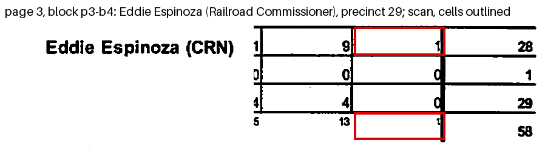

- Precinct 29, votes: the file has 0, the scan has 1. Status settled_against_file: the three cells of precinct 29 add to the small total printed under the column; the small totals under the columns add to the grand total hold(s) with the scan's value and fail(s) with the file's, and no printed total holds with the file's value and fails with the scan's Changed in the corrected file.
  - the three cells of precinct 29 add to the small total printed under the column: printed 1; with the scan's value the cells add to 1 (holds); with the file's value they add to 1 (does not hold).
  - the small totals under the columns add to the grand total: printed 58; with the scan's value the cells add to 58 (holds); with the file's value they add to 57 (does not hold).
- Precinct 29, early_voting: the file has 0, the scan has 1. Status settled_against_file: the EARLY cells across the page add to the row total printed at the right end of the row; the three cells of precinct 29 add to the small total printed under the column hold(s) with the scan's value and fail(s) with the file's, and no printed total holds with the file's value and fails with the scan's Changed in the corrected file.
  - the EARLY cells across the page add to the row total printed at the right end of the row: printed 28; with the scan's value the cells add to 28 (holds); with the file's value they add to 27 (does not hold).
  - the three cells of precinct 29 add to the small total printed under the column: printed 1; with the scan's value the cells add to 1 (holds); with the file's value they add to 0 (does not hold).

### g026: wrong_number, DaSean Jones, precinct 29

Justice, Supreme Court, Place 2. Page 4, block p4-b0. Statuses: settled_against_file 2.

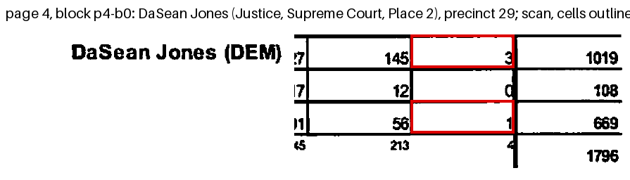

- Precinct 29, early_voting: the file has 4, the scan has 3. Status settled_against_file: the EARLY cells across the page add to the row total printed at the right end of the row; the three cells of precinct 29 add to the small total printed under the column hold(s) with the scan's value and fail(s) with the file's, and no printed total holds with the file's value and fails with the scan's Changed in the corrected file.
  - the EARLY cells across the page add to the row total printed at the right end of the row: printed 1019; with the scan's value the cells add to 1019 (holds); with the file's value they add to 1020 (does not hold).
  - the three cells of precinct 29 add to the small total printed under the column: printed 4; with the scan's value the cells add to 4 (holds); with the file's value they add to 5 (does not hold).
- Precinct 29, election_day: the file has 0, the scan has 1. Status settled_against_file: the PRECINCT cells across the page add to the row total printed at the right end of the row; the three cells of precinct 29 add to the small total printed under the column hold(s) with the scan's value and fail(s) with the file's, and no printed total holds with the file's value and fails with the scan's Changed in the corrected file.
  - the PRECINCT cells across the page add to the row total printed at the right end of the row: printed 669; with the scan's value the cells add to 669 (holds); with the file's value they add to 668 (does not hold).
  - the three cells of precinct 29 add to the small total printed under the column: printed 4; with the scan's value the cells add to 4 (holds); with the file's value they add to 3 (does not hold).

### g027: wrong_number, Christine Vinh Weems, precinct 29

Justice, Supreme Court, Place 4. Page 4, block p4-b2. Statuses: settled_against_file 2.

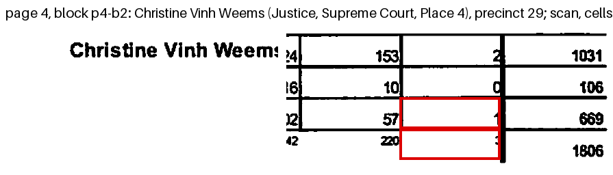

- Precinct 29, votes: the file has 2, the scan has 3. Status settled_against_file: the three cells of precinct 29 add to the small total printed under the column; the small totals under the columns add to the grand total hold(s) with the scan's value and fail(s) with the file's, and no printed total holds with the file's value and fails with the scan's Changed in the corrected file.
  - the three cells of precinct 29 add to the small total printed under the column: printed 3; with the scan's value the cells add to 3 (holds); with the file's value they add to 3 (does not hold).
  - the small totals under the columns add to the grand total: printed 1806; with the scan's value the cells add to 1806 (holds); with the file's value they add to 1805 (does not hold).
- Precinct 29, election_day: the file has 0, the scan has 1. Status settled_against_file: the PRECINCT cells across the page add to the row total printed at the right end of the row; the three cells of precinct 29 add to the small total printed under the column hold(s) with the scan's value and fail(s) with the file's, and no printed total holds with the file's value and fails with the scan's Changed in the corrected file.
  - the PRECINCT cells across the page add to the row total printed at the right end of the row: printed 669; with the scan's value the cells add to 669 (holds); with the file's value they add to 668 (does not hold).
  - the three cells of precinct 29 add to the small total printed under the column: printed 3; with the scan's value the cells add to 3 (holds); with the file's value they add to 2 (does not hold).

### g028: wrong_number, J.David Roberson, precinct 12

Justice, Supreme Court, Place 6. Page 4, block p4-b5. Statuses: settled_against_file 2.

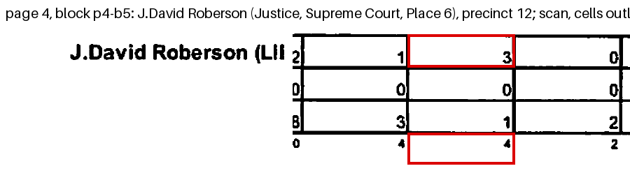

- Precinct 12, votes: the file has 2, the scan has 4. Status settled_against_file: the three cells of precinct 12 add to the small total printed under the column; the small totals under the columns add to the grand total hold(s) with the scan's value and fail(s) with the file's, and no printed total holds with the file's value and fails with the scan's Changed in the corrected file.
  - the three cells of precinct 12 add to the small total printed under the column: printed 4; with the scan's value the cells add to 4 (holds); with the file's value they add to 4 (does not hold).
  - the small totals under the columns add to the grand total: printed 200; with the scan's value the cells add to 200 (holds); with the file's value they add to 198 (does not hold).
- Precinct 12, early_voting: the file has 1, the scan has 3. Status settled_against_file: the EARLY cells across the page add to the row total printed at the right end of the row; the three cells of precinct 12 add to the small total printed under the column hold(s) with the scan's value and fail(s) with the file's, and no printed total holds with the file's value and fails with the scan's Changed in the corrected file.
  - the EARLY cells across the page add to the row total printed at the right end of the row: printed 117; with the scan's value the cells add to 117 (holds); with the file's value they add to 115 (does not hold).
  - the three cells of precinct 12 add to the small total printed under the column: printed 4; with the scan's value the cells add to 4 (holds); with the file's value they add to 2 (does not hold).

### g029: wrong_number, J.David Roberson, precinct 13

Justice, Supreme Court, Place 6. Page 4, block p4-b5. Statuses: settled_against_file 3.

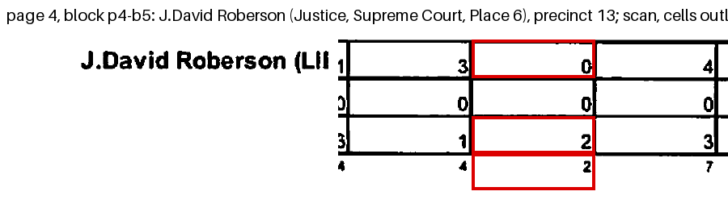

- Precinct 13, votes: the file has 7, the scan has 2. Status settled_against_file: the three cells of precinct 13 add to the small total printed under the column; the small totals under the columns add to the grand total hold(s) with the scan's value and fail(s) with the file's, and no printed total holds with the file's value and fails with the scan's Changed in the corrected file.
  - the three cells of precinct 13 add to the small total printed under the column: printed 2; with the scan's value the cells add to 2 (holds); with the file's value they add to 2 (does not hold).
  - the small totals under the columns add to the grand total: printed 200; with the scan's value the cells add to 200 (holds); with the file's value they add to 205 (does not hold).
- Precinct 13, early_voting: the file has 3, the scan has 0. Status settled_against_file: the EARLY cells across the page add to the row total printed at the right end of the row; the three cells of precinct 13 add to the small total printed under the column hold(s) with the scan's value and fail(s) with the file's, and no printed total holds with the file's value and fails with the scan's Changed in the corrected file.
  - the EARLY cells across the page add to the row total printed at the right end of the row: printed 117; with the scan's value the cells add to 117 (holds); with the file's value they add to 120 (does not hold).
  - the three cells of precinct 13 add to the small total printed under the column: printed 2; with the scan's value the cells add to 2 (holds); with the file's value they add to 5 (does not hold).
- Precinct 13, election_day: the file has 4, the scan has 2. Status settled_against_file: the PRECINCT cells across the page add to the row total printed at the right end of the row; the three cells of precinct 13 add to the small total printed under the column hold(s) with the scan's value and fail(s) with the file's, and no printed total holds with the file's value and fails with the scan's Changed in the corrected file.
  - the PRECINCT cells across the page add to the row total printed at the right end of the row: printed 80; with the scan's value the cells add to 80 (holds); with the file's value they add to 82 (does not hold).
  - the three cells of precinct 13 add to the small total printed under the column: printed 2; with the scan's value the cells add to 2 (holds); with the file's value they add to 4 (does not hold).

### g030: wrong_number, J.David Roberson, precinct 14

Justice, Supreme Court, Place 6. Page 4, block p4-b5. Statuses: settled_against_file 3.

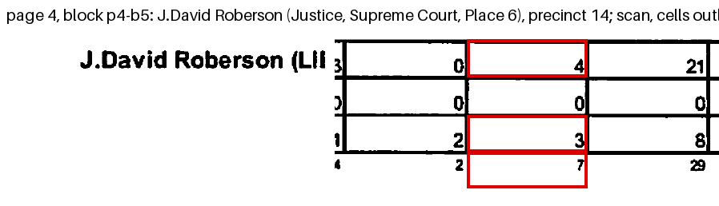

- Precinct 14, votes: the file has 4, the scan has 7. Status settled_against_file: the three cells of precinct 14 add to the small total printed under the column; the small totals under the columns add to the grand total hold(s) with the scan's value and fail(s) with the file's, and no printed total holds with the file's value and fails with the scan's Changed in the corrected file.
  - the three cells of precinct 14 add to the small total printed under the column: printed 7; with the scan's value the cells add to 7 (holds); with the file's value they add to 7 (does not hold).
  - the small totals under the columns add to the grand total: printed 200; with the scan's value the cells add to 200 (holds); with the file's value they add to 197 (does not hold).
- Precinct 14, early_voting: the file has 2, the scan has 4. Status settled_against_file: the EARLY cells across the page add to the row total printed at the right end of the row; the three cells of precinct 14 add to the small total printed under the column hold(s) with the scan's value and fail(s) with the file's, and no printed total holds with the file's value and fails with the scan's Changed in the corrected file.
  - the EARLY cells across the page add to the row total printed at the right end of the row: printed 117; with the scan's value the cells add to 117 (holds); with the file's value they add to 115 (does not hold).
  - the three cells of precinct 14 add to the small total printed under the column: printed 7; with the scan's value the cells add to 7 (holds); with the file's value they add to 5 (does not hold).
- Precinct 14, election_day: the file has 2, the scan has 3. Status settled_against_file: the PRECINCT cells across the page add to the row total printed at the right end of the row; the three cells of precinct 14 add to the small total printed under the column hold(s) with the scan's value and fail(s) with the file's, and no printed total holds with the file's value and fails with the scan's Changed in the corrected file.
  - the PRECINCT cells across the page add to the row total printed at the right end of the row: printed 80; with the scan's value the cells add to 80 (holds); with the file's value they add to 79 (does not hold).
  - the three cells of precinct 14 add to the small total printed under the column: printed 7; with the scan's value the cells add to 7 (holds); with the file's value they add to 6 (does not hold).

### g031: wrong_number, J.David Roberson, precinct 29

Justice, Supreme Court, Place 6. Page 4, block p4-b5. Statuses: settled_against_file 2.

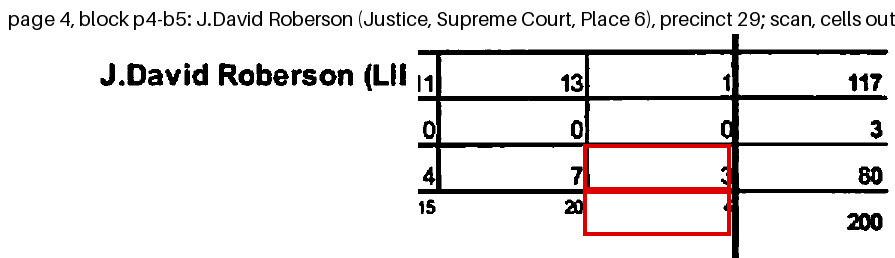

- Precinct 29, votes: the file has 1, the scan has 4. Status settled_against_file: the three cells of precinct 29 add to the small total printed under the column; the small totals under the columns add to the grand total hold(s) with the scan's value and fail(s) with the file's, and no printed total holds with the file's value and fails with the scan's Changed in the corrected file.
  - the three cells of precinct 29 add to the small total printed under the column: printed 4; with the scan's value the cells add to 4 (holds); with the file's value they add to 4 (does not hold).
  - the small totals under the columns add to the grand total: printed 200; with the scan's value the cells add to 200 (holds); with the file's value they add to 197 (does not hold).
- Precinct 29, election_day: the file has 0, the scan has 3. Status settled_against_file: the PRECINCT cells across the page add to the row total printed at the right end of the row; the three cells of precinct 29 add to the small total printed under the column hold(s) with the scan's value and fail(s) with the file's, and no printed total holds with the file's value and fails with the scan's Changed in the corrected file.
  - the PRECINCT cells across the page add to the row total printed at the right end of the row: printed 80; with the scan's value the cells add to 80 (holds); with the file's value they add to 77 (does not hold).
  - the three cells of precinct 29 add to the small total printed under the column: printed 4; with the scan's value the cells add to 4 (holds); with the file's value they add to 1 (does not hold).

### g032: wrong_column, Chika Anyiam, precinct 29

Judge, Court of Criminal Appeals, Place 8. Page 5, block p5-b3. Statuses: settled_against_file 2.

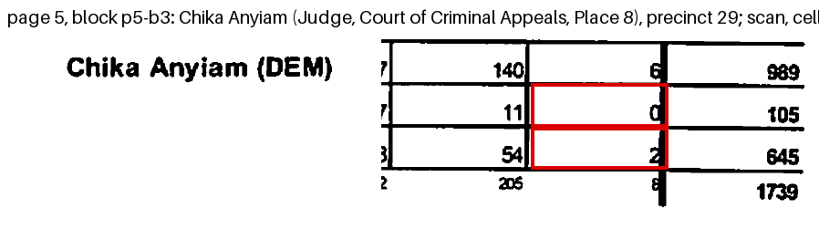

- Precinct 29, absentee: the file has 2, the scan has 0. Status settled_against_file: the ABSENTEE cells across the page add to the row total printed at the right end of the row; the three cells of precinct 29 add to the small total printed under the column hold(s) with the scan's value and fail(s) with the file's, and no printed total holds with the file's value and fails with the scan's Changed in the corrected file.
  - the ABSENTEE cells across the page add to the row total printed at the right end of the row: printed 105; with the scan's value the cells add to 105 (holds); with the file's value they add to 107 (does not hold).
  - the three cells of precinct 29 add to the small total printed under the column: printed 8; with the scan's value the cells add to 8 (holds); with the file's value they add to 10 (does not hold).
- Precinct 29, election_day: the file has 0, the scan has 2. Status settled_against_file: the PRECINCT cells across the page add to the row total printed at the right end of the row; the three cells of precinct 29 add to the small total printed under the column hold(s) with the scan's value and fail(s) with the file's, and no printed total holds with the file's value and fails with the scan's Changed in the corrected file.
  - the PRECINCT cells across the page add to the row total printed at the right end of the row: printed 645; with the scan's value the cells add to 645 (holds); with the file's value they add to 643 (does not hold).
  - the three cells of precinct 29 add to the small total printed under the column: printed 8; with the scan's value the cells add to 8 (holds); with the file's value they add to 6 (does not hold).

### g033: missing_row, Billy Alexander, precinct 18

County Commissioner, 1. Page 6, block p6-b1. Statuses: settled_against_file 1.

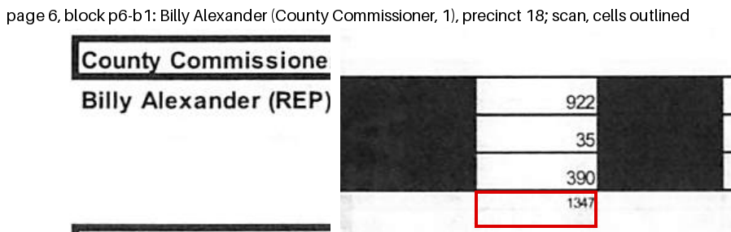

- Precinct 18, votes: the file has no row, the scan has 1347. Status settled_against_file: the three cells of precinct 18 add to the small total printed under the column; the small totals under the columns add to the grand total hold(s) with the scan's value and fail(s) with the file's, and no printed total holds with the file's value and fails with the scan's
  - The scan shows: votes 1347 = absentee 35 + early voting 922 + election day 390.
  - The file has no such row.
  - the three cells of precinct 18 add to the small total printed under the column: printed 1347; with the scan's value the cells add to 1347 (holds); with the file's value they add to 1347 (does not hold).
  - the small totals under the columns add to the grand total: printed 2642; with the scan's value the cells add to 2642 (holds); with the file's value they add to 1295 (does not hold).

### g034: missing_row, Billy Alexander, precinct 20

County Commissioner, 1. Page 6, block p6-b1. Statuses: settled_against_file 1.

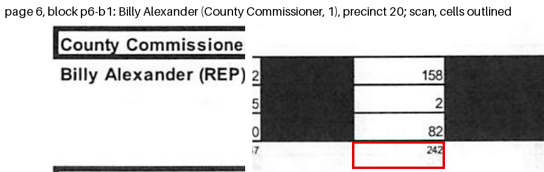

- Precinct 20, votes: the file has no row, the scan has 242. Status settled_against_file: the three cells of precinct 20 add to the small total printed under the column; the small totals under the columns add to the grand total hold(s) with the scan's value and fail(s) with the file's, and no printed total holds with the file's value and fails with the scan's
  - The scan shows: votes 242 = absentee 2 + early voting 158 + election day 82.
  - The file has no such row.
  - the three cells of precinct 20 add to the small total printed under the column: printed 242; with the scan's value the cells add to 242 (holds); with the file's value they add to 242 (does not hold).
  - the small totals under the columns add to the grand total: printed 2642; with the scan's value the cells add to 2642 (holds); with the file's value they add to 2400 (does not hold).

### g035: wrong_precinct, Craig M. Lawless, precinct 3, 7

County Commissioner, 3. Page 6, block p6-b2. Statuses: settled_against_file 2.

Move the same 1 rows of values to the precinct where the scan has them (3 to 7), and 1 more row(s) of the group have no counterpart (see the missing and extra rows).

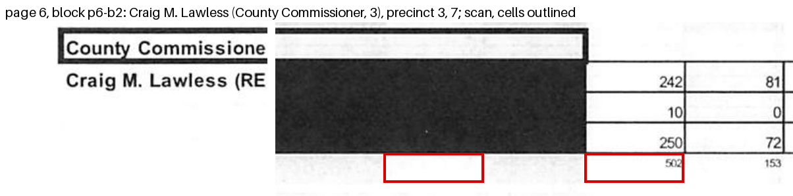

- Precinct 7, votes: the file has no row, the scan has 502. Status settled_against_file: the three cells of precinct 7 add to the small total printed under the column; the small totals under the columns add to the grand total hold(s) with the scan's value and fail(s) with the file's, and no printed total holds with the file's value and fails with the scan's
  - the three cells of precinct 7 add to the small total printed under the column: printed 502; with the scan's value the cells add to 502 (holds); with the file's value they add to 502 (does not hold).
  - the small totals under the columns add to the grand total: printed 2006; with the scan's value the cells add to 2006 (holds); with the file's value they add to 1504 (does not hold).
- Precinct 3, votes: the file has 502, the scan has no row. Status settled_against_file: the small totals under the columns add to the grand total hold(s) with the scan's value and fail(s) with the file's, and no printed total holds with the file's value and fails with the scan's
  - the small totals under the columns add to the grand total: printed 2006; with the scan's value the cells add to 2006 (holds); with the file's value they add to 2508 (does not hold).

### g036: wrong_precinct, Craig M. Lawless, precinct 10, 28

County Commissioner, 3. Page 6, block p6-b2. Statuses: settled_against_file 2.

Move the same 1 rows of values to the precinct where the scan has them (28 to 10), and 1 more row(s) of the group have no counterpart (see the missing and extra rows).

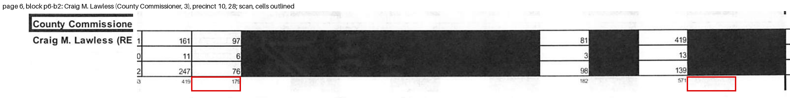

- Precinct 10, votes: the file has no row, the scan has 179. Status settled_against_file: the three cells of precinct 10 add to the small total printed under the column; the small totals under the columns add to the grand total hold(s) with the scan's value and fail(s) with the file's, and no printed total holds with the file's value and fails with the scan's
  - the three cells of precinct 10 add to the small total printed under the column: printed 179; with the scan's value the cells add to 179 (holds); with the file's value they add to 179 (does not hold).
  - the small totals under the columns add to the grand total: printed 2006; with the scan's value the cells add to 2006 (holds); with the file's value they add to 1827 (does not hold).
- Precinct 28, votes: the file has 179, the scan has no row. Status settled_against_file: the small totals under the columns add to the grand total hold(s) with the scan's value and fail(s) with the file's, and no printed total holds with the file's value and fails with the scan's
  - the small totals under the columns add to the grand total: printed 2006; with the scan's value the cells add to 2006 (holds); with the file's value they add to 2185 (does not hold).

### g037: missing_row, Craig M. Lawless, precinct 22

County Commissioner, 3. Page 6, block p6-b2. Statuses: settled_against_file 1.

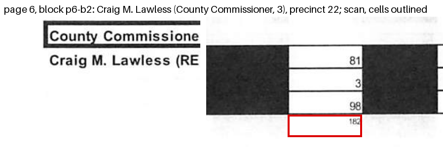

- Precinct 22, votes: the file has no row, the scan has 182. Status settled_against_file: the three cells of precinct 22 add to the small total printed under the column; the small totals under the columns add to the grand total hold(s) with the scan's value and fail(s) with the file's, and no printed total holds with the file's value and fails with the scan's
  - The scan shows: votes 182 = absentee 3 + early voting 81 + election day 98.
  - The file has no such row.
  - the three cells of precinct 22 add to the small total printed under the column: printed 182; with the scan's value the cells add to 182 (holds); with the file's value they add to 182 (does not hold).
  - the small totals under the columns add to the grand total: printed 2006; with the scan's value the cells add to 2006 (holds); with the file's value they add to 1824 (does not hold).

### g038: missing_row, Craig M. Lawless, precinct 27

County Commissioner, 3. Page 6, block p6-b2. Statuses: settled_against_file 1.

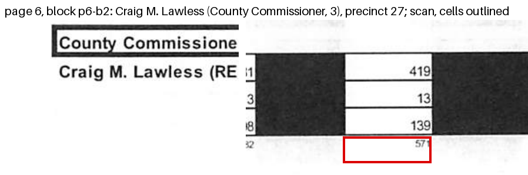

- Precinct 27, votes: the file has no row, the scan has 571. Status settled_against_file: the three cells of precinct 27 add to the small total printed under the column; the small totals under the columns add to the grand total hold(s) with the scan's value and fail(s) with the file's, and no printed total holds with the file's value and fails with the scan's
  - The scan shows: votes 571 = absentee 13 + early voting 419 + election day 139.
  - The file has no such row.
  - the three cells of precinct 27 add to the small total printed under the column: printed 571; with the scan's value the cells add to 571 (holds); with the file's value they add to 571 (does not hold).
  - the small totals under the columns add to the grand total: printed 2006; with the scan's value the cells add to 2006 (holds); with the file's value they add to 1435 (does not hold).

### g039: wrong_precinct, Jeff Ivy, precinct 10, 12, 13, 14, 18, 19, 20, 26

Constable, 1 & 4. Page 6, block p6-b3. Statuses: settled_against_file 17, cannot_verify 8.

Move the same 7 rows of values to the precinct where the scan has them (12 to 13, 13 to 14, 14 to 18, 18 to 19, 19 to 20, 20 to 26, 10 to 12), and 1 more row(s) of the group have no counterpart (see the missing and extra rows).

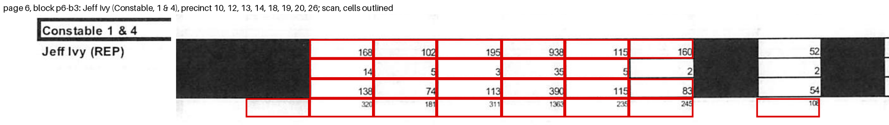

- Precinct 12, votes: the file has 181, the scan has 320. Status cannot_verify: the sums do not decide: the small totals under the columns add to the grand total fail(s) with either value or hold(s) with both, although others hold with the scan's value and fail with the file's
  - the three cells of precinct 12 add to the small total printed under the column: printed 320; with the scan's value the cells add to 320 (holds); with the file's value they add to 320 (does not hold).
  - the small totals under the columns add to the grand total: printed 5320; with the scan's value the cells add to 5323 (does not hold); with the file's value they add to 5184 (does not hold).
  - Looked at the scan again (claude-sonnet-4.6, 400 dpi): it reads 320.
- Precinct 13, votes: the file has 311, the scan has 181. Status cannot_verify: the sums do not decide: the small totals under the columns add to the grand total fail(s) with either value or hold(s) with both, although others hold with the scan's value and fail with the file's
  - the three cells of precinct 13 add to the small total printed under the column: printed 181; with the scan's value the cells add to 181 (holds); with the file's value they add to 181 (does not hold).
  - the small totals under the columns add to the grand total: printed 5320; with the scan's value the cells add to 5323 (does not hold); with the file's value they add to 5453 (does not hold).
  - Looked at the scan again (claude-sonnet-4.6, 400 dpi): it reads 181.
- Precinct 14, votes: the file has 1363, the scan has 311. Status cannot_verify: the sums do not decide: the small totals under the columns add to the grand total fail(s) with either value or hold(s) with both, although others hold with the scan's value and fail with the file's
  - the three cells of precinct 14 add to the small total printed under the column: printed 311; with the scan's value the cells add to 311 (holds); with the file's value they add to 311 (does not hold).
  - the small totals under the columns add to the grand total: printed 5320; with the scan's value the cells add to 5323 (does not hold); with the file's value they add to 6375 (does not hold).
  - Looked at the scan again (claude-sonnet-4.6, 400 dpi): it reads 311.
- Precinct 18, votes: the file has 235, the scan has 1363. Status cannot_verify: the sums do not decide: the small totals under the columns add to the grand total fail(s) with either value or hold(s) with both, although others hold with the scan's value and fail with the file's
  - the three cells of precinct 18 add to the small total printed under the column: printed 1363; with the scan's value the cells add to 1363 (holds); with the file's value they add to 1363 (does not hold).
  - the small totals under the columns add to the grand total: printed 5320; with the scan's value the cells add to 5323 (does not hold); with the file's value they add to 4195 (does not hold).
  - Looked at the scan again (claude-sonnet-4.6, 400 dpi): it reads 1363.
- Precinct 19, votes: the file has 245, the scan has 235. Status cannot_verify: the sums do not decide: the small totals under the columns add to the grand total fail(s) with either value or hold(s) with both, although others hold with the scan's value and fail with the file's
  - the three cells of precinct 19 add to the small total printed under the column: printed 235; with the scan's value the cells add to 235 (holds); with the file's value they add to 235 (does not hold).
  - the small totals under the columns add to the grand total: printed 5320; with the scan's value the cells add to 5323 (does not hold); with the file's value they add to 5333 (does not hold).
  - Looked at the scan again (claude-sonnet-4.6, 400 dpi): it reads 235.
- Precinct 20, votes: the file has 108, the scan has 245. Status cannot_verify: the sums do not decide: the small totals under the columns add to the grand total fail(s) with either value or hold(s) with both, although others hold with the scan's value and fail with the file's
  - the three cells of precinct 20 add to the small total printed under the column: printed 245; with the scan's value the cells add to 245 (holds); with the file's value they add to 245 (does not hold).
  - the small totals under the columns add to the grand total: printed 5320; with the scan's value the cells add to 5323 (does not hold); with the file's value they add to 5186 (does not hold).
  - Looked at the scan again (claude-sonnet-4.6, 400 dpi): it reads 245.
- Precinct 26, votes: the file has no row, the scan has 108. Status cannot_verify: the sums do not decide: the small totals under the columns add to the grand total fail(s) with either value or hold(s) with both, although others hold with the scan's value and fail with the file's
  - the three cells of precinct 26 add to the small total printed under the column: printed 108; with the scan's value the cells add to 108 (holds); with the file's value they add to 108 (does not hold).
  - the small totals under the columns add to the grand total: printed 5320; with the scan's value the cells add to 5323 (does not hold); with the file's value they add to 5215 (does not hold).
- Precinct 10, votes: the file has 320, the scan has no row. Status cannot_verify: no printed total decides: the small totals under the columns add to the grand total give the same answer with either value
  - the small totals under the columns add to the grand total: printed 5320; with the scan's value the cells add to 5323 (does not hold); with the file's value they add to 5643 (does not hold).
- Precinct 12, absentee: the file has 5, the scan has 14. Status settled_against_file: the ABSENTEE cells across the page add to the row total printed at the right end of the row; the three cells of precinct 12 add to the small total printed under the column hold(s) with the scan's value and fail(s) with the file's, and no printed total holds with the file's value and fails with the scan's
  - the ABSENTEE cells across the page add to the row total printed at the right end of the row: printed 149; with the scan's value the cells add to 149 (holds); with the file's value they add to 140 (does not hold).
  - the three cells of precinct 12 add to the small total printed under the column: printed 320; with the scan's value the cells add to 320 (holds); with the file's value they add to 311 (does not hold).
- Precinct 13, absentee: the file has 3, the scan has 5. Status settled_against_file: the ABSENTEE cells across the page add to the row total printed at the right end of the row; the three cells of precinct 13 add to the small total printed under the column hold(s) with the scan's value and fail(s) with the file's, and no printed total holds with the file's value and fails with the scan's
  - the ABSENTEE cells across the page add to the row total printed at the right end of the row: printed 149; with the scan's value the cells add to 149 (holds); with the file's value they add to 147 (does not hold).
  - the three cells of precinct 13 add to the small total printed under the column: printed 181; with the scan's value the cells add to 181 (holds); with the file's value they add to 179 (does not hold).
- Precinct 14, absentee: the file has 35, the scan has 3. Status settled_against_file: the ABSENTEE cells across the page add to the row total printed at the right end of the row; the three cells of precinct 14 add to the small total printed under the column hold(s) with the scan's value and fail(s) with the file's, and no printed total holds with the file's value and fails with the scan's
  - the ABSENTEE cells across the page add to the row total printed at the right end of the row: printed 149; with the scan's value the cells add to 149 (holds); with the file's value they add to 181 (does not hold).
  - the three cells of precinct 14 add to the small total printed under the column: printed 311; with the scan's value the cells add to 311 (holds); with the file's value they add to 343 (does not hold).
- Precinct 18, absentee: the file has 5, the scan has 35. Status settled_against_file: the ABSENTEE cells across the page add to the row total printed at the right end of the row; the three cells of precinct 18 add to the small total printed under the column hold(s) with the scan's value and fail(s) with the file's, and no printed total holds with the file's value and fails with the scan's
  - the ABSENTEE cells across the page add to the row total printed at the right end of the row: printed 149; with the scan's value the cells add to 149 (holds); with the file's value they add to 119 (does not hold).
  - the three cells of precinct 18 add to the small total printed under the column: printed 1363; with the scan's value the cells add to 1363 (holds); with the file's value they add to 1333 (does not hold).
- Precinct 19, absentee: the file has 2, the scan has 5. Status settled_against_file: the ABSENTEE cells across the page add to the row total printed at the right end of the row; the three cells of precinct 19 add to the small total printed under the column hold(s) with the scan's value and fail(s) with the file's, and no printed total holds with the file's value and fails with the scan's
  - the ABSENTEE cells across the page add to the row total printed at the right end of the row: printed 149; with the scan's value the cells add to 149 (holds); with the file's value they add to 146 (does not hold).
  - the three cells of precinct 19 add to the small total printed under the column: printed 235; with the scan's value the cells add to 235 (holds); with the file's value they add to 232 (does not hold).
- Precinct 12, early_voting: the file has 102, the scan has 168. Status settled_against_file: the EARLY cells across the page add to the row total printed at the right end of the row; the three cells of precinct 12 add to the small total printed under the column hold(s) with the scan's value and fail(s) with the file's, and no printed total holds with the file's value and fails with the scan's
  - the EARLY cells across the page add to the row total printed at the right end of the row: printed 3616; with the scan's value the cells add to 3616 (holds); with the file's value they add to 3550 (does not hold).
  - the three cells of precinct 12 add to the small total printed under the column: printed 320; with the scan's value the cells add to 320 (holds); with the file's value they add to 254 (does not hold).
- Precinct 13, early_voting: the file has 195, the scan has 102. Status settled_against_file: the EARLY cells across the page add to the row total printed at the right end of the row; the three cells of precinct 13 add to the small total printed under the column hold(s) with the scan's value and fail(s) with the file's, and no printed total holds with the file's value and fails with the scan's
  - the EARLY cells across the page add to the row total printed at the right end of the row: printed 3616; with the scan's value the cells add to 3616 (holds); with the file's value they add to 3709 (does not hold).
  - the three cells of precinct 13 add to the small total printed under the column: printed 181; with the scan's value the cells add to 181 (holds); with the file's value they add to 274 (does not hold).
- Precinct 14, early_voting: the file has 938, the scan has 195. Status settled_against_file: the EARLY cells across the page add to the row total printed at the right end of the row; the three cells of precinct 14 add to the small total printed under the column hold(s) with the scan's value and fail(s) with the file's, and no printed total holds with the file's value and fails with the scan's
  - the EARLY cells across the page add to the row total printed at the right end of the row: printed 3616; with the scan's value the cells add to 3616 (holds); with the file's value they add to 4359 (does not hold).
  - the three cells of precinct 14 add to the small total printed under the column: printed 311; with the scan's value the cells add to 311 (holds); with the file's value they add to 1054 (does not hold).
- Precinct 18, early_voting: the file has 115, the scan has 938. Status settled_against_file: the EARLY cells across the page add to the row total printed at the right end of the row; the three cells of precinct 18 add to the small total printed under the column hold(s) with the scan's value and fail(s) with the file's, and no printed total holds with the file's value and fails with the scan's
  - the EARLY cells across the page add to the row total printed at the right end of the row: printed 3616; with the scan's value the cells add to 3616 (holds); with the file's value they add to 2793 (does not hold).
  - the three cells of precinct 18 add to the small total printed under the column: printed 1363; with the scan's value the cells add to 1363 (holds); with the file's value they add to 540 (does not hold).
- Precinct 19, early_voting: the file has 160, the scan has 115. Status settled_against_file: the EARLY cells across the page add to the row total printed at the right end of the row; the three cells of precinct 19 add to the small total printed under the column hold(s) with the scan's value and fail(s) with the file's, and no printed total holds with the file's value and fails with the scan's
  - the EARLY cells across the page add to the row total printed at the right end of the row: printed 3616; with the scan's value the cells add to 3616 (holds); with the file's value they add to 3661 (does not hold).
  - the three cells of precinct 19 add to the small total printed under the column: printed 235; with the scan's value the cells add to 235 (holds); with the file's value they add to 280 (does not hold).
- Precinct 20, early_voting: the file has 52, the scan has 160. Status settled_against_file: the EARLY cells across the page add to the row total printed at the right end of the row; the three cells of precinct 20 add to the small total printed under the column hold(s) with the scan's value and fail(s) with the file's, and no printed total holds with the file's value and fails with the scan's
  - the EARLY cells across the page add to the row total printed at the right end of the row: printed 3616; with the scan's value the cells add to 3616 (holds); with the file's value they add to 3508 (does not hold).
  - the three cells of precinct 20 add to the small total printed under the column: printed 245; with the scan's value the cells add to 245 (holds); with the file's value they add to 137 (does not hold).
- Precinct 12, election_day: the file has 74, the scan has 138. Status settled_against_file: the PRECINCT cells across the page add to the row total printed at the right end of the row; the three cells of precinct 12 add to the small total printed under the column hold(s) with the scan's value and fail(s) with the file's, and no printed total holds with the file's value and fails with the scan's
  - the PRECINCT cells across the page add to the row total printed at the right end of the row: printed 1555; with the scan's value the cells add to 1555 (holds); with the file's value they add to 1491 (does not hold).
  - the three cells of precinct 12 add to the small total printed under the column: printed 320; with the scan's value the cells add to 320 (holds); with the file's value they add to 256 (does not hold).
- Precinct 13, election_day: the file has 113, the scan has 74. Status settled_against_file: the PRECINCT cells across the page add to the row total printed at the right end of the row; the three cells of precinct 13 add to the small total printed under the column hold(s) with the scan's value and fail(s) with the file's, and no printed total holds with the file's value and fails with the scan's
  - the PRECINCT cells across the page add to the row total printed at the right end of the row: printed 1555; with the scan's value the cells add to 1555 (holds); with the file's value they add to 1594 (does not hold).
  - the three cells of precinct 13 add to the small total printed under the column: printed 181; with the scan's value the cells add to 181 (holds); with the file's value they add to 220 (does not hold).
- Precinct 14, election_day: the file has 390, the scan has 113. Status settled_against_file: the PRECINCT cells across the page add to the row total printed at the right end of the row; the three cells of precinct 14 add to the small total printed under the column hold(s) with the scan's value and fail(s) with the file's, and no printed total holds with the file's value and fails with the scan's
  - the PRECINCT cells across the page add to the row total printed at the right end of the row: printed 1555; with the scan's value the cells add to 1555 (holds); with the file's value they add to 1832 (does not hold).
  - the three cells of precinct 14 add to the small total printed under the column: printed 311; with the scan's value the cells add to 311 (holds); with the file's value they add to 588 (does not hold).
- Precinct 18, election_day: the file has 115, the scan has 390. Status settled_against_file: the PRECINCT cells across the page add to the row total printed at the right end of the row; the three cells of precinct 18 add to the small total printed under the column hold(s) with the scan's value and fail(s) with the file's, and no printed total holds with the file's value and fails with the scan's
  - the PRECINCT cells across the page add to the row total printed at the right end of the row: printed 1555; with the scan's value the cells add to 1555 (holds); with the file's value they add to 1280 (does not hold).
  - the three cells of precinct 18 add to the small total printed under the column: printed 1363; with the scan's value the cells add to 1363 (holds); with the file's value they add to 1088 (does not hold).
- Precinct 19, election_day: the file has 83, the scan has 115. Status settled_against_file: the PRECINCT cells across the page add to the row total printed at the right end of the row; the three cells of precinct 19 add to the small total printed under the column hold(s) with the scan's value and fail(s) with the file's, and no printed total holds with the file's value and fails with the scan's
  - the PRECINCT cells across the page add to the row total printed at the right end of the row: printed 1555; with the scan's value the cells add to 1555 (holds); with the file's value they add to 1523 (does not hold).
  - the three cells of precinct 19 add to the small total printed under the column: printed 235; with the scan's value the cells add to 235 (holds); with the file's value they add to 203 (does not hold).
- Precinct 20, election_day: the file has 54, the scan has 83. Status settled_against_file: the PRECINCT cells across the page add to the row total printed at the right end of the row; the three cells of precinct 20 add to the small total printed under the column hold(s) with the scan's value and fail(s) with the file's, and no printed total holds with the file's value and fails with the scan's
  - the PRECINCT cells across the page add to the row total printed at the right end of the row: printed 1555; with the scan's value the cells add to 1555 (holds); with the file's value they add to 1526 (does not hold).
  - the three cells of precinct 20 add to the small total printed under the column: printed 245; with the scan's value the cells add to 245 (holds); with the file's value they add to 216 (does not hold).

### g040: wrong_precinct, Jeff Ivy, precinct 27, 28

Constable, 1 & 4. Page 6, block p6-b3. Statuses: cannot_verify 2.

Move the same 1 rows of values to the precinct where the scan has them (27 to 28), and 1 more row(s) of the group have no counterpart (see the missing and extra rows).

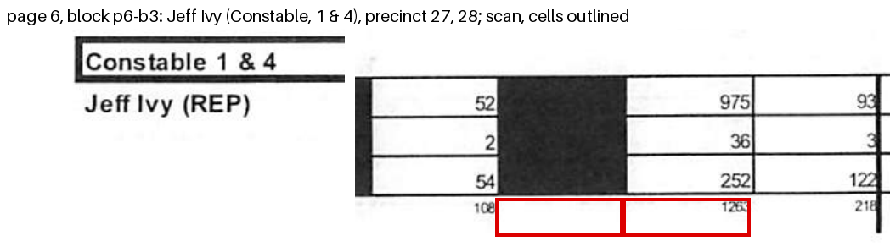

- Precinct 28, votes: the file has no row, the scan has 1263. Status cannot_verify: the sums do not decide: the small totals under the columns add to the grand total fail(s) with either value or hold(s) with both, although others hold with the scan's value and fail with the file's
  - the three cells of precinct 28 add to the small total printed under the column: printed 1263; with the scan's value the cells add to 1263 (holds); with the file's value they add to 1263 (does not hold).
  - the small totals under the columns add to the grand total: printed 5320; with the scan's value the cells add to 5323 (does not hold); with the file's value they add to 4060 (does not hold).
- Precinct 27, votes: the file has 1263, the scan has no row. Status cannot_verify: no printed total decides: the small totals under the columns add to the grand total give the same answer with either value
  - the small totals under the columns add to the grand total: printed 5320; with the scan's value the cells add to 5323 (does not hold); with the file's value they add to 6586 (does not hold).

### g041: missing_row, Jeff Ivy, precinct 1

Constable, 1 & 4. Page 6, block p6-b3. Statuses: cannot_verify 1.

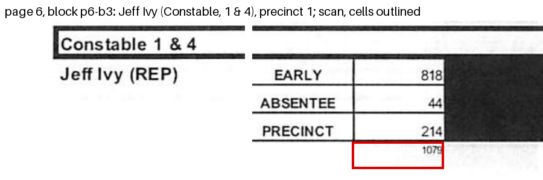

- Precinct 1, votes: the file has no row, the scan has 1079. Status cannot_verify: no printed total decides: the three cells of precinct 1 add to the small total printed under the column; the small totals under the columns add to the grand total give the same answer with either value
  - The scan shows: votes 1079 = absentee 44 + early voting 818 + election day 214.
  - The file has no such row.
  - the three cells of precinct 1 add to the small total printed under the column: printed 1079; with the scan's value the cells add to 1076 (does not hold); with the file's value they add to 1076 (does not hold).
  - the small totals under the columns add to the grand total: printed 5320; with the scan's value the cells add to 5323 (does not hold); with the file's value they add to 4244 (does not hold).

### g042: wrong_precinct, Brack LaGrone, precinct 10, 22

Constable, 2 & 3. Page 6, block p6-b4. Statuses: settled_against_file 5.

Move the same 1 rows of values, each labelled 1 precinct later than where the scan has it, back to the precinct the scan puts them under, and 1 more row(s) of the group have no counterpart (see the missing and extra rows).

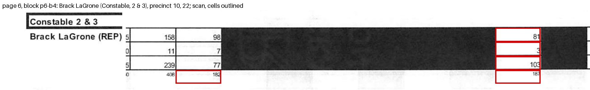

- Precinct 10, votes: the file has no row, the scan has 182. Status settled_against_file: the three cells of precinct 10 add to the small total printed under the column; the small totals under the columns add to the grand total hold(s) with the scan's value and fail(s) with the file's, and no printed total holds with the file's value and fails with the scan's
  - the three cells of precinct 10 add to the small total printed under the column: printed 182; with the scan's value the cells add to 182 (holds); with the file's value they add to 182 (does not hold).
  - the small totals under the columns add to the grand total: printed 4405; with the scan's value the cells add to 4405 (holds); with the file's value they add to 4223 (does not hold).
- Precinct 22, votes: the file has 182, the scan has 187. Status settled_against_file: the three cells of precinct 22 add to the small total printed under the column; the small totals under the columns add to the grand total hold(s) with the scan's value and fail(s) with the file's, and no printed total holds with the file's value and fails with the scan's Changed in the corrected file.
  - the three cells of precinct 22 add to the small total printed under the column: printed 187; with the scan's value the cells add to 187 (holds); with the file's value they add to 187 (does not hold).
  - the small totals under the columns add to the grand total: printed 4405; with the scan's value the cells add to 4405 (holds); with the file's value they add to 4400 (does not hold).
- Precinct 22, absentee: the file has 7, the scan has 3. Status settled_against_file: the ABSENTEE cells across the page add to the row total printed at the right end of the row; the three cells of precinct 22 add to the small total printed under the column hold(s) with the scan's value and fail(s) with the file's, and no printed total holds with the file's value and fails with the scan's Changed in the corrected file.
  - the ABSENTEE cells across the page add to the row total printed at the right end of the row: printed 97; with the scan's value the cells add to 97 (holds); with the file's value they add to 101 (does not hold).
  - the three cells of precinct 22 add to the small total printed under the column: printed 187; with the scan's value the cells add to 187 (holds); with the file's value they add to 191 (does not hold).
- Precinct 22, early_voting: the file has 98, the scan has 81. Status settled_against_file: the EARLY cells across the page add to the row total printed at the right end of the row; the three cells of precinct 22 add to the small total printed under the column hold(s) with the scan's value and fail(s) with the file's, and no printed total holds with the file's value and fails with the scan's Changed in the corrected file.
  - the EARLY cells across the page add to the row total printed at the right end of the row: printed 2789; with the scan's value the cells add to 2789 (holds); with the file's value they add to 2806 (does not hold).
  - the three cells of precinct 22 add to the small total printed under the column: printed 187; with the scan's value the cells add to 187 (holds); with the file's value they add to 204 (does not hold).
- Precinct 22, election_day: the file has 77, the scan has 103. Status settled_against_file: the PRECINCT cells across the page add to the row total printed at the right end of the row; the three cells of precinct 22 add to the small total printed under the column hold(s) with the scan's value and fail(s) with the file's, and no printed total holds with the file's value and fails with the scan's Changed in the corrected file.
  - the PRECINCT cells across the page add to the row total printed at the right end of the row: printed 1519; with the scan's value the cells add to 1519 (holds); with the file's value they add to 1493 (does not hold).
  - the three cells of precinct 22 add to the small total printed under the column: printed 187; with the scan's value the cells add to 187 (holds); with the file's value they add to 161 (does not hold).

### g043: missing_row, Brack LaGrone, precinct 27

Constable, 2 & 3. Page 6, block p6-b4. Statuses: settled_against_file 1.

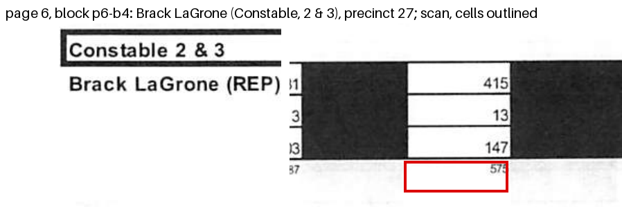

- Precinct 27, votes: the file has no row, the scan has 575. Status settled_against_file: the three cells of precinct 27 add to the small total printed under the column; the small totals under the columns add to the grand total hold(s) with the scan's value and fail(s) with the file's, and no printed total holds with the file's value and fails with the scan's
  - The scan shows: votes 575 = absentee 13 + early voting 415 + election day 147.
  - The file has no such row.
  - the three cells of precinct 27 add to the small total printed under the column: printed 575; with the scan's value the cells add to 575 (holds); with the file's value they add to 575 (does not hold).
  - the small totals under the columns add to the grand total: printed 4405; with the scan's value the cells add to 4405 (holds); with the file's value they add to 3830 (does not hold).

### g044: extra_row, Brack LaGrone, precinct 26

Constable, 2 & 3. Page 6, block p6-b4. Statuses: settled_against_file 1.

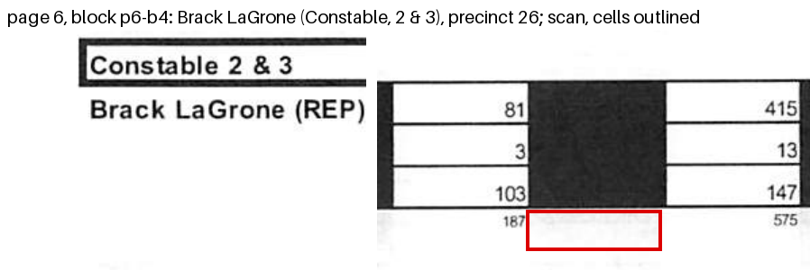

- Precinct 26, votes: the file has 81, the scan has no row. Status settled_against_file: the small totals under the columns add to the grand total hold(s) with the scan's value and fail(s) with the file's, and no printed total holds with the file's value and fails with the scan's
  - The scan has no such row.
  - The file shows: votes 81 = absentee 3 + early voting 41 + election day 37.
  - the small totals under the columns add to the grand total: printed 4405; with the scan's value the cells add to 4405 (holds); with the file's value they add to 4486 (does not hold).

### g045: extra_row, Brack LaGrone, precinct 28

Constable, 2 & 3. Page 6, block p6-b4. Statuses: settled_against_file 1.

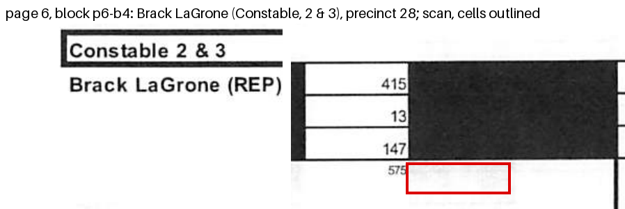

- Precinct 28, votes: the file has 187, the scan has no row. Status settled_against_file: the small totals under the columns add to the grand total hold(s) with the scan's value and fail(s) with the file's, and no printed total holds with the file's value and fails with the scan's
  - The scan has no such row.
  - The file shows: votes 187 = absentee 3 + early voting 103 + election day 81.
  - the small totals under the columns add to the grand total: printed 4405; with the scan's value the cells add to 4405 (holds); with the file's value they add to 4592 (does not hold).

### g046: file_row_fails_own_total, Leann Kay Rafferty, precinct 22

District Judge, 123rd Judicial District. Page 5, block p5-b6. Statuses: settled_against_file 1.

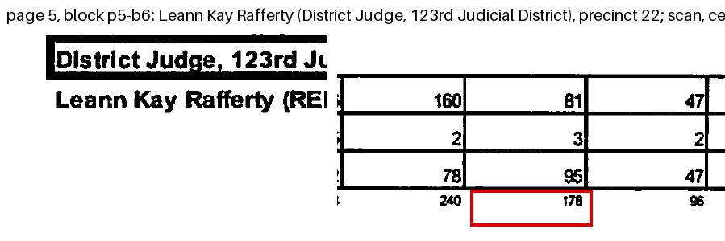

- Precinct 22, votes: the file has 178, the scan has 179. Status settled_against_file: the file's votes 178 differ from its parts 3 + 81 + 95 = 179; the three cells of precinct 22 add to the small total printed under the column; the small totals under the columns add to the grand total hold(s) with the scan's value and fail(s) with the file's, and no printed total holds with the file's value and fails with the scan's Changed in the corrected file.
  - the three cells of precinct 22 add to the small total printed under the column: printed 179; with the scan's value the cells add to 179 (holds); with the file's value they add to 179 (does not hold).
  - the small totals under the columns add to the grand total: printed 9524; with the scan's value the cells add to 9524 (holds); with the file's value they add to 9523 (does not hold).

## What could not be verified, and why

- f001 (group g001), Registered Voters, precinct 3, votes: cannot_verify. no printed total decides: the registered-voters row (its cells add to the printed total of the row; this row has no other sum) give the same answer with either value
- f085 (group g039), Jeff Ivy, precinct 12, votes: cannot_verify. the sums do not decide: the small totals under the columns add to the grand total fail(s) with either value or hold(s) with both, although others hold with the scan's value and fail with the file's
- f086 (group g039), Jeff Ivy, precinct 13, votes: cannot_verify. the sums do not decide: the small totals under the columns add to the grand total fail(s) with either value or hold(s) with both, although others hold with the scan's value and fail with the file's
- f087 (group g039), Jeff Ivy, precinct 14, votes: cannot_verify. the sums do not decide: the small totals under the columns add to the grand total fail(s) with either value or hold(s) with both, although others hold with the scan's value and fail with the file's
- f088 (group g039), Jeff Ivy, precinct 18, votes: cannot_verify. the sums do not decide: the small totals under the columns add to the grand total fail(s) with either value or hold(s) with both, although others hold with the scan's value and fail with the file's
- f089 (group g039), Jeff Ivy, precinct 19, votes: cannot_verify. the sums do not decide: the small totals under the columns add to the grand total fail(s) with either value or hold(s) with both, although others hold with the scan's value and fail with the file's
- f090 (group g039), Jeff Ivy, precinct 20, votes: cannot_verify. the sums do not decide: the small totals under the columns add to the grand total fail(s) with either value or hold(s) with both, although others hold with the scan's value and fail with the file's
- f091 (group g039), Jeff Ivy, precinct 26, votes: cannot_verify. the sums do not decide: the small totals under the columns add to the grand total fail(s) with either value or hold(s) with both, although others hold with the scan's value and fail with the file's
- f092 (group g039), Jeff Ivy, precinct 10, votes: cannot_verify. no printed total decides: the small totals under the columns add to the grand total give the same answer with either value
- f110 (group g040), Jeff Ivy, precinct 28, votes: cannot_verify. the sums do not decide: the small totals under the columns add to the grand total fail(s) with either value or hold(s) with both, although others hold with the scan's value and fail with the file's
- f111 (group g040), Jeff Ivy, precinct 27, votes: cannot_verify. no printed total decides: the small totals under the columns add to the grand total give the same answer with either value
- f112 (group g041), Jeff Ivy, precinct 1, votes: cannot_verify. no printed total decides: the three cells of precinct 1 add to the small total printed under the column; the small totals under the columns add to the grand total give the same answer with either value
- The ledger itself: col:6:p6-b3:1 ended document_inconsistent. the scan shows 1079 there on every re-read (claude-sonnet-4.6 read 1079, claude-opus-4.6 read 1079) while both sums it sits on still fail: column sum of precinct 1 (page 6, block p6-b3: the cells add to 1076, printed 1079); and grand total against the small totals (page 6, block p6-b3: the cells add to 5323, printed 5320). The document disagrees with itself.
- The ledger itself: grand_col:6:p6-b3: ended document_inconsistent. the scan shows 1079 there on every re-read (claude-sonnet-4.6 read 1079, claude-opus-4.6 read 1079) while both sums it sits on still fail: column sum of precinct 1 (page 6, block p6-b3: the cells add to 1076, printed 1079); and grand total against the small totals (page 6, block p6-b3: the cells add to 5323, printed 5320). The document disagrees with itself.
- The ledger itself: row:1:reg:REGISTERED ended cannot_verify. six actions used on this item and its sum still fails
